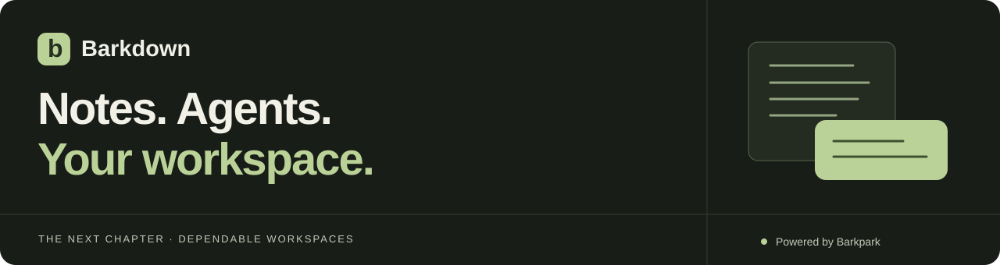
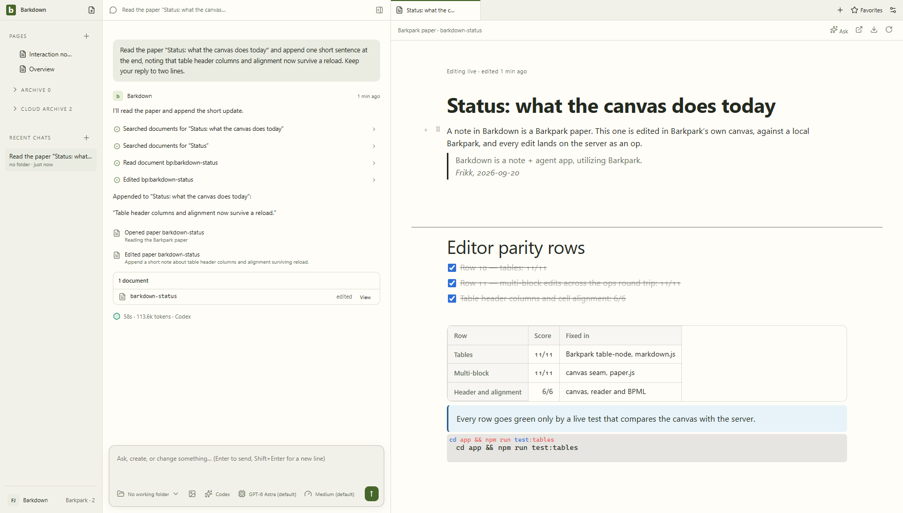
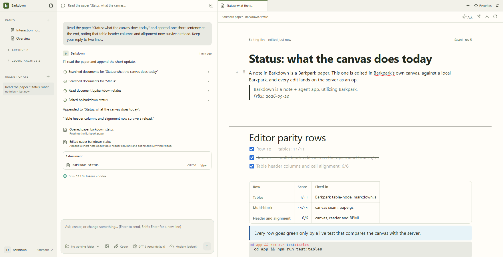
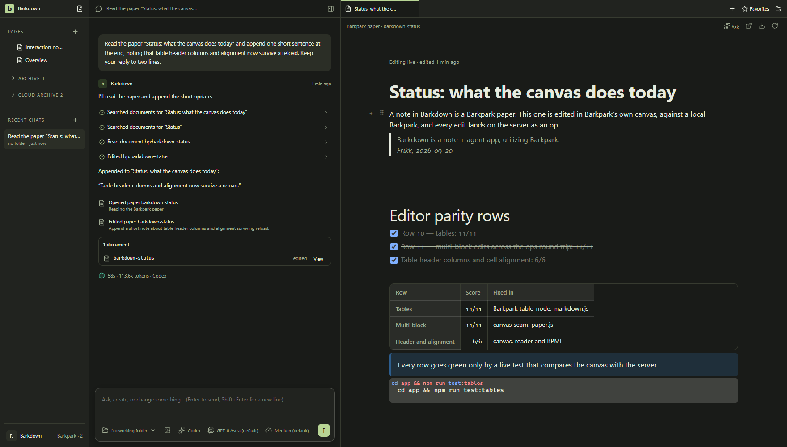
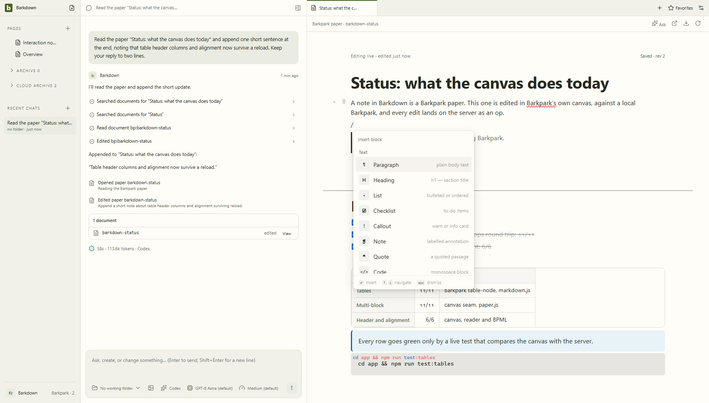
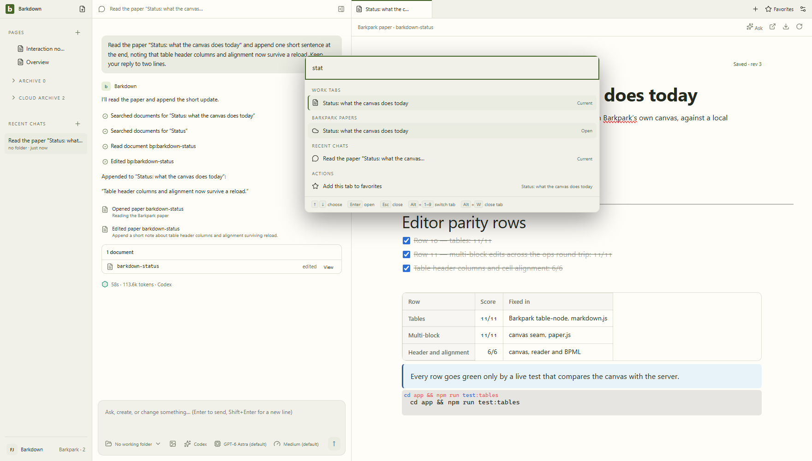
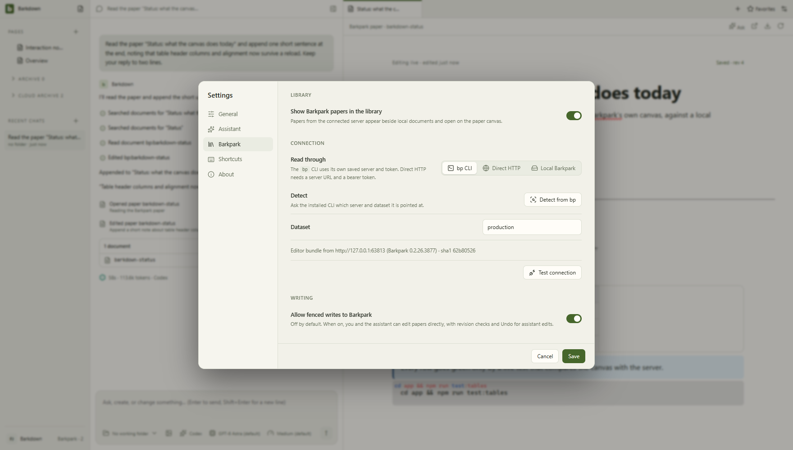

<p align="center">
  <a href="docs/PLAN.md"><strong>The next chapter</strong></a> ·
  <a href="CONTRIBUTING.md">Build & contribute</a> ·
  <a href="docs/README.md">Documentation</a> ·
  <a href="docs/VALIDATION.md">Evidence</a>
</p>

# A place for your notes and the work around them

Write, ask, revise, and keep going in one desktop workspace. Barkdown pairs Barkpark’s real Paper editor with agents that can read your notes, make visible edits, and work in folders you choose for each conversation.

**Working desktop prototype · Windows runtime first · Powered by Barkpark**



## Think in notes. Work in conversations.

- **One workspace, many kinds of work.** Notes, websites, project files, reviews and side conversations open beside the chat.
- **Edits you can follow.** Direct assistant edits show their target and writing, respect human takeover, and offer revision-checked Undo.
- **Your organization stays yours.** Arrange Pages how you want. Cloud discoveries stay in Cloud archive until you place them.
- **Conversations keep their context.** Main and side chats have model controls, images, drafts and history. Each agent has its own working folder.

<details>
<summary><strong>See the editor in motion and explore the desktop</strong></summary>











These are captures of the running app, not mockups. [Capture provenance](docs/images/status/manifest.json) records the source commits and whether the assistant turn was live. The typographic banner above is repository artwork.

</details>

## The next chapter: a workspace you can depend on

**Create a local profile → write with an agent → restart safely → move to another machine and continue.**

| Today | Next | After that |
|---|---|---|
| Working Paper editor, agent conversations and a managed Windows source runtime | Profile isolation, safe migration of every note to Paper, recovery and portability | Optional two-way sync and installation without a developer toolchain |

**P1: profile ownership and isolation is in validation.** This integration branch has opt-in profiles, captured agent ownership, saved goal workers, explicit same-machine library adoption and crash-recovery checks. Complete isolation through two real profile runtimes is still being tested. Local notes retain a separate editor/store; migration of every note to Paper, portability and cloud sync remain pending. The managed runtime requires a built Barkpark checkout; upstream integration and CI gates remain separate.

[Combined checkpoint and remaining checks](docs/cycles/C008-integration.md) � [Rich editor video and screenshots](docs/visual/rich-takeover/README.md) � [Actual library adoption](docs/visual/adoption/runs/2026-09-22T00-21-07-265Z/README.md) � [Workspace recovery](docs/visual/workspace-recovery/README.md)

[Read the delivery plan →](docs/PLAN.md) · [See what is verified →](docs/VALIDATION.md)

## Run the desktop

Use Node 22.13+ and a desktop session. From the repository root:

```sh
npm ci
npm --prefix app ci
npm run desktop
```

Use your existing Claude Code or Codex login, or configure an API key in Settings. To edit Barkpark papers, connect a server in Settings → Barkpark or follow the [managed local runtime setup](docs/LOCAL-BARKPARK.md). There is no packaged installer yet.

## Build the next slice

```sh
npm run plan                   # next stage and current delivery cycle
npm run cycle                  # bounded goal, handoff and next action
npx playwright install chromium
npm run verify                 # roadmap, docs, types and concept checks
npm run test:desktop            # build + desktop regression suite
```

The [contribution guide](CONTRIBUTING.md) covers real-runtime tests, upstream ownership, data safety and screenshot evidence. The [continuation brief](docs/NEXT-AGENT.md) takes you directly into P1.

| Place | Purpose |
|---|---|
| [app/](app/README.md) | The real Electron desktop and its tests |
| [docs/](docs/README.md) | Active plan, acceptance, architecture and evidence |
| [AGENTS.md](AGENTS.md) | Repository rules and product decisions to preserve |
| [Historical material](docs/archive/README.md) | Original plans, concepts and provenance; retained for reference |

Barkpark owns the content format, revisions and shared editor. Barkdown owns the desktop experience and workspace orchestration. A profile owns library data; an agent’s working folder belongs to its conversation.

---

Private development repository. No production deployment is implied by a passing check or a source build. Original material has no public open-source license; dependencies retain their [third-party notices](THIRD-PARTY.md).

## Review the health of the app

Browse [visual health](docs/visual/README.md) for area READMEs with current screenshots, interaction GIFs, provenance and changelogs. Code changes trigger fresh capture and comparison; an agent or person must inspect the evidence before approval. [Review rules and known coverage gaps](docs/visual/RULES.md) keep screenshots separate from functional proof.
