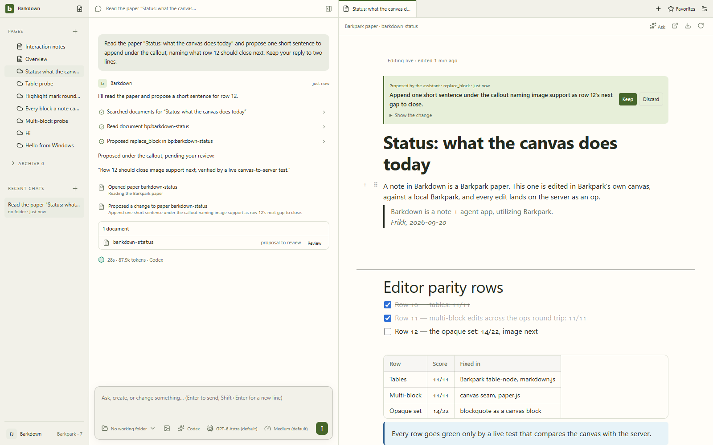
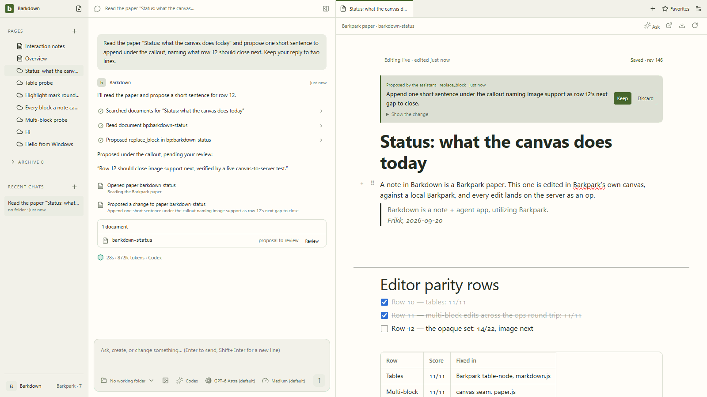
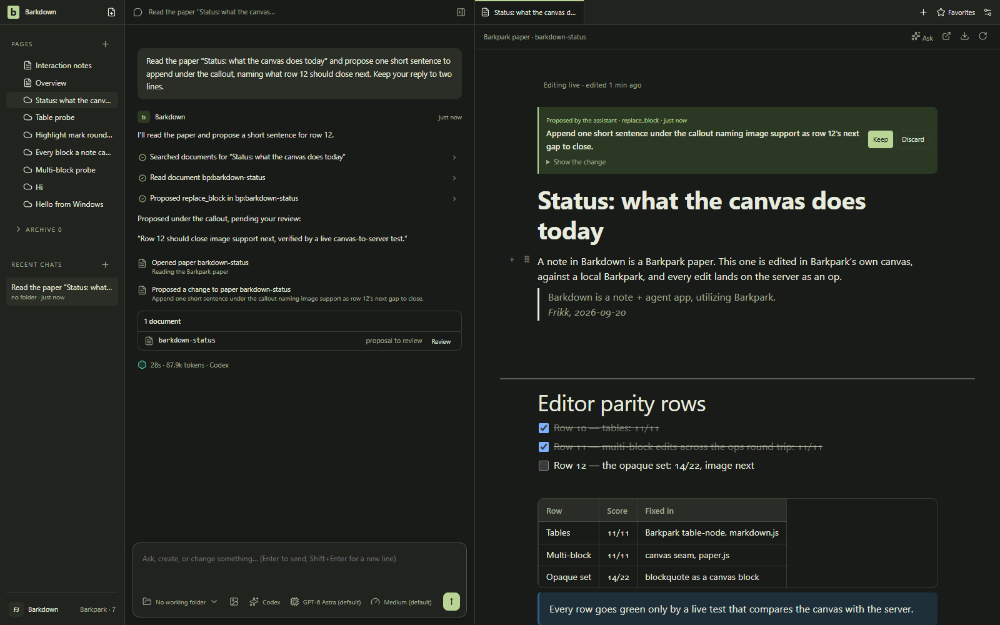
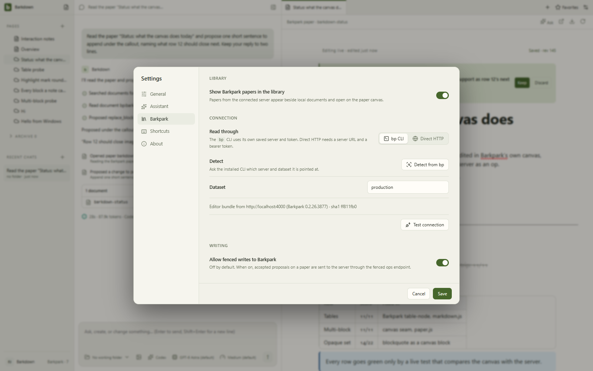
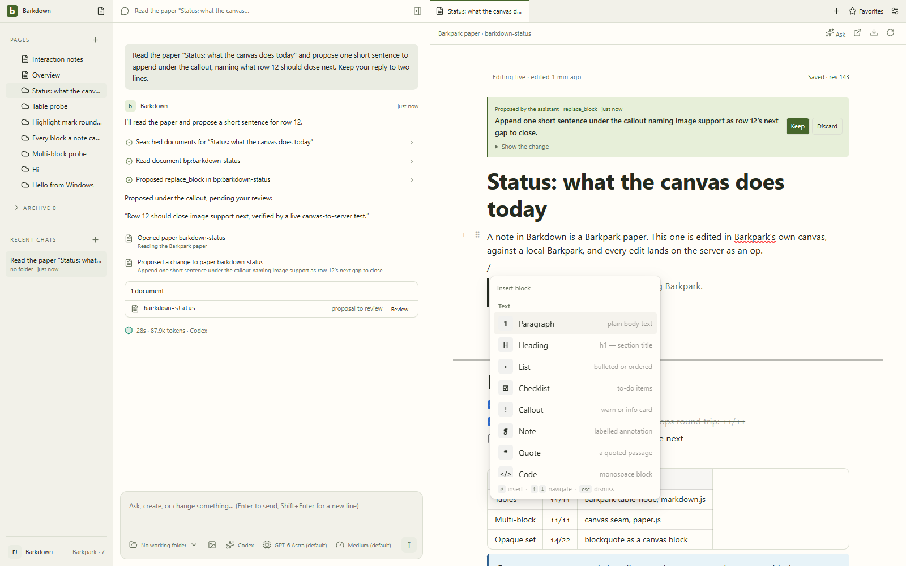
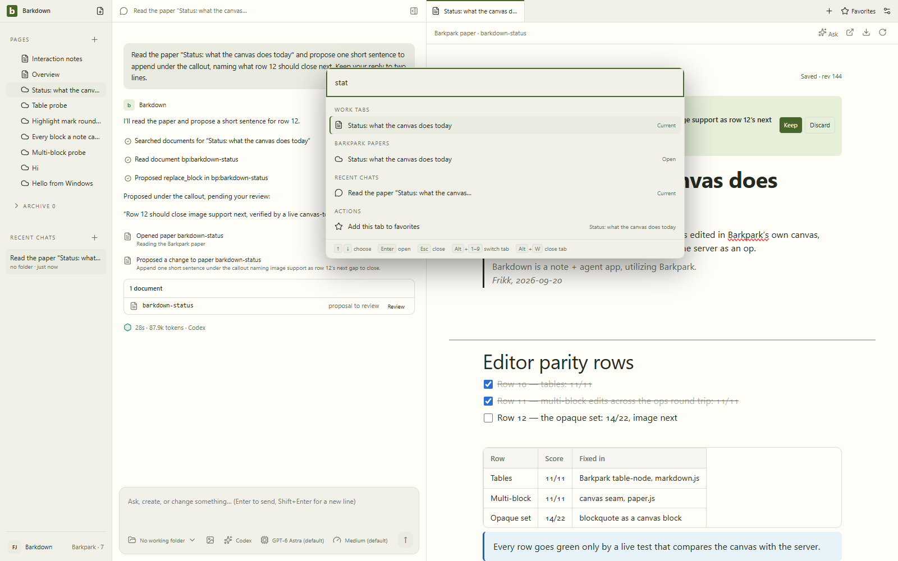

# Barkdown

**A note + agent app, utilizing Barkpark.**

Notes are Barkpark papers, edited in Barkpark's own canvas. Beside them sits an assistant that runs on the Claude Code or Codex sign-in already on your machine, reads and proposes on those notes, and works in folders you give it. Barkpark supplies the document format, the ops protocol, the editor and the cloud; Barkdown is the desktop that puts a person and an agent in front of them. The real Barkpark runs locally beside the app and syncs to bp cloud; a profile can also stay local-only.





*Real pictures of the running app, taken by `cd app && npm run shots` against the local Barkpark: five stills and the loop above. `npm run check` refuses a README whose pictures are older than the last change to the app's UI, and every capture gets content-hashed filenames so a cached old picture can never stand in for a new one. The manifest beside them says which commits they came from and whether the assistant turn in them was real.*

## Where it stands

- **The app** is the Electron desktop in [app/](app/README.md): a Notion-like page tree of papers and local documents, the assistant with approval-gated edits and commands, per-chat working folders with a project editor, git reviews, website tabs, side chats, favorites and quick open. Barkpark papers open in `<bp-paper-canvas>`, loaded from the connected Barkpark itself (Settings › Barkpark shows which build); every edit is an ops batch under `ifRev`, acknowledged, echoed, and conflict-carded on 412.
- **The store** is a real Barkpark — Postgres to the bone — running on this machine (`scripts\setup-windows.ps1` in the Barkpark checkout) or in bp cloud. Barkdown does not reimplement any of it; profiles, export and sync build on `bp servers`, `bp export` and `bp migrate`.
- **The editor goal** is measurable: [EDITOR-PARITY.md](docs/EDITOR-PARITY.md) lists what Barkdown's older Tiptap tab gives an author and turns each row green only by a live test that compares the canvas with the server. Rows 10 (tables), 11 (multi-block edits) and 12 (every block type a note can hold mounts editable, edits and inserts through the slash menu) are green. [TIPTAP-REVIEW.md](docs/TIPTAP-REVIEW.md) sizes the rest at five to six focused weeks.
- **The plan** is [PLAN.md](docs/PLAN.md): an ordered sequence with one GitHub issue per task under five milestones. The project skill `plan-followup` (`.claude/skills/plan-followup`) picks the next issue, works it Barkpark-first, and lands both repos.



## Start here

1. [PLAN.md](docs/PLAN.md) — what to do next and in what order; `node .claude/skills/plan-followup/scripts/next.mjs` prints the next open issue and checks the environment.
2. [EDITOR-PARITY.md](docs/EDITOR-PARITY.md) — the standing goal and its matrix; [TIPTAP-REVIEW.md](docs/TIPTAP-REVIEW.md) — the gap against Tiptap itself.
3. [DESIGN-DECISIONS.md](docs/DESIGN-DECISIONS.md) — accepted decisions, including the 2026-09-20 identity and editor decisions.
4. [NEXT-AGENT.md](docs/NEXT-AGENT.md) — the handoff: what is real, what is simulated, the corrections most likely to get lost.
5. [PRD.md](docs/PRD.md), [ARCHITECTURE.md](docs/ARCHITECTURE.md), the [typed proposal](docs/contracts/workspace.ts), [ACCEPTANCE.md](docs/ACCEPTANCE.md) — the product and integration plan the app grew from.

The central rule still holds: **Barkdown is app-wide. Agents have working folders.** The sidebar is not scoped to a folder; each chat carries its agent's working context; a project editor is a work tab inside that conversation.

## Run it

```sh
cd app && npm install && npm start
```

Requires Node 22.13+ and a desktop session (Electron 38). The assistant uses your `claude` or `codex` login as-is; an Anthropic API key is the fallback. To edit papers you need a Barkpark: point Settings › Barkpark (or `bp use`) at bp cloud, or run one locally — the Barkpark checkout's `scripts\setup-windows.ps1` installs the toolchain and a Postgres cluster without admin rights; the traps found on the way (compile under `vcvars64`, Postgres wedging under load) are written down in [PLAN.md](docs/PLAN.md) and the `plan-followup` skill.



## Verify

```sh
cd app && npm test
```

`npm test` runs the scripted-client agent checks and the Playwright suite against the real Electron window. The editor parity rows are live, against a Barkpark: `npm run test:tables`, `npm run test:multiblock`, `npm run test:highlight`, `npm run test:opaque`. `npm run shots` refreshes the README's pictures and their manifest. At the repo root, `npm run check` verifies links, the handoff's requirements and hashes, and that those pictures are no older than the UI they show.





## Working in two repos

Editor truth lives in Barkpark. A change to a block, a mark or an attribute is a Barkpark PR first (schema, reader render, contract, canvas, unit test, on the `barkdown/editor-quality` branch), then a red-first live row here. The app loads the canvas bundle from the Barkpark it is connected to (cached under userData; `app/renderer/vendor` is the offline fallback and is refreshed when a Barkpark change lands), so a Barkpark editor change reaches Barkdown by restarting Phoenix. Landing a Barkpark PR has its own gates; `.claude/skills/plan-followup/scripts/barkpark-pr.mjs` walks them.

## The concept handoff (v0.5, kept as history)

The repository began as a product and engineering handoff: [concepts/workspace.html](concepts/workspace.html) (the app shell and simulated agent activity), [concepts/editor-study.html](concepts/editor-study.html) (block editing interactions), and the illustrated PRD. They are still the interaction reference the app was built from and are still checked:

```sh
npm ci
npx playwright install chromium
npm run verify
npm run preview
```

`npm run build` regenerates the portable preview pages (`preview/*.html`, self-contained), the GitHub-readable PRD and the artifact hashes; `npm test` exercises the concepts at widths down to 320px. Open `http://127.0.0.1:4173` for the preview. Everything in the concepts is in-memory and resets on reload.

| File | Role |
|---|---|
| `app/` | The desktop app. `main/` (Electron main: window, IPC, documents, files, git, agent, Barkpark adapter, settings), `renderer/` (the UI; `vendor/` holds the canvas bundle), `shared/` (markdown, PortableDoc and ops helpers), `tests/` (unit, Playwright/Electron, and the live parity rows). |
| `docs/` | The plan, the goal, the review, decisions, the handoff, the PRD and its source. `docs/images/status/` is written by `npm run shots`. |
| `concepts/`, `preview/`, `evidence/` | The v0.5 concept, its portable previews, and source provenance with hashes. |
| `.claude/skills/plan-followup/` | The project skill that works the plan. |

## Status and licence

[VALIDATION.md](docs/VALIDATION.md) records the checks that were run and on what. Original Barkdown material has no public open-source licence; the repository is private on purpose. Third-party notices are in [THIRD-PARTY.md](THIRD-PARTY.md).
