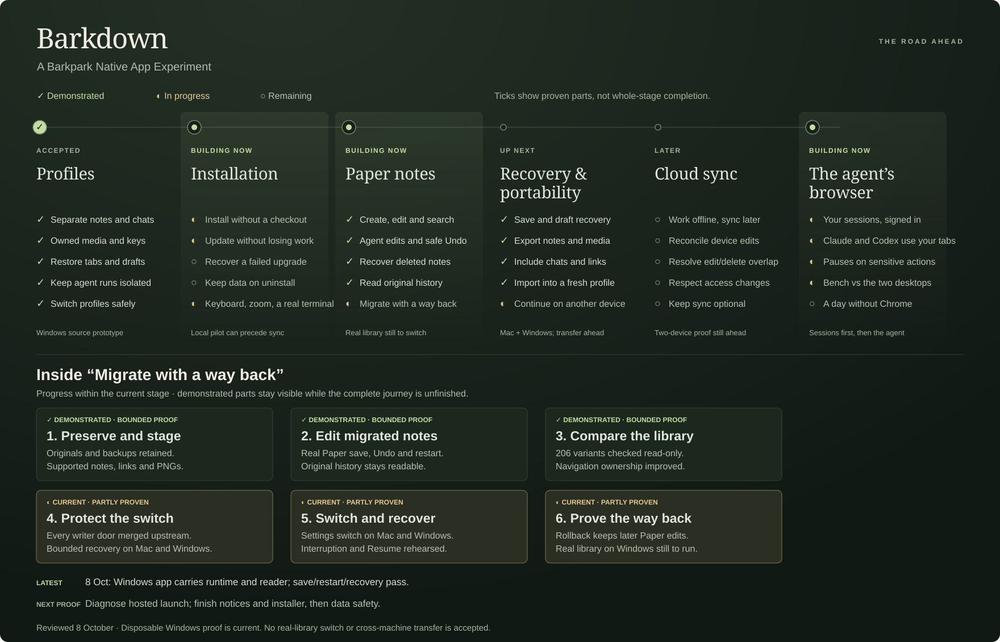
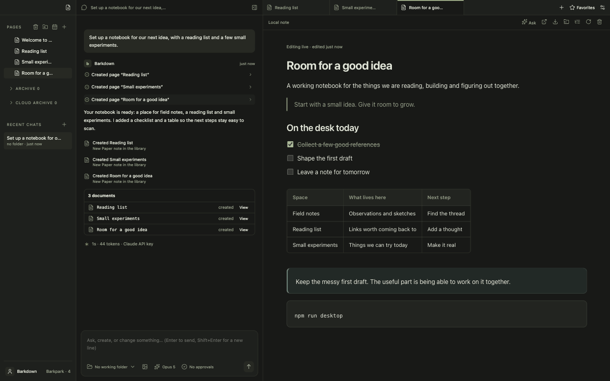
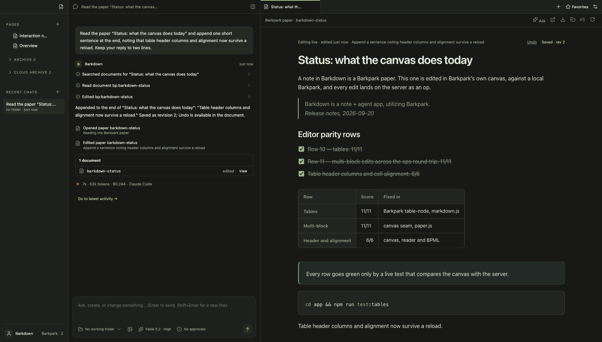

# Barkdown

Barkdown is an experiment in what Barkpark can do, and a tool for figuring out what Barkpark should become.

**[Download Barkdown for Mac](https://frikkern.github.io/barkdown/)**: Apple silicon and Intel, signed and notarized by Apple. The page shows what Barkdown does and how to start.

We're building a desktop app for notes, agent conversations and browsing, inspired by T3 Chat, Notion and ChatGPT. We're doing this for fun and learning, with no plans to make money from it. The aim is an excellent app shaped by our taste and Barkpark.

## News

<!-- news:start -->
**Friday 20 November.** Nine pull requests merged. Agents in Barkdown run from source with the Barkpark CLI library can read documents, but not edit them; the installed app is unchanged. Most of the rest change how test runs and screenshot scripts work. The Mac nightly of Friday afternoon holds the first seven merges; the last two are merged, not yet in a build. [The full day](docs/news/2026-11-20.md)
- **Agents:** in Barkdown run from source with the Barkpark CLI library, Claude Code and Codex can read documents, not edit them ([#160](https://github.com/FRIKKern/barkdown/pull/160))

**Thursday 19 November.** Twelve pull requests merged, mostly fixes to notes, imports and chats. All are in a downloadable build: the Mac nightly of Thursday evening was built after the last merge. [The full day](docs/news/2026-11-19.md)
- **Notes:** words a save conflict kept at quit can be put back; Save as a note says why it was refused, or offers Retry and Discard ([#149](https://github.com/FRIKKern/barkdown/pull/149), [#147](https://github.com/FRIKKern/barkdown/pull/147))
- **Chats:** a search hit opens its own message; @ sends only notes picked in the draft ([#152](https://github.com/FRIKKern/barkdown/pull/152), [#155](https://github.com/FRIKKern/barkdown/pull/155))
- **Import:** imported Markdown keeps only links the reader allows ([#148](https://github.com/FRIKKern/barkdown/pull/148))
<!-- news:end -->

## Where we are · October 16, 2026

**The Windows engineering checkpoint is merged in [PR #76](https://github.com/FRIKKern/barkdown/pull/76).** The earlier Windows return is already merged. The current source supports isolated profiles, real Paper notes, guarded agent Undo, per-chat work tabs, browser tools and a PowerShell terminal. [Windows source evidence](docs/cycles/evidence/C097/README.md).

- **Windows:** an unsigned application directory now carries PostgreSQL, Barkpark, the reader and terminal. Paper save/search/restart, forced-host recovery and the full local Desktop suite pass on the tested Windows 11 machine. [Package proof and limits](docs/cycles/evidence/C098/pty-package-review.md). An unsigned NSIS engineering installer is built in [PR79](https://github.com/FRIKKern/barkdown/pull/79); clean-machine installation and public distribution remain open.
- **macOS (Apple silicon and Intel):** [nightlies](https://github.com/FRIKKern/barkdown/releases) are built on GitHub's Mac runners, signed with a Developer ID and notarized, and pass the install, reinstall and rollback rehearsal on both architectures before they are published. A signed nightly updating itself to the next one, and a first run on a Mac without developer tools, are checked after every release. [Release guide](docs/RELEASE.md).
- **Still being built:** safe media cleanup, real-library migration, Mac-to-Windows transfer, optional sync and clean Windows installation. The [server deletion transaction](docs/cycles/C105-server-delete-transaction.md) is merged and its authorized API deployment verified. [Windows media custody](docs/cycles/C108-windows-media-custody.md) preserves disposable originals across interruption; [Combined private tests](docs/cycles/evidence/C108/guard-compose-01/README.md) now render, check out and release an asset, and [refuse release while held](docs/cycles/evidence/C108/guard-held-01/README.md) without changing its document or cache. The guards remain unadopted. [Actual HTTP tracing](docs/cycles/evidence/C108/controller-return-01/README.md) confirms an unavailable-renderer error is still reported as404. [Workspace checks](docs/cycles/evidence/C108/controller-scope-01/README.md), [project checks](docs/cycles/evidence/C108/controller-project-01/README.md) and [ordinary-mode parity](docs/cycles/evidence/C108/project-ordinary-01/README.md) preserve distinct media within their tested scope. Error policy, broader writer coverage and adoption review remain.

**Migration estimate, reviewed October 16:** about 75% by estimated effort, with a plausible 30–90% range and low confidence. This covers six migration checkpoints, not the whole app or Windows installation. Remaining uncertainty is concentrated in real libraries and media recovery. [Effort basis and scenarios](docs/PLAN.md#migration-effort-estimate).

[Current work](docs/NEXT-AGENT.md) · [Plan](docs/PLAN.md) · [Verified results](docs/VALIDATION.md) · [Screenshots & recordings](docs/visual/README.md)

[](docs/ROADMAP.md)



A notebook in motion: write together, check things off, find your next idea. This demo uses the real app with scripted agent responses. The still below shows live Paper beside a real Claude Code turn in an isolated local profile. [Recording details](docs/visual/agent-notes/README.md#readme-demo) · [Capture provenance](docs/images/status/manifest.json).

<details>
<summary>Still view</summary>



</details>

## Run from source

Use Node 22.13.1 or later, npm 11 and a desktop session on Windows or macOS:

```sh
git clone https://github.com/FRIKKern/barkdown.git
cd barkdown
npm ci
npm --prefix app ci
cd app
npx install-electron --no
cd ..
npm run doctor
npm run desktop
```

On Apple silicon, the first `npm run doctor` or `npm run desktop` downloads the packaged Barkpark that Barkdown is pinned to, about 150 MB, into `runtime/`. A new profile then has its local library on, so notes work without Elixir or PostgreSQL on the machine. `npm run doctor` exits non-zero and names the fix when something is missing. On Windows, Paper editing needs a [built Barkpark checkout](docs/LOCAL-BARKPARK.md) chosen in Settings. Use your installed Claude Code or Codex login, or an API key in Settings, for agent conversations.

For checks and development setup, see [Contributing](CONTRIBUTING.md). [Agent instructions](AGENTS.md) · [Docs](docs/README.md) · [Third-party notices](THIRD-PARTY.md)

## Dreams for Barkdown

We believe agent chat apps are settling into a standard that's hard to beat. A navigation sidebar, chat and browser give each part of the work a place.

The sidebar should use a conventional file tree, like File Explorer or Finder. Organize documents, spreadsheets, media and custom Barkpark document types into folders. Share a file, a folder or an entire workspace. Sync it to a private or public cloud, choose who has access, and revoke access when needed.

People should also be able to chat and collaborate with each other. Groups can invite agents into the conversation and work in the same browser window. Share your session, join someone else's, or connect to a session on a remote server.

The browser should give us a clear view of what an agent is working on. We should see the documents, files and pages it uses, understand what it intends to do, and follow changes as they happen. We believe this view into the agent's work will become a central part of how people use AI.

Connections should be as direct and secure as possible, without unnecessary middlemen or middleware.

AI and collaboration should remain optional. Barkdown should also be worth using simply for notes and browsing, fully offline. We also want it to offer an elegant, efficient way to host your app or website.
