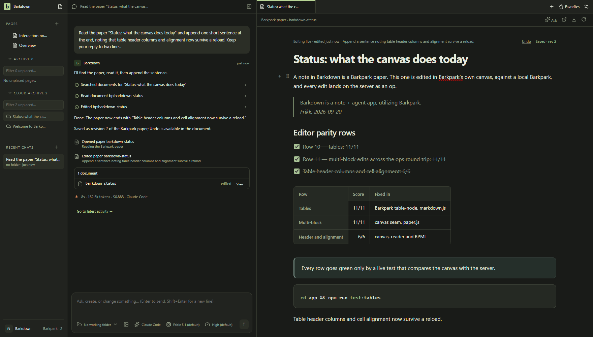

# Barkdown

Barkdown is an experiment in what Barkpark can do, and a tool for figuring out what Barkpark should become.

We’re building a notes-and-agents app inspired by T3 Chat, Notion and ChatGPT, taking the parts we love from each. We’re doing this for fun and learning, with no plans to make money from it. The aim is an excellent app shaped by our taste and Barkpark.

## Where we are · September 29, 2026

**Migration effort estimate: about 60% · plausible scenarios 20–80% · low confidence.** Up from about 55% earlier on September 29. The managed Barkpark runtime now starts on macOS and Linux as well as Windows, and the first half of the library switch was rehearsed live on a Mac: while the runtime is held, an admin write is refused; reopening admits it; restarting a held runtime keeps it blocked instead of silently reopening. The three upstream changes behind this still await merge. This provisional estimate weights demonstrated work against expected work left; it is not a safety rating or a whole-project percentage. The range stays wide because comparison while held, recovery, selection and the way back are unproven. [Estimates, calculation and next calibration](docs/PLAN.md#migration-effort-estimate).

**Working today:** the source prototype supports [writing, searching and restarting](docs/visual/paper-notes/README.md), [agent edits with Undo](docs/visual/agent-notes/README.md), and [deleted-note recovery](docs/visual/paper-deletions/README.md). We’re working toward one dependable Paper note engine; existing libraries have not switched yet.

**Recent progress:** the controller that keeps writes out during migration is now connected to the note, Paper and media writers in production, and a held instance refuses them without changing a row or a byte. Background jobs are admitted the same way and queues pause before a hold. See the [six migration checkpoints](docs/ROADMAP.md#inside-migration).

**Next result:** decide, cluster by cluster, whether the 70 audited writers get a door or are refused while a library switches, and add the one boundary that covers the task board. Then prove an interrupted switch restarts and rolls back safely. Alongside: measure the app on macOS, where development now happens, so the Windows prototype does not become the only tested host.

**Why timing is uncertain:** the audit is done and the count is known, but the policy is not. Best plausible path: most clusters are refused during a switch, one boundary covers the task board, and the recovery checks pass. Adverse path: boot-time and one-shot writes need their own refusal, several clusters need doors, and another full rehearsal follows. We cannot responsibly bound completion time until the policy is recorded.

We report delivered results and reduced uncertainty, not equal-sized checkboxes. Small steps can finish quickly while one safety boundary takes several iterations. This overview changes when the evidence, obstacle or outlook changes; details stay in the linked records. Recovery and portability follow migration; sync and installation remain later work.

[Current work](docs/NEXT-AGENT.md) · [Plan](docs/PLAN.md) · [Verified results](docs/VALIDATION.md) · [Screenshots & recordings](docs/visual/README.md)

[](docs/ROADMAP.md)


A notebook in motion: write together, check things off, find your next idea. Real app, scripted agent responses. [Recording details](docs/visual/agent-notes/README.md#readme-demo).

<details>
<summary>Still view</summary>



</details>

The Barkpark capabilities we’re exploring:

- Authentication
- Local/remote sync, with offline-first use
- Media
- Multiplayer, sharing and access
- Document and spreadsheet editors

## Run it

Windows source prototype. Node 22.13+ and a desktop session:

```sh
npm ci
npm --prefix app ci
npm run desktop
```

Use your Claude Code or Codex login, or an API key in Settings. Paper needs a connected Barkpark; [local setup](docs/LOCAL-BARKPARK.md) requires a built checkout.

[Contributing](CONTRIBUTING.md) · [Agent instructions](AGENTS.md) · [Docs](docs/README.md) · [Capture source](docs/images/status/manifest.json) · [Third-party notices](THIRD-PARTY.md)

## Dreams for Barkdown

We believe agent chat apps are settling into a standard that's hard to beat. A navigation sidebar, chat and browser give each part of the work a place.

The sidebar should use a conventional file tree, like File Explorer or Finder. Organize documents, spreadsheets, media and custom Barkpark document types into folders. Share a file, a folder or an entire workspace. Sync it to a private or public cloud, choose who has access, and revoke access when needed.

People should also be able to chat and collaborate with each other. Groups can invite agents into the conversation and work in the same browser window. Share your session, join someone else's, or connect to a session on a remote server.

The browser should give us a clear view of what an agent is working on. We should see the documents, files and pages it uses, understand what it intends to do, and follow changes as they happen. We believe this view into the agent's work will become a central part of how people use AI.

Connections should be as direct and secure as possible, without unnecessary middlemen or middleware.

AI and collaboration should remain optional. Barkdown should also be worth using simply for notes and browsing, fully offline. We also want it to offer an elegant, efficient way to host your app or website.
