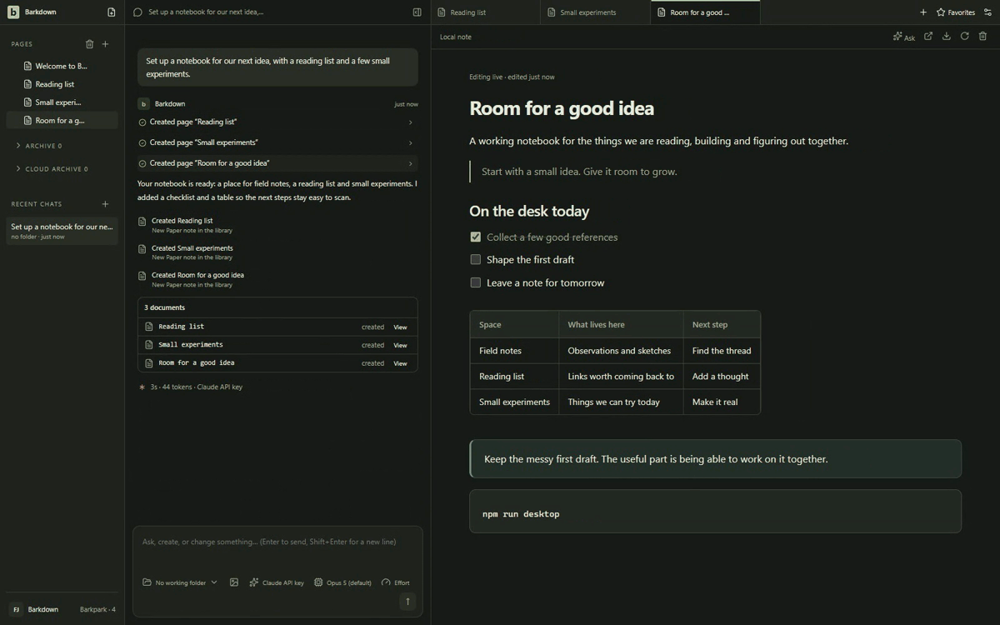
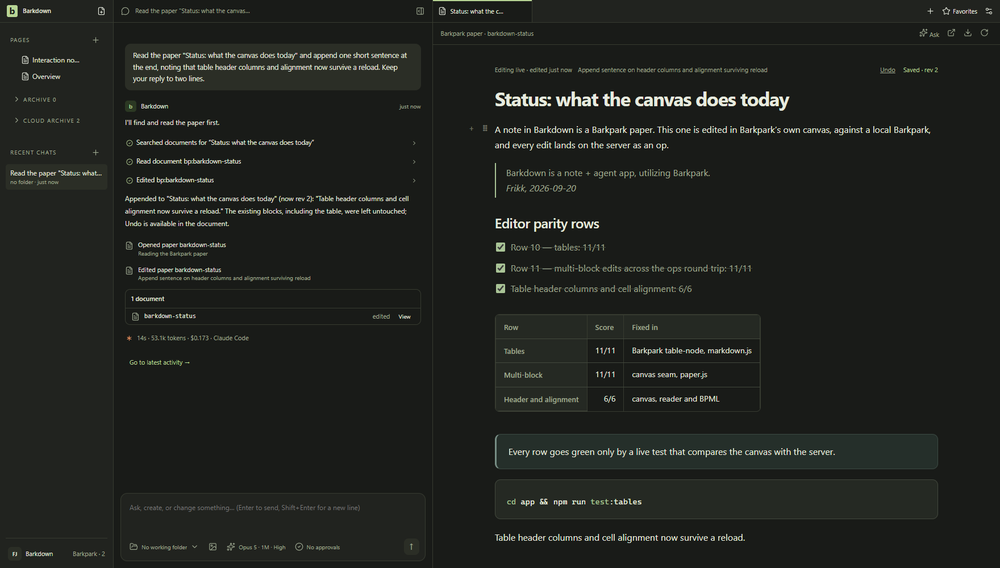

# Barkdown

Barkdown is an experiment in what Barkpark can do, and a tool for figuring out what Barkpark should become.

We're building a desktop app for notes, agent conversations and browsing, inspired by T3 Chat, Notion and ChatGPT. We're doing this for fun and learning, with no plans to make money from it. The aim is an excellent app shaped by our taste and Barkpark.

## Where we are · October 16, 2026

**The Windows engineering checkpoint is merged in [PR #76](https://github.com/FRIKKern/barkdown/pull/76).** The earlier Windows return is already merged. The current source supports isolated profiles, real Paper notes, guarded agent Undo, per-chat work tabs, browser tools and a PowerShell terminal. [Windows source evidence](docs/cycles/evidence/C097/README.md).

- **Windows:** an unsigned application directory now carries PostgreSQL, Barkpark, the reader and terminal. Paper save/search/restart, forced-host recovery and the full local Desktop suite pass on the tested Windows 11 machine. [Package proof and limits](docs/cycles/evidence/C098/pty-package-review.md). An unsigned NSIS engineering installer is built in [draft PR79](https://github.com/FRIKKern/barkdown/pull/79); clean-machine installation and public distribution remain open.
- **macOS Apple silicon:** a [downloadable nightly](https://github.com/FRIKKern/barkdown/releases/tag/v0.6.0-nightly.20261005.2) includes the runtime. It uses ad hoc signing; signed updates and broader installation acceptance remain open. [Release guide](docs/RELEASE.md).
- **Still being built:** safe media cleanup, a real-library migration, actual Mac-to-Windows transfer, optional sync and clean Windows installation. The [server cleanup candidate](docs/cycles/C105-server-delete-transaction.md) is merged upstream and its authorized API deployment is verified. [Windows native custody](docs/cycles/C108-windows-media-custody.md) now preserves an exact disposable file across worker termination and protects a later replacement; production physical cleanup and app adoption remain open. A [real HTTP test](docs/cycles/evidence/C108/http-cache-01/README.md) reproduces cache writes during a held library seal; [upload interruption proof](docs/cycles/evidence/C108/cache-warm-01/README.md) finds copied cache bytes unaccounted for after owner death. [Checkout caller proof](docs/cycles/evidence/C108/checkout-renditions-01/README.md) also finds success reported after failed rendition removal. A [private checkout guard](docs/cycles/evidence/C108/checkout-intent-loss-01/README.md) retains unfinished work across worker loss and coordinator restart; compatibility and error handling still need proof before adoption.

**Migration estimate, reviewed October 16:** about 75% by estimated effort, with a plausible 30–90% range and low confidence. This covers six migration checkpoints, not the whole app or Windows installation. Remaining uncertainty is concentrated in real libraries and media recovery. [Effort basis and scenarios](docs/PLAN.md#migration-effort-estimate).

[Current work](docs/NEXT-AGENT.md) · [Plan](docs/PLAN.md) · [Verified results](docs/VALIDATION.md) · [Screenshots & recordings](docs/visual/README.md)

[](docs/ROADMAP.md)



A notebook in motion: write together, check things off, find your next idea. This earlier demo uses the real app with scripted agent responses. The still below shows live Paper beside a real Claude Code turn in an isolated local profile. [Recording details](docs/visual/agent-notes/README.md#readme-demo) · [Capture provenance](docs/images/status/manifest.json).

<details>
<summary>Still view</summary>



</details>

## Run from source

Use Node 22.13.1 or later, npm 11 and a desktop session on Windows or macOS:

```sh
git clone https://github.com/FRIKKern/barkdown.git
cd barkdown
npm ci
npm --prefix app ci
cd app
npx install-electron --no
cd ..
npm run desktop
```

These commands start the desktop shell. Paper editing also needs a connected Barkpark; [managed local setup](docs/LOCAL-BARKPARK.md) requires a separately built checkout and its native toolchain. The macOS nightly carries that runtime already. Use your installed Claude Code or Codex login, or an API key in Settings, for agent conversations.

For checks and development setup, see [Contributing](CONTRIBUTING.md). [Agent instructions](AGENTS.md) · [Docs](docs/README.md) · [Third-party notices](THIRD-PARTY.md)

## Dreams for Barkdown

We believe agent chat apps are settling into a standard that's hard to beat. A navigation sidebar, chat and browser give each part of the work a place.

The sidebar should use a conventional file tree, like File Explorer or Finder. Organize documents, spreadsheets, media and custom Barkpark document types into folders. Share a file, a folder or an entire workspace. Sync it to a private or public cloud, choose who has access, and revoke access when needed.

People should also be able to chat and collaborate with each other. Groups can invite agents into the conversation and work in the same browser window. Share your session, join someone else's, or connect to a session on a remote server.

The browser should give us a clear view of what an agent is working on. We should see the documents, files and pages it uses, understand what it intends to do, and follow changes as they happen. We believe this view into the agent's work will become a central part of how people use AI.

Connections should be as direct and secure as possible, without unnecessary middlemen or middleware.

AI and collaboration should remain optional. Barkdown should also be worth using simply for notes and browsing, fully offline. We also want it to offer an elegant, efficient way to host your app or website.
