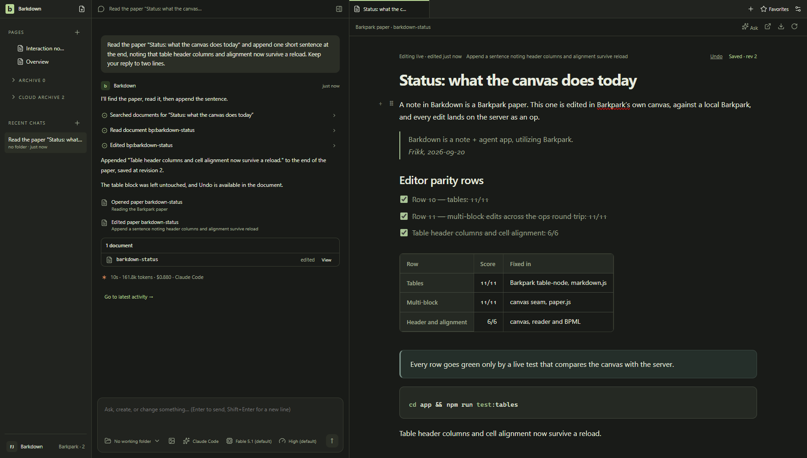

[](docs/PLAN.md)

# Barkdown

Barkdown is an experiment in what Barkpark can do, and a tool for figuring out what Barkpark should become.

We’re building a notes-and-agents app inspired by T3 Chat, Notion and ChatGPT, taking the parts we love from each. We’re doing this for fun and learning, with no plans to make money from it. The aim is an excellent app shaped by our taste and Barkpark.

The Barkpark capabilities we’re exploring:

- Authentication
- Local/remote sync, with offline-first use
- Media
- Multiplayer, sharing and access
- Document and spreadsheet editors



## What we’re working on

One dependable Paper note engine. [Human note creation, editing, search and restart work](docs/visual/paper-notes/README.md); next is bringing agents through that same path with safe Undo. Migration, recovery and portability follow. Sync, multiplayer and spreadsheets are part of the wider exploration, not completed app features.

[Current work](docs/NEXT-AGENT.md) · [Plan](docs/PLAN.md) · [Verified results](docs/VALIDATION.md) · [Screenshots & recordings](docs/visual/README.md)

## Run it

Windows source prototype. Node 22.13+ and a desktop session:

```sh
npm ci
npm --prefix app ci
npm run desktop
```

Use your Claude Code or Codex login, or an API key in Settings. Paper needs a connected Barkpark; [local setup](docs/LOCAL-BARKPARK.md) requires a built checkout.

[Contributing](CONTRIBUTING.md) · [Agent instructions](AGENTS.md) · [Docs](docs/README.md) · [Capture source](docs/images/status/manifest.json) · [Third-party notices](THIRD-PARTY.md)

## Dreams for Barkdown

We believe agent chat apps are settling into a standard that's hard to beat. A navigation sidebar, chat and browser give each part of the work a place.

The sidebar should use a conventional file tree, like File Explorer or Finder. Organize documents, spreadsheets, media and custom Barkpark document types into folders. Share a file, a folder or an entire workspace. Sync it to a private or public cloud, choose who has access, and revoke access when needed.

People should also be able to chat and collaborate with each other. Groups can invite agents into the conversation and work in the same browser window. Share your session, join someone else's, or connect to a session on a remote server.

The browser should give us a clear view of what an agent is working on. We should see the documents, files and pages it uses, understand what it intends to do, and follow changes as they happen. We believe this view into the agent's work will become a central part of how people use AI.

Connections should be as direct and secure as possible, without unnecessary middlemen or middleware.

AI and collaboration should remain optional. Barkdown should also be worth using simply for notes and browsing, fully offline. We also want it to offer an elegant, efficient way to host your app or website.
