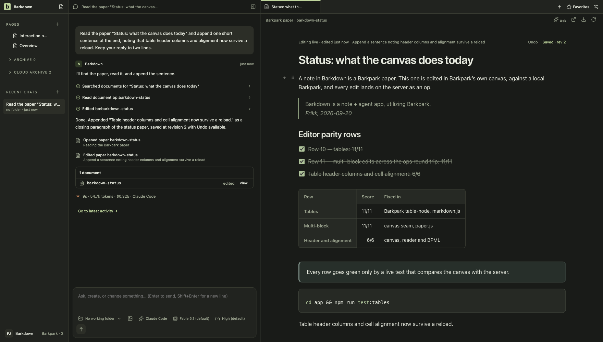

# Barkdown

Barkdown is an experiment in what Barkpark can do, and a tool for figuring out what Barkpark should become.

We’re building a notes-and-agents app inspired by T3 Chat, Notion and ChatGPT, taking the parts we love from each. We’re doing this for fun and learning, with no plans to make money from it. The aim is an excellent app shaped by our taste and Barkpark.

## Where we are · October 2, 2026

**The short version:** notes live on Paper, a whole library can move between machines, the app survives crashes without losing a word, and a Mac installs it from a 156 MB disk image that runs your own Claude Code or Codex. What's missing is a signature, proof on a real library, and Windows.

**Working, and shown working**
- Profiles keep notes, chats and keys apart. [Accepted](docs/cycles/C039-completion-audit.md).
- Paper notes: [write and search](docs/visual/paper-notes/README.md), let an [agent edit with Undo](docs/visual/agent-notes/README.md), get a [deleted note back](docs/visual/paper-deletions/README.md).
- The switch to Paper, with a way back. Started from Settings, interrupted, resumed, rolled back. Rehearsed on macOS with a 24-note corpus ([C083](docs/cycles/C083-writer-admission.md)).
- Portable profiles: export and import from Settings, carried between two installations and into a newer version.
- Nightlies cut themselves from this Mac on a schedule, from a commit with a green chain receipt, with an updater feed beside the image ([how](docs/RELEASE.md)); the app is 420 MB and works at 200 % zoom.
- Rough treatment: a killed app, a killed export or import, a dead database, a quit mid-save. Nothing acknowledged is lost ([C085](docs/cycles/C085-portable-profile.md)).

**Not yet**
- No real library has switched. The corpus so far is ours.
- Nothing has run on Windows since September. The machine is back around October 5.
- Sync and installation are later stages.

**Next**
- [C089 The agent's browser](docs/cycles/C089-agent-browser.md): Claude and Codex get a browser of their own inside Barkdown — the Claude in Chrome tool set over Barkdown's tabs, sign-in that works, bookmarks and history from Chrome, pauses on sensitive actions — measured against Claude Desktop and ChatGPT desktop on a twelve-task bench. Opened October 2.
- Windows returns: switch a real library, carry an export across machines, recover from a crash there.
- The old editor is retired ([C087](docs/cycles/C087-legacy-retirement.md)): profiles are the ordinary launch, an old library is offered for adoption, every note is written on Paper, and legacy notes stay readable. The Mac application [builds with its runtime and database inside](docs/cycles/C086-packaged-runtime.md), not yet signed. It runs chats through [the Claude Code and Codex you already have](docs/cycles/C088-own-agents.md) instead of carrying its own copies: 456 MB, down from 1 GB.

**How far along:** migration is about 75% by effort, low confidence, plausible range 30–90%. That weighs demonstrated work against what's left; it is not a safety rating. [How it's calculated](docs/PLAN.md#migration-effort-estimate).

[Current work](docs/NEXT-AGENT.md) · [Plan](docs/PLAN.md) · [Verified results](docs/VALIDATION.md) · [Screenshots & recordings](docs/visual/README.md)

[](docs/ROADMAP.md)


A notebook in motion: write together, check things off, find your next idea. Real app, scripted agent responses. [Recording details](docs/visual/agent-notes/README.md#readme-demo).

<details>
<summary>Still view</summary>



</details>

The Barkpark capabilities we’re exploring:

- Authentication
- Local/remote sync, with offline-first use
- Media
- Multiplayer, sharing and access
- Document and spreadsheet editors

## Run it

Source prototype on macOS and Windows. Node 22.13+ and a desktop session:

```sh
npm ci
npm --prefix app ci
(cd app && npx install-electron --no)   # Electron 42+ fetches its binary on demand
npm run desktop
```

Use your Claude Code or Codex login, or an API key in Settings. Paper needs a connected Barkpark; [local setup](docs/LOCAL-BARKPARK.md) requires a built checkout.

Or install the macOS disk image instead: the [latest nightly release](https://github.com/FRIKKern/barkdown/releases) carries `Barkdown-<version>-arm64.dmg` (156 MB) with the server, Erlang and Postgres inside, `SHA256SUMS`, and the test receipts it was cut with; `node scripts/build-mac-app.mjs --dmg` builds the same image here. It is signed ad hoc, so open it with right-click › Open; [what is proven and what is not](docs/cycles/C086-packaged-runtime.md), [how releases are cut](docs/RELEASE.md).

[Contributing](CONTRIBUTING.md) · [Agent instructions](AGENTS.md) · [Docs](docs/README.md) · [Capture source](docs/images/status/manifest.json) · [Third-party notices](THIRD-PARTY.md)

## Dreams for Barkdown

We believe agent chat apps are settling into a standard that's hard to beat. A navigation sidebar, chat and browser give each part of the work a place.

The sidebar should use a conventional file tree, like File Explorer or Finder. Organize documents, spreadsheets, media and custom Barkpark document types into folders. Share a file, a folder or an entire workspace. Sync it to a private or public cloud, choose who has access, and revoke access when needed.

People should also be able to chat and collaborate with each other. Groups can invite agents into the conversation and work in the same browser window. Share your session, join someone else's, or connect to a session on a remote server.

The browser should give us a clear view of what an agent is working on. We should see the documents, files and pages it uses, understand what it intends to do, and follow changes as they happen. We believe this view into the agent's work will become a central part of how people use AI.

Connections should be as direct and secure as possible, without unnecessary middlemen or middleware.

AI and collaboration should remain optional. Barkdown should also be worth using simply for notes and browsing, fully offline. We also want it to offer an elegant, efficient way to host your app or website.
