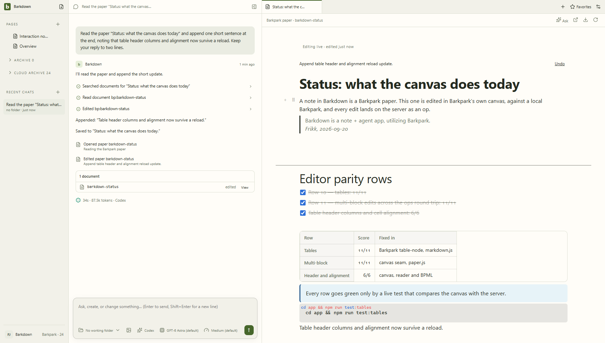
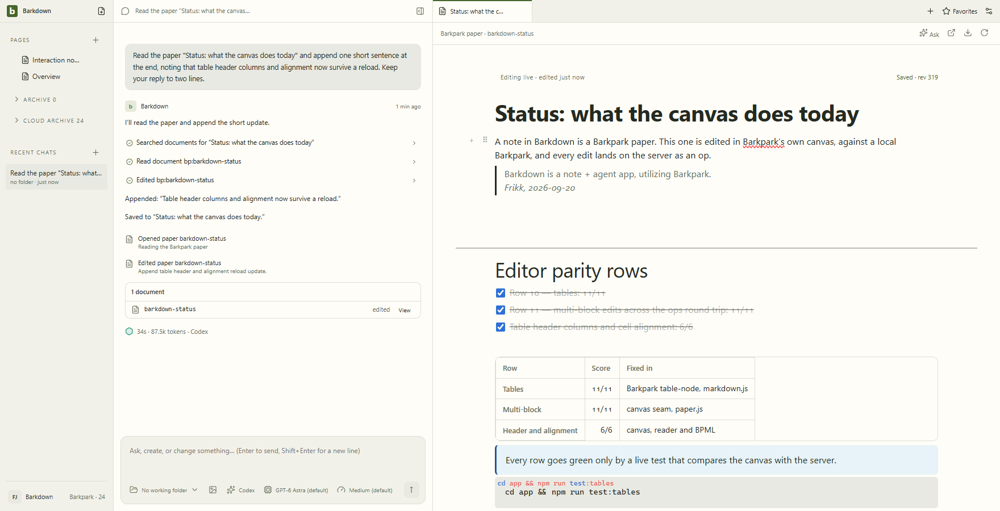
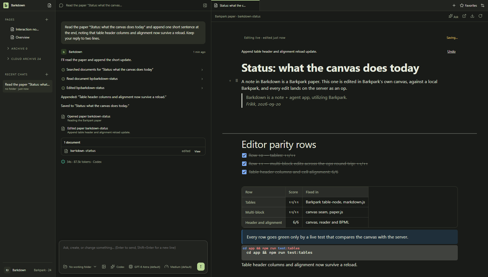
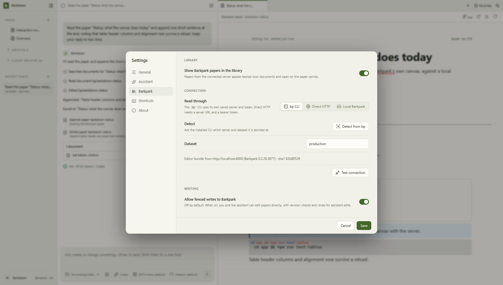
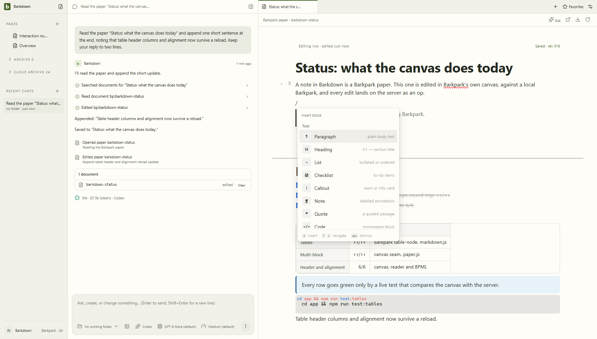
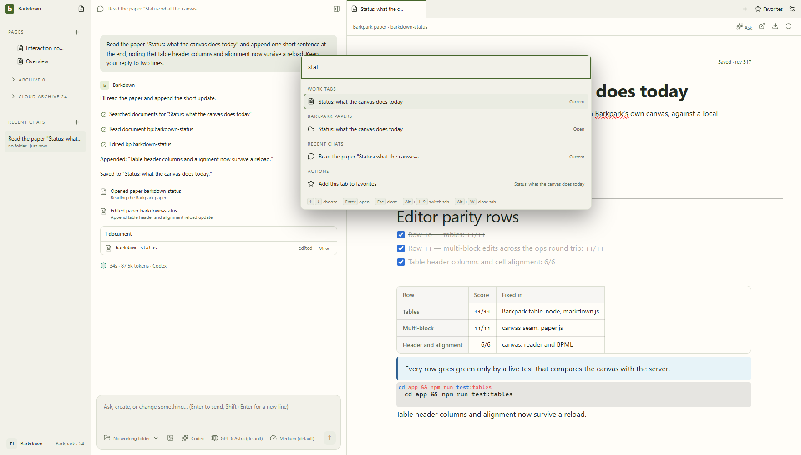

# Barkdown

**A note + agent app, utilizing Barkpark.**

Barkdown puts your notes and conversations in one desktop workspace, with agents using the working folders you give each chat. Barkpark supplies the real Paper editor, content model and revision-checked operations.

**The next goal:** create a local profile, write and edit with an agent, restart safely, then move the profile to another machine and continue. Local-only use comes first; cloud sync is optional and still to be built. [Follow the active plan](docs/PLAN.md).





*Real pictures of the running app, taken by `cd app && npm run shots` against the local Barkpark: five stills and the loop above. `npm run check` refuses a README whose pictures are older than the last change to the app's UI, and every capture gets content-hashed filenames so a cached old picture can never stand in for a new one. The manifest beside them says which commits they came from and whether the assistant turn in them was real.*

## Where it stands

- **Working:** Electron desktop, shared Paper editing, direct assistant edits with Undo, main and side conversations, image/model controls, per-chat working folders, work tabs, favorites and human-organized Pages.
- **Foundation delivered:** opt-in managed Barkpark on Windows with private PostgreSQL, readiness checks, recovery and owned shutdown. It currently needs a built checkout; [setup and limits](docs/LOCAL-BARKPARK.md).
- **Next:** profile ownership → migrate all notes to Paper → recovery and portable profiles → optional sync → ordinary installation. Legacy local notes still use a separate editor/store.
- **Carried gates:** upstream editor integration and cross-repository CI proof remain unfinished. [Evidence and limitations](docs/VALIDATION.md) separate what passed from what is planned.



## Start here

1. [PLAN.md](docs/PLAN.md) — current journey, sequence, first P1 slice and carried gates. Run `npm run plan`.
2. [NEXT-AGENT.md](docs/NEXT-AGENT.md) — concise continuation brief and code map.
3. [DESIGN-DECISIONS.md](docs/DESIGN-DECISIONS.md) — accepted behavior to preserve.
4. [ARCHITECTURE.md](docs/ARCHITECTURE.md) and [ACCEPTANCE.md](docs/ACCEPTANCE.md) — ownership boundaries and scenario exits.
5. [VALIDATION.md](docs/VALIDATION.md) and [EDITOR-PARITY.md](docs/EDITOR-PARITY.md) — baseline and regression evidence.

[Earlier plans and handoffs](docs/archive/README.md) are archived. The original [PRD](docs/PRD.md), concepts and sizing review remain historical references, not a competing queue.

The central rule still holds: **Barkdown is app-wide. Agents have working folders.** The sidebar is not scoped to a folder; each chat carries its agent's working context; a project editor is a work tab inside that conversation.

## Run it

```sh
cd app && npm ci && npm start
```

Requires Node 22.13+ and a desktop session (Electron 38). The assistant uses your Claude Code or Codex login; an API key is the fallback. Settings → Barkpark can connect to an existing server or start the managed Windows source runtime. See [LOCAL-BARKPARK.md](docs/LOCAL-BARKPARK.md) for prerequisites. Profiles, automatic note migration and cloud sync are not yet available.



## Verify

```sh
cd app && npm test
```

`npm test` runs the scripted-client agent checks and the Playwright suite against the real Electron window. The editor parity rows are live, against a Barkpark: `npm run test:tables`, `npm run test:multiblock`, `npm run test:highlight`, `npm run test:images`, `npm run test:find`, `npm run test:mention`, `npm run test:emoji`, `npm run test:row14`, `npm run test:subsup`, `npm run test:opaque`. `npm run shots` refreshes the README's pictures and their manifest. At the repo root, `npm run check` verifies links, the handoff's requirements and hashes, and that those pictures are no older than the UI they show.





## Working in two repos

Editor truth lives in Barkpark. A change to a block, a mark or an attribute is a Barkpark PR first (schema, reader render, contract, canvas, unit test, on the `barkdown/editor-quality` branch), then a red-first live row here. The app loads the canvas bundle from the Barkpark it is connected to (cached under userData; `app/renderer/vendor` is the offline fallback and is refreshed when a Barkpark change lands), so a Barkpark editor change reaches Barkdown by restarting Phoenix. Landing a Barkpark PR has its own gates; `.claude/skills/plan-followup/scripts/barkpark-pr.mjs` walks them.

## The concept handoff (v0.5, kept as history)

The repository began as a product and engineering handoff: [concepts/workspace.html](concepts/workspace.html) (the app shell and simulated agent activity), [concepts/editor-study.html](concepts/editor-study.html) (block editing interactions), and the illustrated PRD. They are still the interaction reference the app was built from and are still checked:

```sh
npm ci
npx playwright install chromium
npm run verify
npm run preview
```

`npm run build` regenerates the portable preview pages (`preview/*.html`, self-contained), the GitHub-readable PRD and the artifact hashes; `npm test` exercises the concepts at widths down to 320px. Open `http://127.0.0.1:4173` for the preview. Everything in the concepts is in-memory and resets on reload.

| File | Role |
|---|---|
| `app/` | The desktop app. `main/` (Electron main: window, IPC, documents, files, git, agent, Barkpark adapter, settings), `renderer/` (the UI; `vendor/` holds the canvas bundle), `shared/` (markdown, PortableDoc and ops helpers), `tests/` (unit, Playwright/Electron, and the live parity rows). |
| `docs/` | The plan, the goal, the review, decisions, the handoff, the PRD and its source. `docs/images/status/` is written by `npm run shots`. |
| `concepts/`, `preview/`, `evidence/` | The v0.5 concept, its portable previews, and source provenance with hashes. |
| `.claude/skills/plan-followup/` | The project workflow and active-queue helper. |

## Status and licence

[VALIDATION.md](docs/VALIDATION.md) records the checks that were run and on what. Original Barkdown material has no public open-source licence; the repository is private on purpose. Third-party notices are in [THIRD-PARTY.md](THIRD-PARTY.md).
