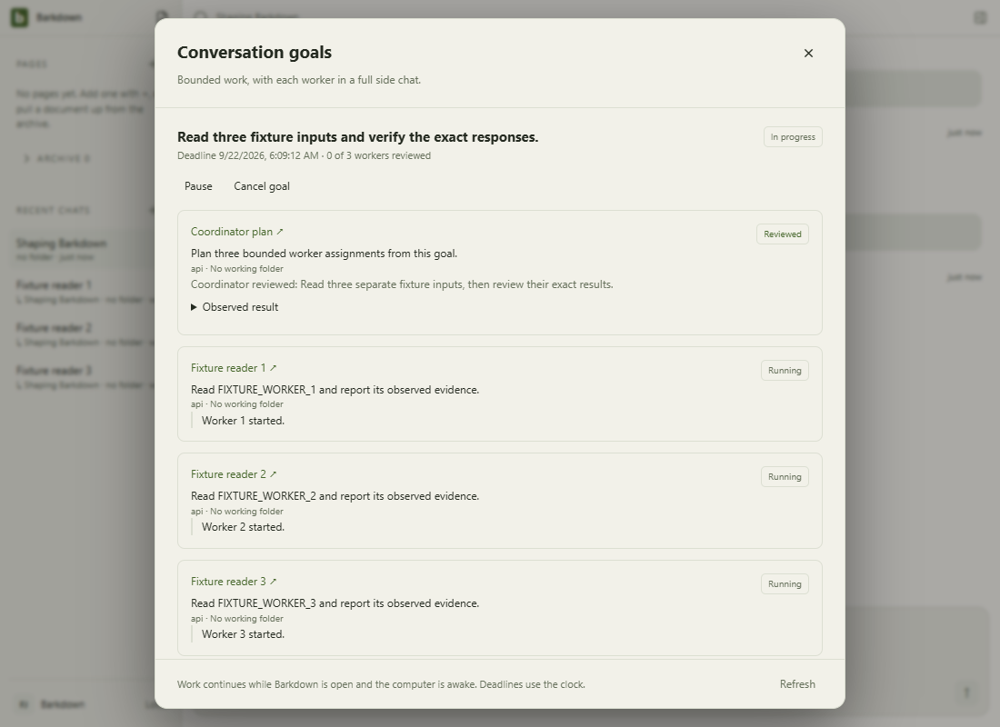

# Main-process health

This directory owns persisted data, provider execution, native processes and the IPC authority boundary. Start with the [current handoff](../../docs/NEXT-AGENT.md) and [A1 evidence table](../../docs/cycles/A1-current-evidence.md): a passing lane does not approve a newer combined source.

This is original C020 Electron evidence with a deterministic provider. Its [recovery gallery](../../docs/visual/coordinator-recovery/README.md) records the source, interruption checks and limits. It is not a fresh capture of every change in this directory.

| When changing | Review the contract and evidence |
|---|---|
| Profiles, registry or adoption | [Ownership](../../docs/PROFILE-OWNERSHIP.md), [repeated adoption](../../docs/visual/adoption-repeat/README.md), [native rollback](../../docs/cycles/C021-rollback-native-preflight.md) |
| Provider dispatch or conversations | [Chat recovery](../../docs/visual/chat-recovery/README.md), [goal integration](../../docs/goals/INTEGRATION.md) and the captured run scope |
| File reads and saves | [Exact file authority](../../docs/visual/project-file-authority/README.md); unavailable navigation must not redirect a retained draft |
| Editor bundle loading | [Cache integrity](../../docs/visual/cache-integrity/README.md); verify both assets and preserve rejected originals |
| Native processes or storage | [Terminal ownership](../../docs/visual/terminal-ownership/README.md), [C023 write recovery](../../docs/cycles/C023-windows-atomic-write.md) |

Resolve profile identity in main before using a store, connection or run. A foreground switch cannot rebind captured work. A failed acknowledgement does not authorize replay. Shutdown claims require the owned process receipt, not merely a closed window. Device provider login and environment credentials remain distinct from profile-owned encrypted secrets.

Run the affected real-adapter tests and the required desktop/visual/root gates in [the visual rules](../../docs/visual/RULES.md). The conservative tripwire includes this directory; screenshots require named review, while storage and process claims require behavior evidence.

## Changelog

- 23 September: [provider sign-in assistance](../../docs/visual/provider-login/README.md), source `1c94f8d`, adds owned login processes and pre-dispatch checks. Native A/B worker transport checks verify captured credentials; full desktop passes. Live Paper/root freshness remains pending in C039.

- 22 September: selected-root search errors remain errors, distinct from no matches; [API-loop regression and retained failure](../../docs/cycles/evidence/missing-working-folder/README.md). Combined visual/runtime verification is pending.
- 22 September: C023 source is integrated with C010 lease relocation preserved; focused combined checks pass, final combined gates remain pending. C024 and C025 original evidence is imported. The handoff above owns current status.

- 22 September, candidate76b07d3: E011 upstream54579 and C016 reading-position source/evidence are imported. [C032 native refusal/restart motion](../../docs/visual/folder-preflight/README.md) retains original8b51fbc; C033 has controlled context-race checks only. C023 original final gates passed. Fresh combined review remains pending; historical images above are not promoted. See [historical validation order](../../docs/cycles/C008-integration.md#remaining-combined-validation-order). E012 upstream work remains unconsumed.

## Current authority and recovery checkpoints

| Boundary | Current behavior and retained proof |
|---|---|
| Ordinary conversation folder | Current persisted folder is captured for every turn. C032 refuses known missing/non-directory/inaccessible Claude/Codex folders before reservation; [actual8b51fbc refusal/restart gallery](../../docs/visual/folder-preflight/README.md) includes main and side chats. A stat check does not prove full access or prevent later removal; API/null-folder and goal-worker behavior are distinct. |
| Context changes while acquiring a runtime | [C033](../../docs/cycles/C033-context-reservation.md) rejects a stale trusted context before dispatch/reservation, releases the lease and preserves newer folder/draft/session state. Fifteen controlled race tests cover ordinary and goal paths; no native race video is claimed. |
| Selected workspace missing or corrupt | [C012 actual87ca623 recovery stills](../../docs/visual/workspace-recovery/README.md) show explicit blocked startup and retained drafts. [C022 cold-adoption motion](../../docs/visual/adoption-repeat/README.md) proves repeat/rollback only for the recorded same-machine fixture. |
| Provider and process completion | [C034 Codex7e07099 proof](../../docs/cycles/evidence/C034/codex-7e07099/manifest.json) verifies local MCP edit revision1→2 and stopped/zero-active Job; [C035 packaged38 ownership](../../docs/visual/packaging38/README.md) proves terminal descendants across switch/forced exit. Neither proves all providers or clean-machine deployment. |

Packaging includes shared modules and resolves the three fixed external native resources outside ASAR; [C035](../../docs/cycles/C035-packaging38.md) retains exact package hashes. The local PostgreSQL/Barkpark runtime still needs a built source checkout. Recovery must retain source data and an uncertain attempt rather than synthesize success or replay it.

### Current migration boundary

The [migration contract](../../docs/migration/README.md) owns the current P2 limits; [validation](../../docs/VALIDATION.md) separates accepted checkpoints from open work. P1 is accepted through C039. Earlier capture lifecycle/adoption evidence remains in its cycle records, not a separate task queue.

`migration-preflight.js` inventories a closed profile and preserves exact backup bytes. `migration-staging.js`, `migration-media.js` and `migration-journal.js` bind source-qualified identities, create-only writes, owned PNG upload receipts and exact readback to one captured runtime. Ambiguous, missing or edited targets refuse. C052 accepts only the audited standard attributes actually saved by the legacy editor; custom metadata remains blocked.

`migration-workspace.js` computes a hash-bound offline navigation preview, preserving typed paths, human Pages and favorites while leaving opaque history/receipts unchanged. Malformed order, missing identities, ambiguous closed document targets and unplaced local archives block. C053 native preview is a separate disposable app, never authority activation.

`migration-restore.js` copies a pinned committed backup into an empty closed profile without overwriting human changes. Process interruption/resume and native restored-profile editing pass; settings, credentials, runtime databases and Paper edits are outside this adapter.

`migration-evidence.js` reads original documents/history/proposals and the canonical local agent receipt from a caller-pinned, fully verified backup. It preserves legacy revision semantics and exposes no actions, Paper revision or mutation. Unsupported historical content stays original evidence; changed or mismatched records refuse. This offline reader is not a native history viewer or cutover permission.

[Reviewed stills and motion](../../docs/visual/migration/README.md) cover native content, references, media, legacy restore and source compatibility. These remain offline adapters. The app has no migration UI or authority switch; original navigation, history and source data remain authoritative. Cross-machine paths, other media, live writer fencing and cutover/rollback remain open.

- 24 September, C056: complete foreground Paper discovery validates every page and refuses partial success; failed same-connection refresh keeps known notes with a conditional Retry notice. Changed connection generations cannot borrow the previous catalog. [Native catalog proof](../../docs/visual/catalog/README.md) records the200/201-paper journey, failure/retry and restart; limited provider list queries remain unchanged. The current handoff records acceptance and remaining scope.

- 24 September, C057: foreground Paper reads and mutations carry a main-process connection binding; settings changes refuse old-buffer access before transmission. The host retains unsaved text and shows the original-connection requirement. Captured CLI routes avoid ambient destination changes. [Connection evidence](../../docs/visual/paper-connection/README.md) and the current handoff record actual acceptance; this is an in-session boundary, not durable bookmark migration.
