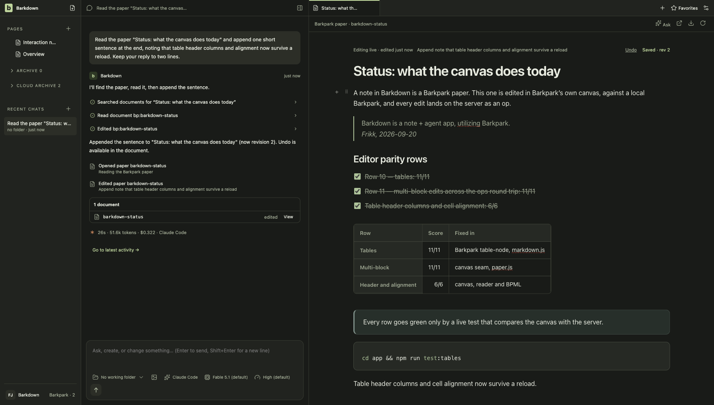

# Main-process health

This directory owns persisted data, provider execution, native processes and the IPC authority boundary. Start with the [current handoff](../../docs/NEXT-AGENT.md) and [A1 evidence table](../../docs/cycles/A1-current-evidence.md): a passing lane does not approve a newer combined source.

The [capture manifest](../../docs/images/status/manifest.json) identifies this live Paper checkpoint. Use the boundary galleries below for ownership, process and recovery proof; one screenshot does not validate every module.

| When changing | Review the contract and evidence |
|---|---|
| Profiles, registry or adoption | [Ownership](../../docs/PROFILE-OWNERSHIP.md), [repeated adoption](../../docs/visual/adoption-repeat/README.md), [native rollback](../../docs/cycles/C021-rollback-native-preflight.md) |
| Provider dispatch or conversations | [Chat recovery](../../docs/visual/chat-recovery/README.md), [goal integration](../../docs/goals/INTEGRATION.md) and the captured run scope |
| File reads and saves | [Exact file authority](../../docs/visual/project-file-authority/README.md); unavailable navigation must not redirect a retained draft |
| Editor bundle loading | [Cache integrity](../../docs/visual/cache-integrity/README.md); verify both assets and preserve rejected originals |
| Ordinary local Paper notes | [Human draft-note journey](../../docs/visual/paper-notes/README.md) and [agent-note journey](../../docs/visual/agent-notes/README.md): exact rows, distinct revision domains, durable creation identity and guarded Undo. `paper-tools.js` shares captured API/MCP access; `paper-edit-ops.js` preserves the locked title. |
| Delete and recover local notes | [Deletion recovery](../../docs/visual/paper-deletions/README.md): `paper-deletions.js` retains an owned snapshot before dispatch. Sent deletions reconcile by reading; recovery uses one new creation identity and preserves later human edits. Requires upstream `deleteExactDraft`; older servers refuse safely. |
| Native processes or storage | [Terminal ownership](../../docs/visual/terminal-ownership/README.md), [C023 write recovery](../../docs/cycles/C023-windows-atomic-write.md) |

Resolve profile identity in main before using a store, connection or run. A foreground switch cannot rebind captured work. A failed acknowledgement does not authorize replay. Shutdown claims require the owned process receipt, not merely a closed window. Device provider login and environment credentials remain distinct from profile-owned encrypted secrets.

Run the affected real-adapter tests and the required desktop/visual/root gates in [the visual rules](../../docs/visual/RULES.md). The conservative tripwire includes this directory; screenshots require named review, while storage and process claims require behavior evidence.

## Current authority and recovery checkpoints

| Boundary | Current behavior and retained proof |
|---|---|
| Ordinary conversation folder | Current persisted folder is captured for every turn. C032 refuses known missing/non-directory/inaccessible Claude/Codex folders before reservation; [actual8b51fbc refusal/restart gallery](../../docs/visual/folder-preflight/README.md) includes main and side chats. A stat check does not prove full access or prevent later removal; API/null-folder and goal-worker behavior are distinct. |
| Context changes while acquiring a runtime | [C033](../../docs/cycles/C033-context-reservation.md) rejects a stale trusted context before dispatch/reservation, releases the lease and preserves newer folder/draft/session state. Fifteen controlled race tests cover ordinary and goal paths; no native race video is claimed. |
| Selected workspace missing or corrupt | [C012 actual87ca623 recovery stills](../../docs/visual/workspace-recovery/README.md) show explicit blocked startup and retained drafts. [C022 cold-adoption motion](../../docs/visual/adoption-repeat/README.md) proves repeat/rollback only for the recorded same-machine fixture. |
| Provider and process completion | [C034 Codex7e07099 proof](../../docs/cycles/evidence/C034/codex-7e07099/manifest.json) verifies local MCP edit revision1→2 and stopped/zero-active Job; [C035 packaged38 ownership](../../docs/visual/packaging38/README.md) proves terminal descendants across switch/forced exit. Neither proves all providers or clean-machine deployment. |

Packaging includes shared modules and resolves the three fixed external native resources outside ASAR; [C035](../../docs/cycles/C035-packaging38.md) retains exact package hashes. The local PostgreSQL/Barkpark runtime still needs a built source checkout. Recovery must retain source data and an uncertain attempt rather than synthesize success or replay it.

### Current migration boundary

The [migration contract](../../docs/migration/README.md) owns the current P2 limits; [validation](../../docs/VALIDATION.md) separates accepted checkpoints from open work. P1 is accepted through C039. Earlier capture lifecycle/adoption evidence remains in its cycle records, not a separate task queue.

`migration-preflight.js` inventories a closed profile and preserves exact backup bytes. `migration-staging.js`, `migration-media.js` and `migration-journal.js` bind source-qualified identities, create-only writes, owned PNG upload receipts and exact readback to one captured runtime. Ambiguous, missing or edited targets refuse. C052 accepts only the audited standard attributes actually saved by the legacy editor; custom metadata remains blocked.

`migration-workspace.js` computes a hash-bound offline navigation preview, preserving typed paths, human Pages and favorites while leaving opaque history/receipts unchanged. Malformed order, missing identities, ambiguous closed document targets and unplaced local archives block. C053 native preview is a separate disposable app, never authority activation.

`migration-restore.js` copies a pinned committed backup into an empty closed profile without overwriting human changes. Process interruption/resume and native restored-profile editing pass; settings, credentials, runtime databases and Paper edits are outside this adapter.

`migration-evidence.js` reads original documents/history/proposals and the canonical local agent receipt from a caller-pinned, fully verified backup. It preserves legacy revision semantics and exposes no actions, Paper revision or mutation. Unsupported historical content stays original evidence; changed or mismatched records refuse. This offline reader is not a native history viewer or cutover permission.

[Reviewed stills and motion](../../docs/visual/migration/README.md) cover native content, references, media, legacy restore and source compatibility. These remain offline adapters. The app has no migration UI or authority switch; original navigation, history and source data remain authoritative. Cross-machine paths, other media, live writer fencing and cutover/rollback remain open.

## Changelog

- 24 September, C056: complete foreground Paper discovery validates every page and refuses partial success; failed same-connection refresh keeps known notes with a conditional Retry notice. Changed connection generations cannot borrow the previous catalog. [Native catalog proof](../../docs/visual/catalog/README.md) records the200/201-paper journey, failure/retry and restart; limited provider list queries remain unchanged. The current handoff records acceptance and remaining scope.

- 24 September, C057: foreground Paper reads and mutations carry a main-process connection binding; settings changes refuse old-buffer access before transmission. The host retains unsaved text and shows the original-connection requirement. Captured CLI routes avoid ambient destination changes. [Connection evidence](../../docs/visual/paper-connection/README.md) and the current handoff record actual acceptance; this is an in-session boundary, not durable bookmark migration.

- Earlier ownership, login, recovery and editor integration checkpoints are retained in [the P1 completion audit](../../docs/cycles/C039-completion-audit.md), [integration history](../../docs/cycles/C008-integration.md) and their linked galleries. Historical pending statements are not an additional active queue.

C058 scopes persisted remote edit evidence to an opaque original-connection owner. Unknown older receipts/proposals remain reference-only; foreign same-slug records cannot execute. [Native evidence and limits](../../docs/visual/paper-evidence/README.md). The cycle handoff records current validation; it does not authorize migration cutover.

C059 carries durable Paper navigation owners from catalog reads through saved targets and provider activity. Foreign/unknown saved references refuse before Paper reads; provider CLI routing is captured once and passed to its MCP process. [Navigation evidence](../../docs/visual/paper-navigation/README.md). Validation is tracked in the current handoff.

C060: [Owned Paper Archive](../../docs/visual/paper-archive/README.md) records trusted main-process origin, local/cloud partition and preserved human organization across two profiles, failure and restart.

- 24 September, C069: [Agent notes](../../docs/visual/agent-notes/README.md) shares managed-local API/MCP creation/discovery, preserves locked titles during body replacement and retains revision-checked Undo receipts across restart. Creation retries retain the original request and content; managed tools no longer seed legacy notes. Native acceptance and remaining recovery limits are tracked in C069.

C074 adds `original-history.js`: profile-owned references pin both source and manifest hashes, verify the full migration backup on each read, and expose no restore or mutation action. Native IPC captures the owner before the folder picker. [Viewer evidence and limits](../../docs/visual/original-history/README.md).

C075 adds `writer-admission.js`: durable store generations and admitted operations guard bound documents/receipts, foreground Paper and attachment writes, captured API/MCP/goal processes and workspace persistence. Failed or interrupted writes remain uncertain; quiescence cannot call them completed. The controller is internal and does not select an engine. [Native evidence and limits](../../docs/visual/writer-fence/README.md).

Legacy adoption retains writer controls byte-for-byte in source backups and excludes them from the new profile projection. The destination captures its own root identity; active, uncertain or quiescing source controls refuse adoption. Cold-runtime staging validates copied controls against their original root before publication.

Provider drivers emit the first chunk immediately, then combine consecutive text/thinking chunks within a100ms batching window and16Ki-character pending limit before assigning event sequence numbers. Tools, approvals, replacements, cancellation and completion flush the buffer. Owned-worker bridges do not batch again; the same fenced synchronous persistence still precedes every forwarded event. Durable sink failures cancel and finalize the run without retrying failure reports through the broken sink. C075 stream tests cover all three provider loops, order, failures, profile ownership and restart readback; measured latency remains recorded in its evidence.

- 25 September, C076 (under validation): profile launch admission can be durably closed before preparation. Ordinary runtime/authentication waits recheck closure; goal service entry points and shared slot admission refuse new launches while existing transcripts can finish. Internal `drainOrdinary` accounts for pending dispatch, cancels late run identities, awaits runtime/transcript finalization and verifies retained Windows job receipts. Native tests stop A's child/grandchild while B continues, then repeat verification after service restart. Missing receipts, cleanup failures and unresolved effects refuse. The completed preparation adapter and cancellation contract are described below. [Current cycle and required visual gates](../../docs/cycles/C076-profile-preparation.md).

Explicit ordinary recovery retires the failed observer only after verified shutdown, settled dispatch and persisted human effects review. It does not clear separate runtime-release failures or reopen launch admission.

C076 draft retention is under validation. Trusted Paper reads mint in-session capabilities for a concrete profile root and stable Paper connection owner. `paper-draft-store.js` writes immutable checksummed title/projection records before returning local receipts, preserving different sessions and edit versions. Restart reads validate root/owner and checksum; malformed records and storage failures refuse. The 32 MiB limit refuses oversized drafts rather than truncating them. These local copies do not acknowledge a server save or authorize restoration over a newer Paper. Final preparation acceptance remains pending in the [current cycle](../../docs/cycles/C076-profile-preparation.md).

`profile-preparation.js` orders held foreground capture, ordinary/goal/terminal drain and writer quiescence with profile-owned durable phases. It journals the intended writer generation before closing admission; interruption can then match either side of that exact transition. Retained drafts are revalidated, rejected drains wait for all other cleanup, and active/uncertain writes refuse completion. The main-window IPC bridge now drains admitted foreground handlers, blocks new mutations and binds recovery writes to a live capture ticket. The renderer saves chat drafts, freezes Paper and refuses dirty legacy/project buffers or composition; prepared restarts stay read-only and can switch profiles. Cancellation journals a fresh writer generation before reopening, verifies the durable abort receipt before launches reopen, and leaves the old host blocked until restart. Prior preparation and launch records remain immutable. A profile-owned clipboard IPC copies only a verified retained draft. Final full/visual gates remain pending. `inspect()` reports retained state, not a fresh verified completion or authority-selection permission. [C076 evidence and integration boundary](../../docs/cycles/evidence/C076/README.md).

Goal-service `drain(profileId)` pauses that profile, waits for queued/running adapter completion while journal settlement remains enabled, verifies every reserved attempt's native receipt, reconciles restart-discovered termination and closes its journal. Goal history remains readable from a copied snapshot; other profiles retain their scheduler and shared capacity. Uncertain completion waits for trusted reconciliation, and missing receipts or persistence/cleanup faults refuse. Native tests cover three child/grandchild trees and abrupt host exit. Restart must revalidate this internal barrier; it does not seal a migration or certify human drafts.

[Preparation and retained-draft review](../../docs/visual/profile-preparation/README.md) tracks native acceptance separately from deterministic and live Paper evidence.

### Read-only migration comparison

`migration-comparison.js` captures a caller-pinned baseline before staging and compares complete published/draft variants, exact referenced PNG bytes, source backups and workspace projection. It holds the preparation coordinator through reads and refuses changed/missing evidence without repairs. [C078](../../docs/cycles/C078-library-comparison.md) records validation and limits. This is an internal rehearsal adapter, not an authority selector; unsupported workspace/media inputs remain explicit refusals.

### 2026-09-26 — owned migration preview (C080)

Migration projection and comparison now bind destinations to the captured library and preserve unplaced notes for local Archive. [Behavior and visual evidence](../../docs/cycles/C080-owned-navigation.md) distinguish this read-only preview from activation. Existing live Paper imagery above remains general editor evidence, not proof of this new path.

### 2026-09-29 — export and import from the app (C085)

`profile-portable.js` is the operator surface over `profile-export.js` and `profile-import.js`. The folder comes from the native picker in the main process and is held there; the window never names a path to write to. An export runs on a prepared profile, reports its phases, releases the preparation when it ends either way and records its outcome against that preparation, so the restart notice names what happened and where the folder is. A failed export's partial folder goes to the system trash. Import creates a new profile and changes no existing one. The manifest counts published Papers and draft-only notes separately. `portable:` requests pass the foreground gate the way `migration:` requests do. [Cycle handoff and limits](../../docs/cycles/C085-portable-profile.md).

### 2026-09-29 — a runtime left by a dead host is reclaimed (C085)

`runtime-orphan.js` records each launch in the runtime's data folder: the host, the runtime's process and both start times. A host that dies leaves its runtime and private database running; before this, the next launch stopped at "Port already in use". Now the driver stops the leftover first, only when the record proves it is this profile's own (same process, same start time), addresses the database only through its private directory, and refuses when the recorded host still runs. A clean stop clears the record. Rehearsed on macOS with a real kill of the main process; the Windows path is written and not rehearsed.

### 2026-09-29 — interrupted export and import (C085)

An export writes its journal before the hold. After a host that died in the middle, the next launch names the interrupted export in the notice; Discard reopens or recovers the runtime, moves the partial folder to the system trash and releases the preparation. A folder that verifies is kept as a complete export. An import that did not finish is listed in Settings, cannot be selected, and is discarded or run again from the export folder its journal names; an import that fails in the running app is discarded at once. `profile-registry.js` gained `removeProfile`, which never removes the selected profile and leaves the folder for the caller to move. Nothing resumes a half-written export or a half-restored database: both are taken again from the start.

### 2026-09-29 — refusals and a notice said once (C085)

The export verifier ignores the files a file manager leaves in a folder a person merely opened (`.DS_Store`, `Thumbs.db`, `desktop.ini`, `._*`); any other unlisted file still refuses the import. A folder without a manifest is called what it is: not a Barkdown profile export. Reasons shown in Settings carry no internal code. A completed outcome (switch, rollback, export) is dismissed once: `preparation:dismiss` records the dismissed preparation, and the notice does not return at later launches.

### 2026-09-29 — a library that refuses changes finds its way back (C085, carried from C083)

A runtime whose host was killed while it was held comes back in recovery and refuses every writer. `upstream-admission.js` now has one hold routine for the operations that reconcile by their own journal (switch, rollback, comparison, export): it recovers such a runtime with the generation and pending count just read, then holds. At launch, a runtime in recovery with no operation in flight is reopened; an interrupted switch or export keeps it for their own resume or discard. `writer-admission.js` settles a write the server answered, whatever the answer, and keeps only a write without an answer uncertain; a departed host's runtime writes are settled once this host has started the runtime anew. Before, any failed write blocked every later preparation. A note refused at the door of a held library may be sent again. A preparation that stops says why in the notice.
