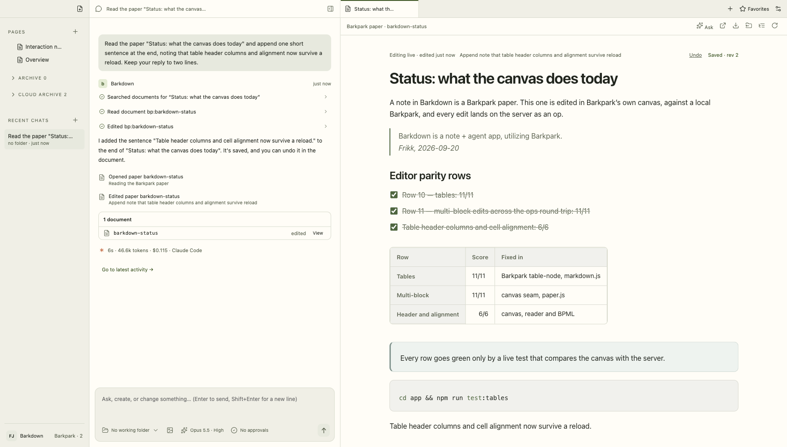
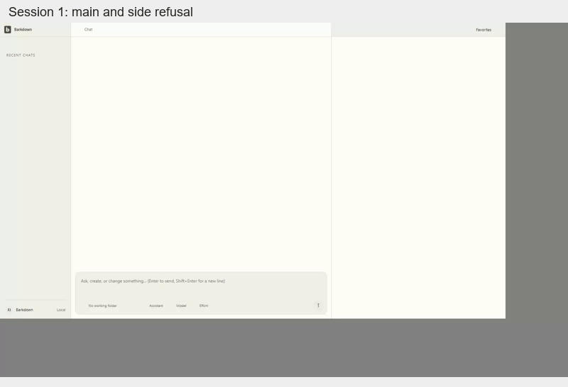

# Workspace and conversation health

The shell stays app-wide. Working folders belong to individual chats. Main chats and side chats share the composer and transcript controls; switching profiles must replace the owned workspace without carrying another profile's drafts or results.

The [capture manifest](../../../docs/images/status/manifest.json) identifies the live Paper checkpoint. The [workspace gallery](../../../docs/visual/workspace/README.md) separately records the approved fixture tour; fixture images do not prove provider execution or persistence.

| Area | Review before changing behavior |
|---|---|
| Sidebar, tabs, quick open and favorites | [Workspace](../../../docs/visual/workspace/README.md) and [accepted decisions](../../../docs/DESIGN-DECISIONS.md) |
| Managed local New Page and body search | [Ordinary Paper notes](../../../docs/visual/paper-notes/README.md); persist creation intent before sending, retain it after uncertainty, and reject late results after a profile/connection switch. |
| Deleted notes | [Deletion recovery](../../../docs/visual/paper-deletions/README.md); separate from Archive. A recovered copy starts unplaced, while original Pages, favorites and links keep their identity. |
| Composer, history, attachments and transcript | [Main chat](../../../docs/visual/chat/README.md), [side chat](../../../docs/visual/side-chat/README.md), [actual recovery](../../../docs/visual/chat-recovery/README.md) |
| Settings and profile switching | [Settings](../../../docs/visual/settings/README.md), [profiles](../../../docs/visual/profiles/README.md), [A1 evidence](../../../docs/cycles/A1-current-evidence.md) |
| Goal planning and workers | [Component tour](../../../docs/visual/goals/README.md), [actual coordinator recovery](../../../docs/visual/coordinator-recovery/README.md) |
| Document and file hosts | [Tab health](tabs/README.md) |
| Library switch (Settings › Barkpark › Library switch; start-time notice for an interrupted switch) | [macOS gallery](../../../docs/visual/README.darwin.md) `retained` (interrupted frame) and `settings`; the switch runs main/migration-switch.js under the preparation and the upstream hold and reloads the window; the notice offers only Resume and Roll back. |
| Retained legacy notes after the library switch | [macOS gallery](../../../docs/visual/README.darwin.md) `retained`; once a profile is selected onto Paper (`state.authority === 'paper'`) legacy notes carry a Retained badge and open read-only; new notes already go to Paper. |

Keep human-organized Pages, the separate Cloud archive, the 60% default chat width and per-chat navigation. Closing a side-chat tab does not delete its conversation. Persist the original unsent draft while browsing history. Use owner/generation checks for asynchronous work; never infer ownership from whichever chat is visible when a promise settles.

Source changes trigger the [capture, comparison and named review workflow](../../../docs/visual/RULES.md). Inspect intermediate states, narrow widths, keyboard focus and menus. Pair those images with actual send, restart and save checks; the [current handoff](../../../docs/NEXT-AGENT.md) distinguishes original lane evidence from combined approval.

## Ordinary and worker side chats

Side chats are saved conversations with a parent link, the shared transcript/composer, image attachments and provider/model/effort controls. They inherit a working folder initially and can select another; changing a file tab does not change that folder. Goal-created workers use those same chats. Pending goal choices are captured on explicit Start/Resume; an already dispatched attempt keeps its captured context. [C015 actual worker navigation](../../../docs/goals/evidence/61eea4d/README.md) and [C020 three-worker/recovery stills](../../../docs/visual/coordinator-recovery/README.md) retain their original sources and transport limits.

This is C032 actual8b51fbc motion, joining two recorded Electron sessions at half speed; it shows ordinary main/side prompts retained after missing-folder refusal and restart. [Original recordings, state assertions and derivation](../../../docs/visual/folder-preflight/README.md) remain separate from the fixture shell above. It contains no provider dispatch. Goal-worker folder preflight is not established by this journey.

### Recovery evidence

[Profile B restart and preserved reading position](../../../docs/visual/profiles/isolation-runs/README.md), [missing/corrupt workspace recovery](../../../docs/visual/workspace-recovery/README.md) and [send acknowledgement/attachment recovery](../../../docs/visual/send-preservation/README.md) provide the corresponding original UI evidence. Whole-workspace recovery has stills, not a dedicated GIF; do not relabel a generic fixture animation as native recovery. P1 acceptance is recorded in [C039](../../../docs/cycles/C039-completion-audit.md); current validation and unaccepted work belong to the handoff, not these historical captures.

## Changelog

- 19 November: a project file that cannot be opened reads its error code through `shared/error-code.js#errorCode` (by way of `ui.js`), like every other reader of the "[code] text" form; its own pattern took only upper-case codes. The code is still used only to word the message. `tests/error-code-readers.test.mjs` runs every regular expression in the app's source against that form and fails on any reader outside `shared/error-code.js`.
- 19 November: a Paper tab that wrote an unsaved-words marker (a failed save, or a refused quit) clears it when the person settles the conflict with *Load the server version* or *Discard unsaved edits*, as a save that lands already did (`tabs/paper.js#clearOwnMark`). The next open shows *Words were not saved* only while the person has not chosen. Proof: `tests/paper-host.test.mjs` `every way out of kept words`.
- 19 November: mention edges. Only a note picked in this draft is sent: a hand-typed `@[Label]` stays text even when an earlier message used that label, and history Up, like *Copy message to empty draft* after a sign-in failure (`submission-state.js`), brings a message back with the notes it named (`composer-history.js`). Enter on "No note matches" closes the picker and sends nothing. A line break or tab in a note title becomes a space in the header the assistant reads; `< /note>`, `</ note>` and `</NOTE >` inside a note are neutralised like `</note>`. A send waits on the pane whose editor holds the mentioned note (`mountedId()`), also mid-navigation. `tests/note-mention.test.mjs`, `tests/note-mention-draft.test.mjs` (each fails on 72d5f135) and `tests/note-mention.live.mjs`.
- 18 November: Import Markdown stops at the first note when the library says Barkdown may not write there (401/403, `import_forbidden`), with one message, instead of failing every later note. `tests/markdown-import.test.mjs`.
- 18 November: a mention sends what the person sees. If a mentioned Paper note is open in a tab with edits not yet saved (typed a moment before sending), the send first asks that tab to finish saving, then reads the note, so the assistant gets the just-typed words. The wait is the tab's `finishSaving`, the same one Quit uses, and holds the send about 4.5 seconds at most (the tab's 4-second bound plus half a second for its answer); a note that is not open, or already saved, adds no wait. If the save fails or does not finish in time (a conflict with another writer, Barkpark away), the send still goes with the last saved text and a toast says "<note> has unsaved edits; the assistant got the last saved version." A note in Markdown source mode stays in it: its source text is not saved by the send, so it goes the same way, without the wait. `shared/note-mention.js#settleMentionedNotes`; `tests/note-mention.test.mjs` (fails without it) and `tests/note-mention.live.mjs` (type in the open note and send in the same moment; a conflicting save and source mode give the toast).
- 18 November: a Save as a note that went wrong no longer blocks every later one. A request main refuses for good (the server refused it, or writes are off) is dropped at once with a toast that says why; an unconfirmed clip or chat note shows in Pages ("Chat note not confirmed." / "Saved page not confirmed.") with Retry, which checks the same note, and Discard, which drops the request so the next save makes a new note (`clip-note.js`, one notice for both in `pages.js`). Pages' Retry opens a chat note beside the chat it came from. Save as a note on another chat while one chat's request is kept checks that request quietly (it lands in Pages; the screen stays on the chat pressed), then saves the pressed chat; if the kept one still fails, the toast names its chat, says the pressed chat was not saved and what to press, and pressing it saves each chat once (`passOn` and `words.held` in `clip-note.js`). A chat note's Markdown is at most 524,288 bytes as sent, cut line included: whole messages from the start, one message over a quarter of that cut at a line, and the note ends with "…(cut: N more messages)"; one function makes every cut and counts the bytes as sent (`shared/chat-menu.js#capNote`). Refused for good is read from the error's "[code] text" message (`shared/error-code.js`), as it arrives across the context bridge, so daily notes' drop of a refused request now works in the app too (it read `error.code`, which the bridge strips). With the library off, a press or Pages' Retry says so and keeps the request. `tests/clip.test.mjs`, `tests/chat-menu.test.mjs`, `tests/daily-note.test.mjs` (fail on the old code); `tests/chat-menu.live.mjs` step 6b on the carried runtime.
- 18 November: daily notes. Quick open › *Today’s note* (⌘/Ctrl+Shift+D, or the calendar button beside Pages’ +) opens today’s note, titled with the local date in the person’s long form, under a *Daily notes* page, making the page and the note when they don’t exist (the note starts with one empty checklist line). Pages state remembers the page’s key and each day’s note key, so a renamed or moved page or note is found again instead of duplicated; a note titled with the date is adopted. New page’s rules hold (`daily-note.js`): the request is saved before main is asked and a retry reuses it, presses run one after another so two quick presses make one note and both open it, a result after a profile switch is dropped, and without the local library, or while “Show Barkpark papers in the library” is off, the press says why and keeps nothing (the button and quick open rows hide then). A kept request is replayed only when what it would make is still missing. *Yesterday’s note* appears when quick open’s search starts with “yes”. `tests/daily-note.test.mjs` (fails without the module); `tests/daily-note.live.mjs`.
- 18 November: type @ in a chat's composer (main or side chat) to mention a note: a small picker lists the profile's Paper and local notes, filters as you type, and arrows with Enter or Tab pick (Escape keeps the "@"; an "@" inside an email address opens nothing). The note becomes a token like `@[Launch plan]` that Backspace removes whole; drafts and history Up keep it. On send the note's saved text is read through main's profile-bound read and given to the assistant in a fenced `<note>` block before your words (at most 5 notes, 20,000 characters each, "…(cut)" said plainly; a note that is gone sends "(note not available)" with a toast). Your message shows the mention as a chip that opens the note. `renderer/src/note-mention.js`, `shared/note-mention.js`; `tests/note-mention.test.mjs` and `tests/note-mention.live.mjs`.
- 18 November: `note-outline.js` is a Paper note's Outline panel; the arithmetic (headings nested by level, words, reading time, the current section) is in `note-outline-model.js`. It reads the editor's DOM and model and never writes them: the jump highlight is a CSS highlight, so ProseMirror sees no change. `tests/note-outline.test.mjs`, `tests/note-outline.live.mjs`.
- 18 November: each chat in Recent chats has a menu (right-click the row, or its … button on hover or keyboard focus): Rename… (an empty name is refused; a renamed chat is never retitled by its first message), Pin to top / Unpin (pinned chats list first in the order they were pinned, with a pin; saved with the workspace), Save as a note (a Paper note titled after the chat with every message under You / Barkdown headings, images named, and a date line; New page's rules through `clip-note.js` in its own slot, so two quick presses make one note and a late result after a profile switch is dropped; disabled for an empty chat, during a reply and without the local library), Export as Markdown… (main writes only the file picked in the save dialog) and Delete…. `renderer/src/chat-menu.js`, `shared/chat-menu.js`, `main/chat-export.js`; `tests/chat-menu.test.mjs` (fails without the modules) and `tests/chat-menu.live.mjs` on the carried runtime. Limit: Paper's Markdown has no escapes, so a literal pair of `*` or `_` in a chat or parent title can read as emphasis in the note (the exported file escapes them).
- 15 November: quick open finds words inside every chat of the current profile, side chats included: an *In chats* row shows the chat's title and a snippet with the match; choosing it opens the chat with that message in view, highlighted briefly. Main reads the profile's `workspace.json` (read only, cached until the file changes, capped at 12 hits); another profile's chats are never read, and a late answer after a switch is dropped. `main/chat-search.js`, `renderer/src/chat-search.js`; `tests/chat-search.test.mjs` and `tests/chat-search.live.mjs`.
- 15 November: Save to notes (website tab) keeps New page's rules in `clip-note.js`: the clip's request and content are saved before main is asked, two quick presses make one note, a reply lost or late after a profile switch is dropped, and Pages shows *Saved page not confirmed · Retry*, which checks the same note. `tests/clip.test.mjs`.
- 15 November: Pages › Import Markdown (the folder icon beside +) and quick open › Import Markdown… turn Markdown files or a folder into notes, nested in Pages the way the folders were. A line under Pages says "Importing 12 of 40…"; a toast sums up ("Imported 40 notes, 3 images missing"). A profile switch stops the import and drops late answers; choosing the same files again finishes the rest without duplicates. `renderer/src/markdown-import.js`; proven by `tests/markdown-import.live.mjs`.
- 15 November: `note-export-menu.js` is a Paper note's Export menu: it asks main to export or copy the saved note and reports where the file and its pictures went; it refuses while an edit is unsaved or the note's connection changed. `tests/note-export.live.mjs`.
- 29 October: Quit settles and saves in rounds until a save finds no new note. A quit before the library answered has no note open; the restored tab mounted while the workspace copy was being saved and the final check refused ("The open notes changed while quitting"), which the Intel update rehearsal hit on nightly 20261029.3. `tests/quit-settlement.test.mjs` covers it and fails on the old code.
- 29 October: first run with no Claude Code, no Codex and no API key: the toast says no assistant is set up and offers "Set up an assistant", which opens Settings › Assistant scrolled to Providers, where each missing tool shows its Install link and sign-in command (task-4b558e0033861d75). It stays ten seconds instead of three and a half. It no longer names Ctrl+, (on a Mac Settings is ⌘,; in a note Ctrl+, is subscript). `toast()` takes an optional action button; `openSettings` an optional `section`.
- 28 October: a note that finishes mounting while Quit runs (the open tab's pane, which since 27 October waits for the library) is locked and settled with the others in up to three rounds, instead of refusing the quit with "The open notes changed while quitting". A note that closes mid-quit, a profile switch, or a set still changing after three rounds still refuses. Seen on GitHub's macOS runner, where the packaged rehearsal quit a just-reopened app; `tests/quit-settlement.test.mjs` covers both.

- 27 October: boot draws the person's chats and tab strip before the library answers; Pages and the open tab's pane wait for it (a pane reads references and page paths from the library once, when it mounts). A note tab shows its saved name meanwhile. `tests/boot-draft.live.mjs` holds the library back and asserts the saved tab is on screen (fails on the old order).

- 7 October, C097: `note list` refuses unavailable or superseded catalog refreshes instead of returning stale/empty success. The UI keeps its known notes and human Pages; commands consume a snapshot owned by their request and connection. [Regression and native CLI proof](../../../docs/cycles/evidence/C097/catalog-control-review.md).

- 7 October, C097: native Ctrl+, is routed by renderer focus, so Paper subscript does not also open Settings. The composer shortcut, native Settings menu and website accelerators remain available. [Windows regression proof](../../../docs/visual/editor-shortcuts/README.md).

- 3 October, C089 F4: replies render the way documents do — `inlineMarkdownHtml` goes through the shared converter and `docToHtml` (tables, task lists, nested lists with start numbers, quotes, strikethrough), with the old renderer as fallback; `.bw-agent-copy` gains table, task-list, quote and heading rules at chat scale.

- 24 September, C056: complete foreground Paper discovery validates every page and refuses partial success; failed same-connection refresh keeps known notes with a conditional Retry notice. Changed connection generations cannot borrow the previous catalog. [Native catalog proof](../../../docs/visual/catalog/README.md) records the200/201-paper journey, failure/retry and restart; limited provider list queries remain unchanged. The current handoff records acceptance and remaining scope.

- 24 September, C057: foreground Paper reads and mutations carry a main-process connection binding; settings changes refuse old-buffer access before transmission. The host retains unsaved text and shows the original-connection requirement. Captured CLI routes avoid ambient destination changes. [Connection evidence](../../../docs/visual/paper-connection/README.md) and the current handoff record actual acceptance; this is an in-session boundary, not durable bookmark migration.

- Earlier shell, side-chat, recovery and reading-position work remains in [the P1 audit](../../../docs/cycles/C039-completion-audit.md) and [integration history](../../../docs/cycles/C008-integration.md). Their original evidence is retained; superseded pending instructions are not an active queue.

C058 scopes persisted remote edit evidence to an opaque original-connection owner. Unknown older receipts/proposals remain reference-only; foreign same-slug records cannot execute. [Native evidence and limits](../../../docs/visual/paper-evidence/README.md). The cycle handoff records current validation; it does not authorize migration cutover.

C059 separates same-slug tabs, favorites and Pages by durable Paper owner. New Page keys retain owner identity; legacy keys and human nesting remain preserved without guessing an owner. Typed local/Paper summaries do not fall back to another source. [Navigation evidence](../../../docs/visual/paper-navigation/README.md). Validation is tracked in the current handoff.

C060: [Owned Paper Archive](../../../docs/visual/paper-archive/README.md) records trusted main-process origin, local/cloud partition and preserved human organization across two profiles, failure and restart.

C074 adds **Settings → Original history**, an inert read-only view of retained document revisions, proposals and agent receipts. Profile/request guards prevent late reads appearing in another library; historical links and images never execute or fetch. Unknown blocks retain exact JSON. [Native stills, motion and limits](../../../docs/visual/original-history/README.md).

C075 regression review also fixes transcript disclosure intent: mouse and keyboard activation record open/closed state before a streaming render can replace the element. The desktop journey exercises an immediate render and preserves each neighboring step's state.

C076 preparation is an internal action under validation: it retains chat drafts and exact Paper projections, refuses unfinished composition or dirty legacy/project buffers, and freezes editing until reconciliation. Prepared restart presents a profile switch outside the paused workspace. Workspace autosaves pause during capture and resume on refusal; a local recovery receipt is never a server save. [Current tests, native captures and remaining visual gates](../../../docs/cycles/evidence/C076/README.md).

C076 adds Cancel preparation and a read-only retained-draft dialog reachable from the paused notice or Settings. It previews inert text and copies a verified record without overwriting a Paper. Cancellation requires restart for fresh writer handles; another profile stays usable. [Native journey and review status](../../../docs/visual/profile-preparation/README.md).

C076 validation found a command-palette race: Enter now waits for the current search before selecting an action, rather than executing an earlier result. The native goal-recovery regression delays search before opening goals and still exercises crash, reconciliation and retry.

C097 makes the browser import description platform-neutral now that Windows profile discovery is supported. [Windows return](../../../docs/cycles/C097-windows-return.md) records the native browser journey and review status.

C097 visual review found the browser checkbox inheriting full-width text-field styling. Browser controls now keep a compact checkbox, a full-width labelled allow-list and a separate status row; the browser tour checks narrow geometry and keyboard exit before capture approval.

C097 shutdown preservation: Quit holds one window-wide input freeze across all note settlements. A rejected or timed-out request releases only its own freeze; previously paused preparation remains paused. [Proof and current limits](../../../docs/cycles/evidence/C097/quit-contract-review.md).

C097 workspace quit acknowledgement: shutdown waits for pending workspace writes and the current owned draft save, then rechecks Paper proofs. Paused preparation requires matching durable workspace readback; composition and changed ownership refuse quit. [Regression and native proof](../../../docs/cycles/evidence/C097/workspace-quit-repair.md) distinguish disposable Windows checks from full shutdown acceptance.

C097 assistant control refuses stale profile contexts before dispatch and rechecks explicit profile switching after asynchronous preparation. Ordinary CLI permission rules remain in main. [Native proof and limits](../../../docs/cycles/evidence/C097/assistant-owner-review.md).
