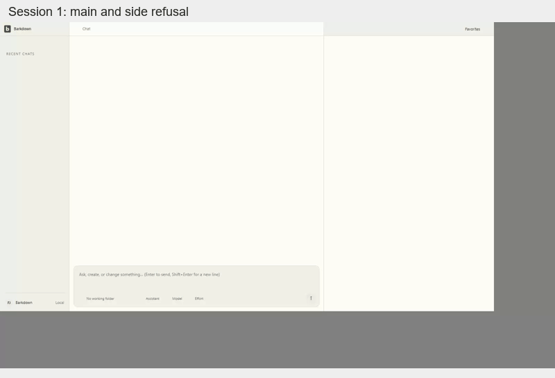

# Workspace and conversation health

The shell stays app-wide. Working folders belong to individual chats. Main chats and side chats share the composer and transcript controls; switching profiles must replace the owned workspace without carrying another profile's drafts or results.

This retained fixture illustrates the shell at its recorded source. Use the [workspace gallery](../../../docs/visual/workspace/README.md) for the currently approved tour and its changelog. A fixture image does not prove provider execution or persistence.

| Area | Review before changing behavior |
|---|---|
| Sidebar, tabs, quick open and favorites | [Workspace](../../../docs/visual/workspace/README.md) and [accepted decisions](../../../docs/DESIGN-DECISIONS.md) |
| Composer, history, attachments and transcript | [Main chat](../../../docs/visual/chat/README.md), [side chat](../../../docs/visual/side-chat/README.md), [actual recovery](../../../docs/visual/chat-recovery/README.md) |
| Settings and profile switching | [Settings](../../../docs/visual/settings/README.md), [profiles](../../../docs/visual/profiles/README.md), [A1 evidence](../../../docs/cycles/A1-current-evidence.md) |
| Goal planning and workers | [Component tour](../../../docs/visual/goals/README.md), [actual coordinator recovery](../../../docs/visual/coordinator-recovery/README.md) |
| Document and file hosts | [Tab health](tabs/README.md) |

Keep human-organized Pages, the separate Cloud archive, the 60% default chat width and per-chat navigation. Closing a side-chat tab does not delete its conversation. Persist the original unsent draft while browsing history. Use owner/generation checks for asynchronous work; never infer ownership from whichever chat is visible when a promise settles.

Source changes trigger the [capture, comparison and named review workflow](../../../docs/visual/RULES.md). Inspect intermediate states, narrow widths, keyboard focus and menus. Pair those images with actual send, restart and save checks; the [current handoff](../../../docs/NEXT-AGENT.md) distinguishes original lane evidence from combined approval.

## Changelog

- 22 September: linked shell, conversation and recovery evidence beside the owning code. Pending native journeys and combined validation remain explicit in the current handoff.

- 22 September, candidate76b07d3: E011 upstream54579 and C016 reading-position source/evidence are imported. [C032 native refusal/restart motion](../../../docs/visual/folder-preflight/README.md) retains original8b51fbc; C033 has controlled context-race checks only. C023 original final gates passed. Fresh combined review remains pending; historical images above are not promoted. See [historical validation order](../../../docs/cycles/C008-integration.md#remaining-combined-validation-order). E012 upstream work remains unconsumed.

## Ordinary and worker side chats

Side chats are saved conversations with a parent link, the shared transcript/composer, image attachments and provider/model/effort controls. They inherit a working folder initially and can select another; changing a file tab does not change that folder. Goal-created workers use those same chats. Pending goal choices are captured on explicit Start/Resume; an already dispatched attempt keeps its captured context. [C015 actual worker navigation](../../../docs/goals/evidence/61eea4d/README.md) and [C020 three-worker/recovery stills](../../../docs/visual/coordinator-recovery/README.md) retain their original sources and transport limits.

This is C032 actual8b51fbc motion, joining two recorded Electron sessions at half speed; it shows ordinary main/side prompts retained after missing-folder refusal and restart. [Original recordings, state assertions and derivation](../../../docs/visual/folder-preflight/README.md) remain separate from the fixture shell above. It contains no provider dispatch. Goal-worker folder preflight is not established by this journey.

### Health update — 22 September, audited3ce6b21

[Profile B restart and preserved reading position](../../../docs/visual/profiles/isolation-runs/README.md), [missing/corrupt workspace recovery](../../../docs/visual/workspace-recovery/README.md) and [send acknowledgement/attachment recovery](../../../docs/visual/send-preservation/README.md) provide the corresponding original UI evidence. Whole-workspace recovery has stills, not a dedicated GIF; do not relabel a generic fixture animation as native recovery. Full desktop52348 passed at5e8433e; subsequent capture-tool changes and final combined dedicated/visual/live/root gates retain their separate pending status. No global approval is changed here.

- 24 September, C056: complete foreground Paper discovery validates every page and refuses partial success; failed same-connection refresh keeps known notes with a conditional Retry notice. Changed connection generations cannot borrow the previous catalog. [Native catalog proof](../../../docs/visual/catalog/README.md) records the200/201-paper journey, failure/retry and restart; limited provider list queries remain unchanged. The current handoff records acceptance and remaining scope.

- 24 September, C057: foreground Paper reads and mutations carry a main-process connection binding; settings changes refuse old-buffer access before transmission. The host retains unsaved text and shows the original-connection requirement. Captured CLI routes avoid ambient destination changes. [Connection evidence](../../../docs/visual/paper-connection/README.md) and the current handoff record actual acceptance; this is an in-session boundary, not durable bookmark migration.
