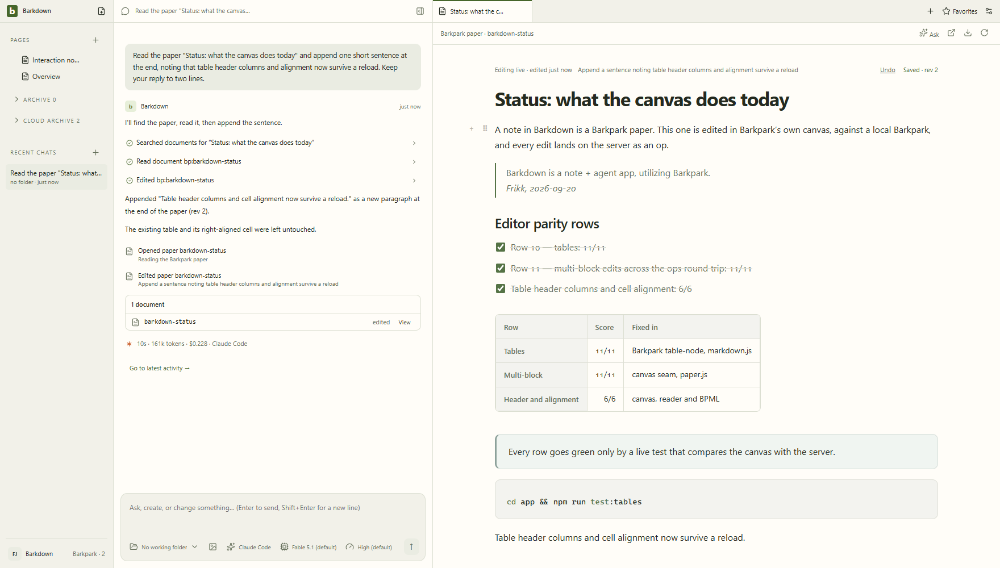

# Workspace and conversation health

The shell stays app-wide. Working folders belong to individual chats. Main chats and side chats share the composer and transcript controls; switching profiles must replace the owned workspace without carrying another profile's drafts or results.

The [capture manifest](../../../docs/images/status/manifest.json) identifies the live Paper checkpoint. The [workspace gallery](../../../docs/visual/workspace/README.md) separately records the approved fixture tour; fixture images do not prove provider execution or persistence.

| Area | Review before changing behavior |
|---|---|
| Sidebar, tabs, quick open and favorites | [Workspace](../../../docs/visual/workspace/README.md) and [accepted decisions](../../../docs/DESIGN-DECISIONS.md) |
| Managed local New Page and body search | [Ordinary Paper notes](../../../docs/visual/paper-notes/README.md); persist creation intent before sending, retain it after uncertainty, and reject late results after a profile/connection switch. |
| Deleted notes | [Deletion recovery](../../../docs/visual/paper-deletions/README.md); separate from Archive. A recovered copy starts unplaced, while original Pages, favorites and links keep their identity. |
| Composer, history, attachments and transcript | [Main chat](../../../docs/visual/chat/README.md), [side chat](../../../docs/visual/side-chat/README.md), [actual recovery](../../../docs/visual/chat-recovery/README.md) |
| Settings and profile switching | [Settings](../../../docs/visual/settings/README.md), [profiles](../../../docs/visual/profiles/README.md), [A1 evidence](../../../docs/cycles/A1-current-evidence.md) |
| Goal planning and workers | [Component tour](../../../docs/visual/goals/README.md), [actual coordinator recovery](../../../docs/visual/coordinator-recovery/README.md) |
| Document and file hosts | [Tab health](tabs/README.md) |

Keep human-organized Pages, the separate Cloud archive, the 60% default chat width and per-chat navigation. Closing a side-chat tab does not delete its conversation. Persist the original unsent draft while browsing history. Use owner/generation checks for asynchronous work; never infer ownership from whichever chat is visible when a promise settles.

Source changes trigger the [capture, comparison and named review workflow](../../../docs/visual/RULES.md). Inspect intermediate states, narrow widths, keyboard focus and menus. Pair those images with actual send, restart and save checks; the [current handoff](../../../docs/NEXT-AGENT.md) distinguishes original lane evidence from combined approval.

## Ordinary and worker side chats

Side chats are saved conversations with a parent link, the shared transcript/composer, image attachments and provider/model/effort controls. They inherit a working folder initially and can select another; changing a file tab does not change that folder. Goal-created workers use those same chats. Pending goal choices are captured on explicit Start/Resume; an already dispatched attempt keeps its captured context. [C015 actual worker navigation](../../../docs/goals/evidence/61eea4d/README.md) and [C020 three-worker/recovery stills](../../../docs/visual/coordinator-recovery/README.md) retain their original sources and transport limits.

This is C032 actual8b51fbc motion, joining two recorded Electron sessions at half speed; it shows ordinary main/side prompts retained after missing-folder refusal and restart. [Original recordings, state assertions and derivation](../../../docs/visual/folder-preflight/README.md) remain separate from the fixture shell above. It contains no provider dispatch. Goal-worker folder preflight is not established by this journey.

### Recovery evidence

[Profile B restart and preserved reading position](../../../docs/visual/profiles/isolation-runs/README.md), [missing/corrupt workspace recovery](../../../docs/visual/workspace-recovery/README.md) and [send acknowledgement/attachment recovery](../../../docs/visual/send-preservation/README.md) provide the corresponding original UI evidence. Whole-workspace recovery has stills, not a dedicated GIF; do not relabel a generic fixture animation as native recovery. P1 acceptance is recorded in [C039](../../../docs/cycles/C039-completion-audit.md); current validation and unaccepted work belong to the handoff, not these historical captures.

## Changelog

- 24 September, C056: complete foreground Paper discovery validates every page and refuses partial success; failed same-connection refresh keeps known notes with a conditional Retry notice. Changed connection generations cannot borrow the previous catalog. [Native catalog proof](../../../docs/visual/catalog/README.md) records the200/201-paper journey, failure/retry and restart; limited provider list queries remain unchanged. The current handoff records acceptance and remaining scope.

- 24 September, C057: foreground Paper reads and mutations carry a main-process connection binding; settings changes refuse old-buffer access before transmission. The host retains unsaved text and shows the original-connection requirement. Captured CLI routes avoid ambient destination changes. [Connection evidence](../../../docs/visual/paper-connection/README.md) and the current handoff record actual acceptance; this is an in-session boundary, not durable bookmark migration.

- Earlier shell, side-chat, recovery and reading-position work remains in [the P1 audit](../../../docs/cycles/C039-completion-audit.md) and [integration history](../../../docs/cycles/C008-integration.md). Their original evidence is retained; superseded pending instructions are not an active queue.

C058 scopes persisted remote edit evidence to an opaque original-connection owner. Unknown older receipts/proposals remain reference-only; foreign same-slug records cannot execute. [Native evidence and limits](../../../docs/visual/paper-evidence/README.md). The cycle handoff records current validation; it does not authorize migration cutover.

C059 separates same-slug tabs, favorites and Pages by durable Paper owner. New Page keys retain owner identity; legacy keys and human nesting remain preserved without guessing an owner. Typed local/Paper summaries do not fall back to another source. [Navigation evidence](../../../docs/visual/paper-navigation/README.md). Validation is tracked in the current handoff.

C060: [Owned Paper Archive](../../../docs/visual/paper-archive/README.md) records trusted main-process origin, local/cloud partition and preserved human organization across two profiles, failure and restart.

C074 adds **Settings → Original history**, an inert read-only view of retained document revisions, proposals and agent receipts. Profile/request guards prevent late reads appearing in another library; historical links and images never execute or fetch. Unknown blocks retain exact JSON. [Native stills, motion and limits](../../../docs/visual/original-history/README.md).

C075 regression review also fixes transcript disclosure intent: mouse and keyboard activation record open/closed state before a streaming render can replace the element. The desktop journey exercises an immediate render and preserves each neighboring step's state.

C076 preparation is an internal action under validation: it retains chat drafts and exact Paper projections, refuses unfinished composition or dirty legacy/project buffers, and freezes editing until reconciliation. Prepared restart presents a profile switch outside the paused workspace. Workspace autosaves pause during capture and resume on refusal; a local recovery receipt is never a server save. [Current tests, native captures and remaining visual gates](../../../docs/cycles/evidence/C076/README.md).

C076 adds Cancel preparation and a read-only retained-draft dialog reachable from the paused notice or Settings. It previews inert text and copies a verified record without overwriting a Paper. Cancellation requires restart for fresh writer handles; another profile stays usable. [Native journey and review status](../../../docs/visual/profile-preparation/README.md).
