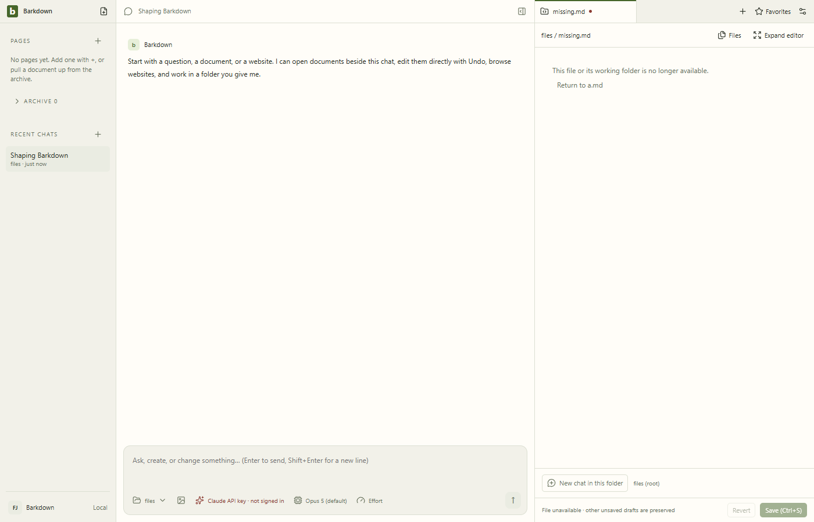

# Work-tab health

Each tab displays an exact destination in its owning chat and profile. File navigation does not change the agent's folder. Async loading, saving and editor presentation must preserve newer human input.

Original C024 Electron evidence: an unavailable destination has no write authority, while **Return to a.md** restores the retained draft. The [file gallery](../../../../docs/visual/project-file-authority/README.md) includes narrow layout, motion, exact source and behavior assertions.

| Host | Evidence and boundary |
|---|---|
| Project files | [File authority](../../../../docs/visual/project-file-authority/README.md), [profile-switch buffer guard](../../../../docs/visual/project-buffers/README.md). Unsaved buffers remain session-only. |
| Real Paper | [Save recovery](../../../../docs/visual/paper-save/README.md), [human takeover](../../../../docs/visual/rich-takeover/README.md), [HTML table paste](../../../../docs/visual/html-table-paste/README.md). Editor behavior belongs upstream; do not replace it with a simulated editor. |
| Local documents | [Legacy editor tour](../../../../docs/visual/documents/README.md). Retain originals until the complete P2 migration gate passes. |
| Terminal | [Owned-process evidence](../../../../docs/visual/terminal-ownership/README.md). Closing UI alone does not prove descendant shutdown. |
| Side chats | [Full conversation controls](../../../../docs/visual/side-chat/README.md). Saved conversation identity and parent links survive tab closure. |

For Paper changes, test acknowledged revisions, native Undo/Redo, human takeover and actual reload. For file changes, test failed opens, late reads, a save resolving after newer typing, and declined conflicts. Preserve failed evidence. Follow the [visual rules](../../../../docs/visual/RULES.md), and use the [current handoff](../../../../docs/NEXT-AGENT.md) for current gate status.

## Changelog

- 4 October, C090: the Ghostty engine and its Settings option are removed (owner decision, D-one-terminal-engine); xterm.js is the terminal's only emulator. Settings › Shortcuts lists the terminal's real keys.

- 3 October, C090: the terminal tab is a real terminal. Keystrokes go to a pty, bytes come back to xterm.js (fit, find with ⌘F, links, copy on select, the app's theme live); Ghostty's core is an engine chosen in Settings › General and falls back to xterm.js. The assistant's commands mirror as before; Start/Restart, Clear and the verified stop are unchanged. Off macOS, Ctrl+V pastes and Ctrl+C copies a selection, as in Windows Terminal. The assistant's commands show in an "Assistant ran" strip under the terminal instead of inside the shell's screen; the light theme's text is readable. The per-tab command draft is gone. [C090](../../../../docs/cycles/C090-real-terminal.md).

- 2 October, C089 (C): a pause card (warning colour) asks the person before a sensitive agent action; Settings › Browser gains the browsing policy (pauses mode, logged-out tabs, the host list); an agent tab is marked on its partition name so main can give it the private partition.

- 2 October, C089 (B): a tab the assistant opens is underlined in the accent and named in its title; the strip keeps main's view of every chat's web tabs current, and an agent's request opens or focuses a tab in its chat.

- 2 October, C089: the website tab is a browser a person lives in. Popups are allowed and become child windows in the same partition (a sign-in returns to its opener); a link that wants a new tab opens a Barkdown tab beside; the address bar suggests places imported from Chrome (Settings › Browser); a site's permission request is a card the person answers once per site. [Tour](../../../../docs/cycles/evidence/C089/live/2026-10-02T14-46-15-443Z-browser/result.json).

- 24 September, C071: owned local drafts have revision-checked Delete and a retained unavailable original tab. [Deleted notes](../../../../docs/visual/paper-deletions/README.md) recovers a separate copy after restart, without rewiring original references or overwriting later edits. Dirty panes refuse deletion; unconfirmed requests remain explicit.

- 24 September, C067: [ordinary Paper notes](../../../../docs/visual/paper-notes/README.md) retain their exact draft identity. The empty body stays visible when the upstream stylesheet loads; Enter at the locked title boundary selects the existing body without copying the title lock. Native development proof passes; final journey acceptance is recorded in the linked gallery.

- 24 September, C053: ancestor favorites navigate the mounted editor through its existing unsaved-work guard. Tab reuse now includes local/Barkpark source identity. [Native Pages/favorites/side-chat rehearsal](../../../../docs/visual/migration/README.md#human-organization-preview--c053) proves the corrected destination and restart; original source stays authoritative.

- 23 September, C046: [migrated Paper evidence](../../../../docs/visual/migration/README.md) proves nine native edit/save/Undo cases and restart. Long titles now wrap in narrow panes without changing title-save ownership. C048 subsequently adds inline-break and recursive-list support; the migration contract owns current eligibility. This is not migration activation.

- 23 September, C037: [Paper visual polish](../../../../docs/cycles/C037-paper-polish.md) repairs inherited heading spacing and double-rendered code, with smaller headings, readable tasks, compact tables and muted callouts. [Light capture](../../../../docs/images/status/paper-light.1c1f1f10.png), [dark capture](../../../../docs/images/status/paper-dark.3f197809.png), [editing GIF](../../../../docs/images/status/editing.44c0c473.gif). Real save/Undo/retry/discard and narrow layout pass separately in the linked cycle.

- 22 September: imported C024 file-authority recovery with its original reviewed stills and motion. At that earlier checkpoint, C016 reading-position and newer clipboard/history work still awaited integration; the subsequent entry below supersedes that status.

- 22 September, candidate76b07d3: E011 upstream54579 and C016 reading-position source/evidence are imported. [C032 native refusal/restart motion](../../../../docs/visual/folder-preflight/README.md) retains original8b51fbc; C033 has controlled context-race checks only. C023 original final gates passed. That candidate preceded later accepted P1 integration; its [historical validation order](../../../../docs/cycles/C008-integration.md#remaining-combined-validation-order) is retained as evidence, not an active queue. The current handoff owns remaining upstream gates.

### Health update — 22 September, audited3ce6b21

- Side-chat and goal-worker tabs display full saved conversations, not disposable subpanels. [C015 worker views](../../../../docs/goals/evidence/61eea4d/README.md), [C020 recovery stills](../../../../docs/visual/coordinator-recovery/README.md) and [C032 main/side refusal/restart GIF](../../../../docs/visual/folder-preflight/README.md) link exact original evidence; their distinct provider/transport scopes remain in those galleries.
- [C016 actual profile-isolation GIF](../../../../docs/visual/profiles/isolation-runs/README.md) covers same-slug ownership, B’s reading position and A-only Undo at34ef068. [C012 recovery stills](../../../../docs/visual/workspace-recovery/README.md) cover unavailable persisted workspace, while C024 above covers individual unavailable project files; neither implies automatic repair.
- [C035 packaged Electron38 gallery](../../../../docs/visual/packaging38/README.md) now proves terminal profile switching, forced application death and restart without replay at89a0fd2, with all four Job receipts stopped. Original videos are available through its motion map; there is no packaged-install GIF claim or clean-machine/bundled-Barkpark claim.
- Full desktop52348 passed at5e8433e before later C036 capture-tool changes. This is historical validation; the current handoff and validation ledger own subsequent accepted gates and remaining work. These links do not promote original screenshots to newer-source approval.

### C038 — Callout refinement

Real Paper callouts use softly tinted cards, restrained tonal borders and a separate editable title line. All seven tones and native folding remain intact. [Cycle and evidence](../../../../docs/cycles/C038-callout-polish.md) records light/dark/narrow review and real-server editing verification.

### C058 — Bound edit evidence and tab titles

Remote receipts and retained proposals belong to their original connection; unknown older records remain reference-only. Paper tab title attempts use the mounted editor owner and retain failed text without relabelling favorites. The current Paper API has no guarded title operation: title changes explicitly refuse before writing, because generic document patch only creates a draft twin. [Native evidence](../../../../docs/visual/paper-evidence/README.md) and the [current handoff](../../../../docs/NEXT-AGENT.md) record validation and limits.

C059 sends the saved owner on every Paper read. A refused saved reference keeps its label and explains how to restore the original connection; it cannot silently become the current library's same-slug Paper. [Navigation evidence](../../../../docs/visual/paper-navigation/README.md). Validation is tracked in the current handoff.

C076 adds internal `retainRecovery()` and `freezeRecovery()` controller operations using the live Paper projection and raw title. They flush settled rich node controls, preserve raw Markdown source mode, and refuse active composition or failed serialization. A receipt checks the current input/revision/projection after persistence without clearing dirty state or displaying Saved. A held freeze makes the pane inert, prevents close/refresh and checks for late programmatic changes; only its owner can release it. This is not yet automatic shutdown recovery or a preparation UI; [C076](../../../../docs/cycles/C076-profile-preparation.md) owns source-specific native evidence and pending integration.

C097 quit settlement distinguishes a preparation lock from unsaved edits. An already-saved frozen Paper needs no redundant draft write through closed admission; preparation still blocks navigation/close, and pending content still reports failed retention. [Before/after and native evidence](../../../../docs/cycles/evidence/C097/quit-freeze-review.md) records the bounded proof and remaining dirty-buffer limits.
