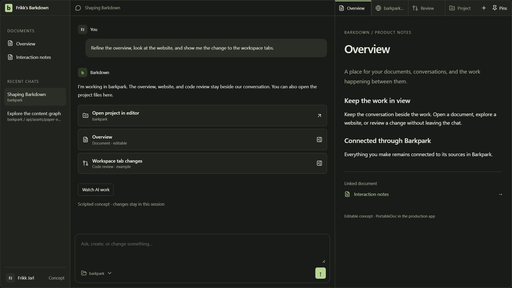
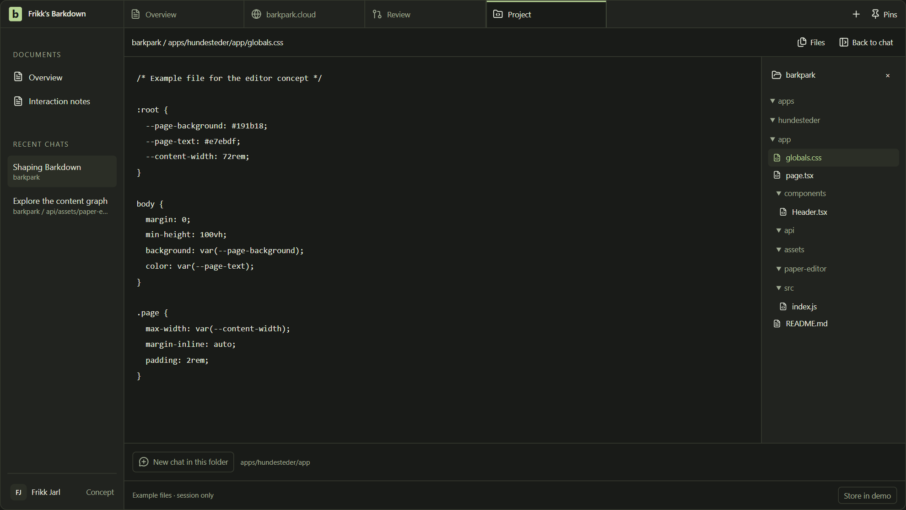
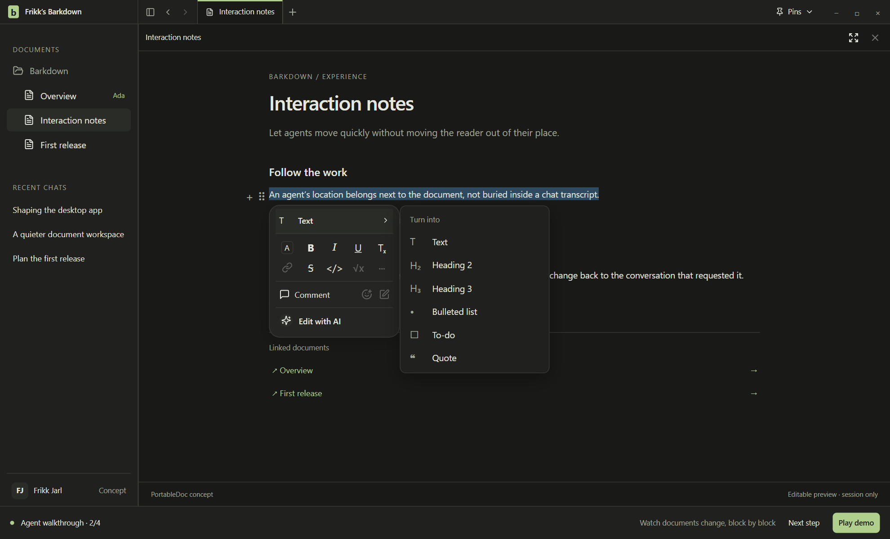
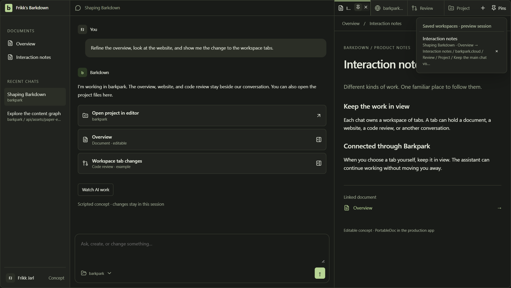
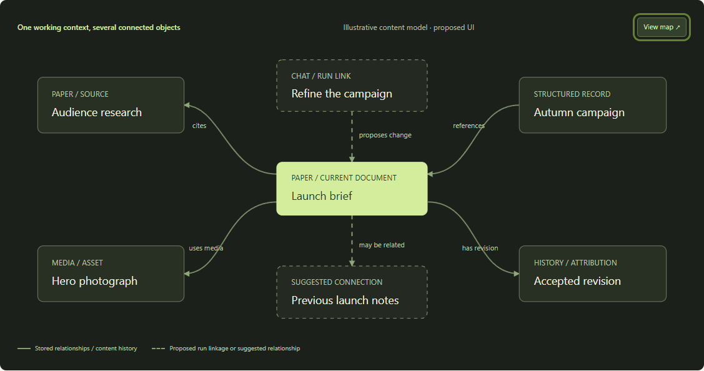

<!-- Generated from prd.source.html by npm run build. Edit the source, not this file. -->

Barkpark desktop · Product requirements

# A place to think. A place to _make it real._

Barkdown brings conversation and a Notion-like editor into one workspace, with Barkpark’s content, search, media, and relationships underneath.

**01 / An app-wide workspace with context for each agent** — Working GUI concept · scripted agent actions · session-only edits

## Turn a conversation into something you can keep working on.

People should be able to ask, find, write, connect, and revise without carrying content between separate chat and document tools. Barkdown keeps the discussion, its sources, and the resulting work within reach.

### The problem

Useful work gets scattered across chat transcripts, notes, media folders, and content systems. The reasoning disappears from the document; the document disappears into the chat. Copying answers between them also loses references, structure, and a clear history of changes.

### The promise

Start with a conversation or a document. Open related material to the right. Let an agent work in the same structured content you edit. Inspect the changes, follow the sources, and return to the exact working context later.

Primary · individual creator

### Think, draft, refine.

Turn research and rough ideas into connected documents, with direct editing always available.

Primary · content team

### Work from shared content.

Reuse approved text, media, and references while respecting the permissions of the workspace.

First pilot · Barkpark users

### Use what already exists.

Open real Papers and linked records instead of rebuilding a separate library inside the app.

### Principles that guide the product

01 / Context

### Stay beside the work.

Keep chat visible when space allows. References open beside their source. In chat mode, work tabs keep documents, websites, reviews, and side conversations available.

02 / Control

### Editing stays direct.

Typing, selecting, formatting, and undoing should feel natural. AI is an available action within that experience.

03 / Structure

### Keep content connected.

A document retains its identity, media, references, permissions, and revisions wherever it is opened.

**First-release outcome:** a user finds a real Barkpark document, opens it beside a chat, makes a manual edit, reviews an agent edit, follows a related document, and returns to the same path after restarting Barkdown.

## One quiet shell. As much context as you need.

The design combines the familiarity of conversational work with the precision of a document editor. The following interaction decisions reflect the latest direction from this design session.

**App-wide navigation, agent-specific folders:** Barkdown itself does not open inside a project folder. Documents and recent chats remain available across the app. An agent can have a working project and folder within its conversation; its project editor opens as a work tab when needed.

-   **Workspace**: Documents occupy the upper left sidebar; recent chats from across the app sit below. Drag the sidebar’s right edge to resize it; its width persists across restarts. The edge also supports arrow keys and double-click to reset. There is no active-folder selector at the top of the sidebar. The main conversation stays in place while the right-hand workspace changes. No dedicated Agents section.
-   **Work tabs**: Project files, documents, websites, code reviews, and new side chats share a compact tab strip above the right-hand workspace. The + action opens a type picker; every tab has a clear icon, title, and close action.
-   **Chat first**: Opening an artifact from chat creates or focuses the corresponding work tab to the right. By default, give the main conversation 60% of the working width after the sidebar, with 40% for work tabs. Keep this split adjustable. On a narrow window, show the focused work and keep an explicit route back to chat.
-   **Document first**: A document opened directly from the sidebar starts a document path without automatically opening chat. Linked documents continue to open progressively to the right.
-   **Paths within tabs**: A document work tab owns its linked-document path and reading positions. Available space determines which internal panes remain visible. Changing work tabs preserves each tab’s internal path.
-   **Remembered context**: Each main chat stores its agent’s optional execution context, ordered work tabs, selected tab, drafts, and reading positions. Switching chats restores that workspace. A side chat has its own transcript and run identity.
-   **Follow the work**: The AI can open or update a relevant work tab and associate it with a chat event. Following can focus that tab. Manual navigation or editing pauses focus changes while background updates remain visible.
-   **Less chrome**: No vertical collapsed rails, visible scrollbar tracks, duplicate chat-title row, or persistent agent-status banner. Top tabs and small activity links carry the navigation.

| Tab type | What lives inside it | AI activity to follow |
| --- | --- | --- |
| Project editor | The selected agent project’s file tree, file buffer, reading position, and save state. Expand into a full editor, then return to the same chat layout. | The exact project, checkout, relative file path, and location being inspected or changed. |
| Document | The shared Paper editor, references, and a local pane path. | Opening sources and proposing edits at an identified block. |
| Website | A browser surface with the current URL, navigation history, loading state, and an external-open fallback. | The page being inspected, with a link from the originating chat event. |
| Code review | A scoped repository diff with an identified base, target, changed files, and review position. | The actual changes produced by a run. Viewing or marking a review does not commit, push, or approve it. |
| New chat | A separate conversation within the current workspace, with its own draft, transcript, and run. | A related question explored without replacing the main conversation. Source context is attached explicitly. |

### The agent knows where it works

Barkdown is an app-wide home for documents and conversations. A saved project identifies an agent’s execution environment and root folder; the agent’s working folder is stored with its chat. Show this context in a compact control beside the composer. Selecting a chat restores that agent context without switching the app into a folder or filtering the sidebar. Document browsing and conversations that do not need local files can remain without a filesystem binding.

### Open the project as an editor

Open project in editor is an action in the conversation and its working-folder menu. It reveals that agent’s project file tree and current file in an expanded work tab. Files remain editable and retain unsaved buffers when switching views. Back to chat restores the main conversation and its 60/40 layout.

### Start a conversation where the work is

New chat in this folder creates a conversation whose agent uses that folder. Side-chat agents inherit the parent’s working context at creation. Opening a different file only changes the view; it never silently moves the chat or a running task.

**Project editor study.** File buffers, folder-bound chats, and return-to-chat navigation work locally in the concept. The displayed files are illustrative fixtures; the prototype does not read or write the repository.

**Scope and identity:** an agent’s local project folder and a Barkpark content project are separate identities. Neither is an app-wide active directory. Link them explicitly when a connection exists. Opening a folder must not grant new dataset access or automatically send every file to a model.

Document pane priority: keep the focused destination visible; retain the main chat when space permits; collapse intermediate documents without vertical rails. The document tab retains the full path.

### A document should feel like a document.

Captured concept

**02 / Editing without leaving the page.** The selection menu stays open while its attached Types submenu is used. The document editing study demonstrates the interaction; the production editor will reuse Barkpark Paper.

### Editing requirements

Use a readable page, subtle block handles, slash commands, headings, lists, checklists, quotes, inline links, and selection formatting. Preserve the selection when opening menus. Menus must reposition at pane edges without detaching or losing focus. Images and references remain structured blocks.

### Agent activity belongs in context

Show an agent’s work through chat events and changes inside the document. During a run, the active destination can open on the right. Manual navigation or typing pauses automatic movement; a compact action on the latest chat event can resume it. No permanent Follow row.

### Pin a place, including the way you got there.

Captured concept

**03 / A pin restores a working context.** Hover or focus a tab to pin or close it. In chat mode, a pin saves the chat, ordered work tabs, focused tab, internal document paths, reading positions, and sidebar state. In document mode, it saves the document path. It does not create a persistent extra sidebar.

**Proposed production details:** preserve pins across restarts; use stable block anchors with scroll offsets as fallback; show unavailable or deleted destinations in place. Closing a work tab removes only that tab and focuses a neighbor. Within a document path, closing an ancestor should truncate its dependent branch and return focus left. Restoring a pin restores navigation, not old document content or executed actions. These edge behaviors still need a usability pass.

## The document is part of a larger body of work.

Barkpark makes the content useful beyond a single page. Barkdown should expose the relationships that help people understand, reuse, and improve it.

REFERENCES

### Make the connection explicit.

Link to the canonical object using its scoped identity. Show typed references, media usage, and backlinks. A backlink explains where this item is used.

DISCOVERY

### Explain why it is related.

Related results should expose their basis, such as shared tags or backlinks. An inferred connection stays a suggestion until someone creates a real reference.

PROVENANCE

### Keep the reason for a change.

Link an accepted operation to the actor, source chat or run, target block, and resulting revision. This cross-system link is work to build.

Barkpark already defines references, permission-filtered backlinks, related results based on tags/backlinks, and revision history. This does not establish a general semantic graph engine. The node map above is a product explanation; first-release navigation uses useful relationship lists and adjacent panes. [Source B3 ↗](#s-graph)

**Composer history.** Up from the first visual line recalls up to 100 sent messages in the current conversation. Down from the last line moves forward, then restores the unfinished draft and caret. Main and side chats have independent histories, and ordinary multiline navigation remains available.

**Direct assistant editing.** New document edits save without a Keep step and offer revision-checked Undo. In the visible editor, mark the target, move an agent caret, and reveal the replacement. This presentation follows an acknowledged save; human input ends it immediately. Honor reduced motion and preserve document conflicts.

**People organize Pages.** Discovered cloud papers remain in a separate, initially collapsed Cloud archive. Opening a paper does not add it to Pages. People choose what to add, nest, reorder, or import as a local copy; library refresh preserves their arrangement.

## Find the right material. Keep its connections intact.

Search should be the shared entry point for people and agents, with a visible scope and useful results across documents and media.

1.  **Ask or search**: Open workspace search, use a document reference picker, or let an agent search within the current workspace, project, and dataset.
2.  **Understand the result**: Show title, type, useful snippet, and source. Include filters and the relevance explanation the backend can actually provide.
3.  **Preview beside the source**: Open a result to the right without replacing the conversation or document that prompted the search.
4.  **Use the original object**: Attach a reference, cite a block, insert a media asset, or ask for a revision grounded in the selected sources.

Example session · proposed

“Find the approved launch notes, bring in the campaign image, and update the brief using the latest research.”

The agent searches the selected scope, opens the source documents, proposes changes to the brief, and inserts a reference to the existing image. Its answer links to what it used.

### Media is content too

An inserted image keeps its asset identity, caption, alt text, and available metadata. Picking existing media should come before uploading a duplicate. Uploads show progress, failure, and retry; unfinished uploads never masquerade as saved blocks. Asset permissions and actual derivative availability determine what can be displayed.

**Use the existing search investment.** Barkpark documents a shared query pipeline, an Indx retriever, federated document/media search, and search intelligence. Barkdown needs a scoped adapter and interface for these capabilities. Ranking gains, semantic retrieval, and new graph reasoning must be validated rather than assumed. [Sources B4–B5 ↗](#s-search)

### Results have boundaries.

Enforce permissions before exposing a title, snippet, count, or preview. Agents receive the same permitted scope as the person using the app. Searches state limits and pagination; “all documents” requires a complete result set.

### Sources remain inspectable.

A citation stores document identity, revision, and a block anchor when available. If the source changes, show that distinction. Treat instructions found inside retrieved content as source material, not new permission to act.

## See the change. Keep control of the document.

Manual edits and agent edits use the same content model. They need different visual states so users always know what is proposed, what has been saved, and what needs their attention.

**1\. Read**Fetch the scoped document and its revision.

**2\. Propose**Stream an attributable block-level change.

**3\. Review**Compare before and after. Keep or discard.

**4\. Commit**Validate the revision and apply the operation.

**5\. Confirm**Show the saved revision and available undo.

### Human editing

Autosave manual edits through the existing Paper operations. Preserve caret, selection, and native text undo. Show pending, saved, or failed state without taking over the page. Keep an unsent draft recoverable when a connection fails; do not promise full offline synchronization.

### Agent editing

For the first release, stream proposed changes into an overlay on the real document. “Keep change” commits the operation; “Discard” removes the proposal. This is the proposed default, to validate in the pilot. Broader session-authorized automatic application can follow after conflict and undo behavior are proven.

### Behavior when work overlaps

| Situation | Required behavior |
| --- | --- |
| A person types in the target block | Pause automatic movement and the local agent preview for that block. Preserve the person’s draft. Require a fresh comparison before applying the agent’s proposal. |
| The saved revision changes | Reject a stale write. Re-read the document, preserve the original proposal, and present any overlap. Apply unrelated changes only when the operation can be validated safely. |
| A connection drops after “Keep” | Reconcile by operation ID and server state. Do not replay a potentially completed write as a new operation. |
| The user stops a run | Stop new work, retain already confirmed changes, and distinguish partial completion from cancellation. Keep unapplied proposals available for review or discard. |
| The user asks to undo | Use the supported content undo receipt when valid; explain expiration or conflict. A history restore creates a new draft revision. Neither action is the same as reverting a Git checkpoint. |

Barkpark already has revision-aware editing, overlap review behavior, and authorized undo receipts with a limited lifetime. The desktop bridge must preserve those guarantees; continuous multi-user CRDT collaboration is not assumed. [Sources B1–B2 ↗](#s-paper)

## Build on the systems that already own the work.

Fork T3 Code for the desktop and agent runtime. Reuse Barkpark Paper for editing. Keep Barkpark authoritative for structured content, relationships, media, permissions, search, and document revisions.

**Proposed system boundary**Architecture recommendation

Barkdown desktop · T3 Code fork

### Navigation, conversations, and the document workspace

Chat-owned workspaces · typed work tabs · document paths · saved pins · shared Paper editor · browser and review hosts

User intent ↓     Confirmed state and activity ↑

Execution authority

### T3 runtime

Provider adapters, runs, orchestration events, and execution environment. Retain its supported runtime boundaries.

Integration to build

### Barkpark adapter

Authentication, capability discovery, scoped identity, search, reads, validated operations, and event reconciliation.

Scoped commands and subscriptions · revision checks · stable operation identity

Content authority · Barkpark

### The durable content system

Schemas and documents · PortableDoc blocks · references and backlinks · media · search · revisions · access controls

### Reuse, adapt, and build

| Area | Existing foundation | Barkdown work |
| --- | --- | --- |
| Desktop & runs | T3 Code’s Electron app, client/runtime separation, and event-backed orchestration. [T1](#s-t3) | Choose an immutable upstream baseline; add the Barkdown navigation and document surfaces. Preserve a clear upstream update process. |
| Rich editing | Barkpark’s Tiptap 2-based Paper web components, canvas, formatting, conversion, and block operations. [B1–B2](#s-paper) | Make the existing editor reusable in the desktop shell. Adapt its mount, events, styling, save acknowledgements, and focus lifecycle; preserve PortableDoc fidelity. |
| Content & graph | Document identity, schemas, references, backlinks, related results, and history. [B3](#s-graph) | Expose connections in panes. Add source-chat/run attribution where needed, with versioned contracts. |
| Search & media | Scoped query pipeline, federated search, media retrieval, and search intelligence. [B4–B5](#s-search) | Build search and pickers; map mixed results; provide source citations and media insertion into Paper. |
| Live updates | Barkpark document updates and revision-aware mutation behavior. [B1](#s-paper) | Reconcile desktop subscriptions, run events, pending proposals, and server acknowledgements without duplicate writes or focus loss. |

**Editor decision:** the existing Barkpark Paper editor is the starting point. The Tiptap Notion-like template is an interaction reference. A purchase, replacement editor, or Tiptap major-version migration is not a prerequisite for this plan. [Reference T3 ↗](#s-tiptap)

### Contracts to settle before broad implementation

Identity & navigation

**Content address:** instance, workspace, project, dataset, document ID, optional block ID and revision.

**Chat workspace:** originating chat ID, optional agent-session context (saved project ID, host/environment, checkout root, and working folder), ordered tab IDs and types, selected tab, and per-tab state. Project-editor tabs hold a project ID, relative file path, buffer identity, and cursor/scroll; document tabs hold scoped pane paths; web tabs hold URL/history; review tabs hold repository and revision identity; chat tabs refer to independent conversations.

**Pin:** a versioned navigation snapshot of the workspace and focused destination, including the agent’s optional project and folder context, editor layout, file locations, document paths, reading anchors, and sidebar state. Re-authorize references on restore; retain unavailable entries. Do not restore content backwards or replay tool actions.

Operations & events

**Change envelope:** operation ID, run and chat IDs, scoped content address, actor, expected revision, structured operation, and lifecycle state. Activity events additionally carry a typed target and stable tab key so the UI can focus or mark the correct work tab. File targets include project, checkout, relative path, and optional line/range; a run retains the project/folder captured when it started.

**Commit receipt:** accepted or rejected result, resulting revision, and any supported undo receipt.

**Reconnect:** use event cursors where supported; otherwise refetch and reconcile authoritative state. Never infer commit success from streamed prose.

The contracts above are proposals, not existing API field names. T3’s orchestration history and Barkpark’s content history remain distinct authorities. A small attribution link connects them; duplicating both into a new universal event store is outside the first release.

### Agent context and execution

For an agent run requiring local files, resolve project identity, execution environment, checkout root, and working folder. Keep the binding on the agent session and capture it per run; never assign a working folder to the app shell. Content-only conversations do not require a local checkout. Load applicable project/folder instructions through the runtime, with their provenance. Pass the working directory to that run rather than changing a shared global directory. A foreground chat switch must not redirect background tools or responses into the newly selected project.

A file target is resolved against its authorized project root. Validate the resolved path, including traversal and symlink boundaries, before reading or writing. Opening a file in the editor does not change the chat’s working directory. A requested context change applies explicitly to future work; already-running work retains its captured binding. If a saved root is missing, show it as unavailable and provide a deliberate folder-rebinding flow.

File buffers and Barkpark Papers keep their existing storage semantics. A code edit needs an acknowledged file write and external-change conflict handling; a Paper needs a revision-checked content operation. A shared project view does not make these two save mechanisms interchangeable.

### Work-tab lifecycle and host boundaries

Use a typed tab descriptor and host adapter for each surface. Repeated activity for the same target should reuse its tab without resetting reading position. When following is paused, mark a background tab as updated; do not take focus. A tab deliberately closed during a run stays closed until the user reopens its activity. Closing a tab does not implicitly cancel its associated run or delete a conversation.

Website content requires an isolated browser host with a visible origin and no access to desktop or Barkpark credentials through a privileged bridge. Choose the host and session model in the baseline audit. Handle unsupported pages, popups, downloads, and external navigation explicitly. Review tabs use runtime repository identity and revision bounds; they do not turn code into a Paper or equate Git history with Barkpark revisions.

### Connection and access

Start with one active Barkpark connection and an explicit workspace, project, and dataset. Discover supported capabilities instead of assuming every plugin is installed. Keep credentials in the platform’s secure storage and scoped server boundary, never in content or model prompts. Provider credentials and Barkpark credentials remain separate. Read-only users can browse and search; editing controls reflect server authorization. Switching accounts must clear protected cached results and re-check saved paths.

T3 documents a server that owns execution and a desktop client that communicates through authenticated RPC. Its event log distinguishes accepted intent from completed work. Barkdown should retain that separation. T3 Code uses the MIT license; preserve the upstream copyright and license notices and review bundled dependencies during the fork audit. [Sources T1–T2 ↗](#s-t3)

## The first release should complete one real working session.

P0 is the connected alpha. P1 expands the product after the core loop is reliable. The prototype proves interaction ideas; none of the rows below should be read as a completed production integration.

24 requirements · all priorities

| ID | Requirement | Observable acceptance | Priority |
| --- | --- | --- | --- |
| BD-01 | Scoped connection | Connect to a real Barkpark instance, choose scope, and show supported capabilities. Read-only access cannot mutate content. | P0 |
| BD-02 | Workspace shell | Documents above recent chats; compact titlebar; no Agents section, extra status row, visible scroll tracks, or collapsed vertical rails. | P0 |
| BD-03 | Workspaces & document paths | A main chat owns independent work tabs. A document tab retains its linked-document path. Switching chats restores tabs and selection; direct document entry opens without chat. | P0 |
| BD-04 | Persistent pins | Save and restore the chat workspace, focused tab, document paths, and reading positions after restart. Two routes to the same document can be distinct pins. Remove a pin from the dropdown. | P0 |
| BD-05 | Paper editing | Create, open, format, link, and save a Paper through the shared editor. Supported blocks round-trip without loss; unsupported content is preserved and clearly handled. | P0 |
| BD-06 | Scoped search | Find documents and media, filter results, open a preview, and insert a reference. User and agent results respect the same access boundary. | P0 |
| BD-07 | Relationships | Follow outgoing references, backlinks, and related items in adjacent panes. Show why an item is related; do not label a ranking suggestion as an explicit reference. | P0 |
| BD-08 | Media reuse | Pick or upload an image, edit its caption and alt text, and persist a media reference. Loading, missing permission, and upload failure have recoverable states. | P0 |
| BD-09 | Agent session | Use one audited provider adapter end to end. Start, stream, stop, and recover a run; source links in chat open the correct document or block. | P0 |
| BD-10 | Visible agent changes | Watch an attributed block proposal appear in place. Keep or discard it. Confirm server state and return from the change to its originating chat. | P0 |
| BD-11 | Conflict & recovery | Reject stale operations, preserve local drafts, and reconcile an uncertain commit without duplication. Stopping a run does not undo confirmed work. | P0 |
| BD-12 | History & undo | Inspect a revision, use a valid undo receipt, and handle expired or conflicting undo. Restore from history only with a clear resulting draft state. | P0 |
| BD-13 | Accessible desktop | Keyboard users can open and close panes, pin paths, search, format, and review changes. Verify readable reflow at 200% zoom and focus recovery after menus close. | P0 |
| BD-14 | Richer structured views | Add schema-driven record forms and collection views without creating a second content store. Choose views from observed pilot needs. | P1 |
| BD-15 | Reviewable graph suggestions | Suggest a connection with evidence and provenance. Accepting it creates an explicit reference; dismissal leaves stored relationships unchanged. | P1 |
| BD-16 | Comments & collaboration | Introduce persistent comments and validated shared editing behavior. Audit the existing capabilities before choosing a collaboration transport. | P1 |
| BD-17 | Broader agent work | Add scoped batch operations, optional session-authorized apply, and additional audited providers with operation-level recovery and reporting. | P1 |
| BD-18 | Broader desktop support | Extend packaging, update verification, keyboard conventions, and native behavior to additional operating systems after the first pilot. | P1 |
| BD-19 | Typed work tabs | Use + to open a project editor, document, website, code review, or new chat. Switching and closing tabs preserves drafts and scroll. Website and review surfaces retain their own identities and access boundaries. | P0 |
| BD-20 | Follow AI activity | A run opens or reuses the relevant tab. Manual tab selection or editing pauses focus changes. Background work receives an update marker; a closed tab is not reopened automatically. Clicking a chat event returns to its target. | P0 |
| BD-21 | Side conversations | A new chat tab has a separate transcript, draft, and run identity. Its agent inherits the parent’s working context at creation. Its additional context attachments are explicit, and the main conversation is preserved. Closing its view does not delete the conversation. | P0 |
| BD-22 | Agent project and folder context | Barkdown has no global working folder. Each agent that uses local files resolves its own saved project, execution environment, checkout, and working folder. Show this context beside the chat composer. Sidebar documents and recent chats remain app-wide. Switching chats or files does not rebind runs; missing roots remain unavailable. | P0 |
| BD-23 | Project editor | From the chat or its working-folder menu, open the agent’s project, navigate its file tree, edit a file, preserve unsaved buffers, and expand the editor. Return to the same chat and split. Report file save failures and external changes; do not discard drafts on tab close. | P0 |
| BD-24 | Folder-based chat creation | Starting a chat from an editor folder assigns that project and location to its agent. Side-chat agents inherit that execution context. File activity opens the exact referenced file and location, even after the user browses elsewhere. | P0 |

**Outside the first release**Full Notion feature parity; a general-purpose graph canvas; autonomous changes across every project; new semantic search infrastructure; full offline multi-device sync; a new content format; or a replacement for Barkpark Studio’s administration. Existing capabilities remain accessible through their current surfaces.

## Build in demonstrable steps.

Each phase ends in a working result and an explicit exit gate. Sequence is proposed; durations and staffing should be estimated after the fork and editor integration spike.

Phase 00

### Choose the baseline and prove the editor fit

Make the two foundations work together before expanding the interface.

#### Deliver

-   Pin the T3 upstream commit, inventory desktop/runtime boundaries, and preserve licensing.
-   Mount the existing Paper canvas in a desktop test route; read and save one real Paper.
-   Audit auth, capabilities, event contracts, editor dependencies, export fidelity, and the browser/review tab hosts. Establish scope and isolation before opening real websites. Audit saved-project identity, checkout/root resolution, per-run working directories, and the file editor host.

Proposed owners: desktop lead + Barkpark/editor lead.

#### Exit gate

A supported document can be edited, saved, and reopened without a lossy conversion. The chosen scope and revision are visible in diagnostics. Record any missing adapter contracts and estimate the next phases.

Phase 01

### Make the workspace durable

Replace simulated navigation and data with the first connected experience.

#### Deliver

-   Connection and scope selection; per-agent project and folder context, app-wide documents and recent chats, typed work tabs, back/forward, and compact layout.
-   Per-chat workspaces, folder-based chat creation, inherited side-chat context, project file editing, internal document paths, persistent pins, and stable reading anchors.
-   Shared Paper editing with acknowledged autosave and recovery of unsent drafts.

Proposed owners: desktop + editor engineering; product design.

#### Exit gate

Complete document-first and chat-first journeys against real content. Open each tab type, edit a project file, create a chat in a subfolder, and verify its execution context. Switch main chats and recover pins, tabs, drafts, and document paths after restarting. Verify revoked access, missing documents, and narrow-window behavior.

Phase 02

### Connect discovery, references, and media

Make the underlying content system useful throughout the workspace.

#### Deliver

-   Scoped document/media search and insertion pickers.
-   Reference traversal, backlinks, related items, and inspectable source citations.
-   Media reuse, upload recovery, captions, and alt text inside Paper.

Proposed owners: Barkpark adapter + search/media engineering.

#### Exit gate

Find a source, open it beside its caller, follow a relationship, insert existing media, and save the result. A restricted account sees no protected title, snippet, asset, or count in tested paths.

Phase 03

### Let a real agent work in the document

Connect one provider to scoped tools, visible proposals, and revision checks.

#### Deliver

-   Agent search/read operations and structured, attributable change proposals.
-   Route run activity to document, website, and review tabs without a permanent status row; pause focus changes on user intent and respect tabs the user closed.
-   Keep/discard, conflict review, stop behavior, reconnect reconciliation, and supported undo.

Proposed owners: agent/runtime + adapter + editor engineering.

#### Exit gate

Run the complete brief-to-revision journey. Interrupt a commit, retry after reconnect, and edit the same block manually. Demonstrate no duplicate write and no lost manual draft in those cases.

Phase 04

### Harden and pilot the desktop alpha

Verify the experience under real documents, interruptions, and daily use.

#### Deliver

-   Packaging and update verification for the first operating system.
-   Keyboard, zoom, long-document, account-switch, and failure-state testing.
-   Instrument the working-session funnel without collecting document bodies by default; run the initial user study.

Proposed owners: release engineering + QA + product/design.

#### Exit gate

All P0 acceptance cases pass; no open data-loss or access-boundary defects. Pilot users can complete the core loop and explain which changes are saved. Broader scope follows observed friction.

**Dependency order:** establish identity and operation contracts in phase 00; make human editing reliable before agent writes; prove scoped discovery before allowing agents to search; complete interruption recovery before expanding automation.

## Measure confidence as well as speed.

These are proposed targets, not measured results. Establish a baseline using a documented device, network, dataset, and representative Papers before committing to performance budgets.

8 of 10

### Complete the core session

Pilot participants find a source, edit manually, review an agent change, and restore a pin without facilitator help. Treat the small sample as directional.

≤ 200 ms

### Warm pane response · p95

Interaction to visible cached pane. Measure cold loading separately and show a useful loading state immediately.

≤ 1 s

### Search results visible · p95

End-to-end result rendering on the agreed pilot network and dataset, excluding deliberate input debounce. Record backend and client time separately.

100%

### Supported-content fidelity

All agreed round-trip fixtures preserve supported PortableDoc blocks, references, and marks. Unsupported nodes must survive without silent flattening.

0

### Lost or duplicated writes

Across required same-block conflict, cancellation, restart, timeout, and reconnect cases. This is a test release gate, not a claim of universal proof.

0

### Access leaks in tested flows

No protected content, snippets, counts, cached titles, or media exposed by tested account and scope combinations.

### Release evidence

1.  **Navigation and persistence**: Exercise chat A → Paper → reference, chat B, then chat A. Open a website, code review, and side chat as well. Verify per-chat restoration, folder inheritance, file and side-chat drafts, closed-tab behavior, and pins after restart. Start a run, switch to a chat whose agent uses another folder, and prove the original run remains bound to its own root and folder while app navigation stays unchanged. Inaccessible destinations must not reroute to another object.
2.  **Editor fidelity and comfort**: Run the existing Paper fixtures and desktop integration cases. Verify IME input, paste, cross-block selection, menu focus, native undo, and long-document caret stability.
3.  **Agent execution and recovery**: Drop the connection before and after acknowledgement. Change the target revision, stop mid-run, expire undo, and replay duplicate events. Compare stored operations and revisions.

1.  **Search, media, and permissions**: Exercise allowed and forbidden records, mixed media results, pagination, missing assets, and failed uploads. Confirm no content crosses an unauthorized scope.
2.  **Accessible desktop behavior**: Verify keyboard-only paths, visible focus, screen-reader names, touch targets, reduced motion, and 200% zoom. Hidden tracks must never make scrollable content unreachable.
3.  **Operational clarity**: Measure load/save/search/run latency, failures, conflicts, and recovery. Default telemetry to IDs, timings, and state transitions; content capture requires a separate explicit policy.

### Risks and the work that reduces them

### The fork becomes expensive to maintain

Keep product-specific navigation and Barkpark integration isolated. Record the upstream baseline and periodically review changes to runtime, providers, and packaging.

### The editor forks into two implementations

Share the Paper implementation and its fixtures. Put desktop differences in a host adapter, and require round-trip checks before changing conversions or node handling.

### Automatic pane movement interrupts reading

Use user interaction as the stop signal. Keep the current reading position and make return-to-work a small action inside chat activity.

### Agent changes race with human changes

Use expected revisions, operation identity, proposal state, and explicit overlap review. Prove the reconnect path before offering automatic apply.

### Search feels stronger than its evidence

Show actual relevance reasons and source boundaries. Establish a query evaluation set from the pilot; separate inferred suggestions from stored relationships.

### Unavailable content breaks saved paths

Re-check access during restoration and preserve an unavailable entry with a clear return action. Do not fetch across scopes or substitute a similarly named document.

## A clear direction. A few deliberate choices ahead.

The navigation and visual direction are established. The following implementation recommendations should be settled in the baseline spike, without reopening those interaction decisions.

Established

### The product and editor foundations

Barkdown’s intended runtime foundation is a T3 Code fork using Barkpark. This handoff contains the product specification and concepts; it does not yet import that runtime. Reuse and improve the existing Paper editor. Barkdown remains app-wide; agents carry their own project and working-folder context within their chats. Chat mode pairs that conversation with browser-like work tabs for a project editor, documents, websites, code reviews, and new chats. Document tabs retain their own linked pane paths. Pins restore the workspace and exact destination from a dropdown.

Choose baseline

### Upstream fork and maintenance

The private delivery repository is FRIKKern/barkdown. T3 reference commit 4749035bda13b4b6260499caedbc0d69a2f60e6f is pinned as evidence; audit desktop, provider, licensing, and toolchain boundaries before selecting the imported runtime baseline.

Recommendation

### Conversation ownership

Keep chat/run orchestration with the T3-derived runtime. Store canonical content in Barkpark and connect the two through attributable references. Decide separately whether searchable chat summaries become Barkpark documents.

Recommendation

### Initial platform and provider

Start the pilot on Windows, based on the current working environment, with one existing provider adapter that passes the integration audit. This is a planning assumption; Mac/Linux support and the first provider are not yet selected commitments.

Validate in pilot

### Agent apply policy

Use visible proposals with inline Keep/Discard for the alpha. Evaluate session-authorized application only after users understand saved state, overlapping edits, and recovery.

Integration gate

### Authentication, storage, and editor packaging

Confirm supported Barkpark authentication and token renewal, secure local persistence, cache retention, and the editor packaging boundary. A desktop wrapper around the shared web component is the starting recommendation, subject to the spike.

The next concrete milestone is a real Barkpark Paper, editable inside the T3-derived desktop shell.

[Review phase 00 ↗](#delivery)

## Grounded in the code. Explicit about the proposal.

The images are fresh captures of the current Barkdown GUI concept. They demonstrate agent-specific project/folder context, expanded file editing, the mixed work-tab workspace, direct document editing menus, and simulated agent activity. Website content, editable project files, and code diffs in the workspace studies are local illustrations, not live browsing or repository reads/writes. They do not show a connected desktop build, production search, or live Barkpark mutations.

Evidence baseline

### Barkpark checkout

Reviewed at commit `88280ee4306baa911a3cfd0c33b04f44ee71d427`. Links below point to that revision. Remote main was observed at 68406495e0e6e4fd391babf970b3089a6f8bcd60 during handoff; changes since the reviewed checkout still need an integration audit.

Document status

### PRD draft · v0.5

Prepared 17 September 2026. Product preferences come from this design session. This private handoff adds portable concept code, checked type proposals, reproducible validation, and a next-agent guide. Milestones, targets, contracts, and unresolved defaults remain implementation proposals.

[B1 · Barkpark Paper architecture and editing guarantees ↗](https://github.com/FRIKKern/barkpark/blob/88280ee4306baa911a3cfd0c33b04f44ee71d427/api/CLAUDE.md)

Shared reader/editor, PortableDoc operations, revision-aware focus, scoped updates, overlap handling, and content undo.

[B2 · Existing Paper editor source ↗](https://github.com/FRIKKern/barkpark/tree/88280ee4306baa911a3cfd0c33b04f44ee71d427/api/assets/paper-editor)

Package manifest; src/index.js; src/canvas/index.js; src/convert.js; src/format-bubble.js. Tiptap-based web components and conversion are present; desktop packaging remains to build.

[B3 · Document graph and history contract ↗](https://github.com/FRIKKern/barkpark/blob/88280ee4306baa911a3cfd0c33b04f44ee71d427/docs/contracts/document-graph-and-history.md)

Backlinks, related results, tags, revision listing, revision lookup, and restore semantics. Read scope and visibility rules before exposing graph results.

[B4 · Search and media architecture ↗](https://github.com/FRIKKern/barkpark/blob/88280ee4306baa911a3cfd0c33b04f44ee71d427/docs/cards/search-media.md)

Shared query pipeline, retriever boundaries, media retrieval, and the distinction between finding content and picking a reference.

[B5 · Search intelligence and delivery status ↗](https://github.com/FRIKKern/barkpark/blob/88280ee4306baa911a3cfd0c33b04f44ee71d427/docs/search/INTELLIGENCE.md)

Scoped search, analytics, evaluation, federated search, and documented Indx delivery. Future ranking changes still require measurement.

[B6 · Barkpark product philosophy ↗](https://github.com/FRIKKern/barkpark/blob/88280ee4306baa911a3cfd0c33b04f44ee71d427/docs/PHILOSOPHY.md)

Owned, structured content, shared foundations, and human and agent surfaces. This PRD applies that direction to the desktop experience.

[T1 · T3 Code architecture ↗](https://github.com/pingdotgg/t3code/blob/4749035bda13b4b6260499caedbc0d69a2f60e6f/docs/internals/overview.md)

Upstream execution model, clients, runtime, event orchestration, and desktop boundary. Reference checked at commit 4749035bda13b4b6260499caedbc0d69a2f60e6f. Audit and select the import baseline before implementation.

[T2 · T3 Code license ↗](https://github.com/pingdotgg/t3code/blob/4749035bda13b4b6260499caedbc0d69a2f60e6f/LICENSE)

MIT, copyright 2026 T3 Tools Inc. Preserve the notice and license in the fork; audit additional dependencies separately.

[T3 · Tiptap Notion-like editor reference ↗](https://tiptap.dev/docs/ui-components/templates/notion-like-editor)

Interaction reference supplied during design. The existing Barkpark editor remains the chosen foundation.

**D1 · Barkdown design session and prototype**

The v0.5 chat workspace supersedes the earlier one-tab-per-pane rule in chat mode. Current user decisions also supersede an app-wide project folder, earlier agent panels, persistent pinned sidebars, vertical collapsed rails, and visible scroll tracks. Workspace and project-editor screenshots come from the app-wide concept transferred into v0.5; the editor image comes from the earlier Paper editing study. Both are local simulations captured on 17 September 2026.

## Continue from the exact code.

The private Barkdown repository contains both working concept sources, generated previews, this product plan, typed state proposals, and repeatable checks. The first implementation milestone is one real Paper mounted, edited, saved, and reopened in an audited T3-derived desktop shell.

### Authoritative source

`concepts/workspace.html` owns the current shell and agent folder behavior. `concepts/editor-study.html` supplies richer editing interactions; its older shell is superseded. `docs/prd.source.html` generates the readable Markdown and HTML plan.

### Run the handoff

Install the locked dependencies with `npm ci`, install Playwright Chromium, then run `npm run verify`. Open the committed preview pages locally or use `npm run preview`. No real provider, filesystem write, search, or Barkpark mutation is connected yet.

-   **Next agent**: [Read the exact continuation brief, code map, first milestone, and limitations.](https://github.com/FRIKKern/barkdown/blob/main/docs/NEXT-AGENT.md)
-   **Decisions**: [Preserve the accepted design, including app-wide navigation and per-agent working folders.](https://github.com/FRIKKern/barkdown/blob/main/docs/DESIGN-DECISIONS.md)
-   **Architecture**: [Separate navigation, execution, file buffers, and canonical Barkpark content.](https://github.com/FRIKKern/barkdown/blob/main/docs/ARCHITECTURE.md)
-   **Acceptance**: [Use the requirement coverage map and production exit scenarios.](https://github.com/FRIKKern/barkdown/blob/main/docs/ACCEPTANCE.md)
