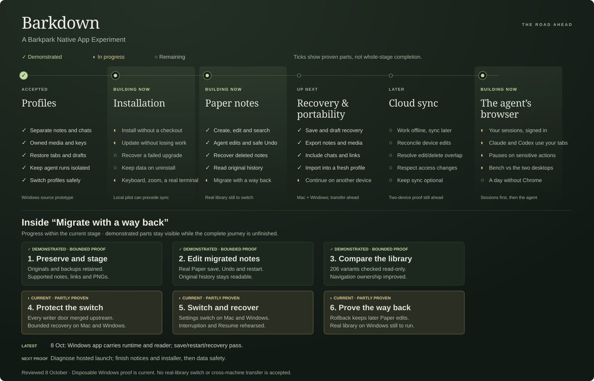

# Roadmap at a glance

<!-- Generated by scripts/generate-roadmap.mjs. Edit its summaries, not this file. -->

**✓ Demonstrated** · **◐ In progress / partial proof** · **○ Remaining**

Checks refer to the bounded journeys linked below. Stage acceptance comes from [the plan](PLAN.md) and [acceptance gates](ACCEPTANCE.md), not a count of ticks. This is the Windows source prototype, not an installable release.

**Latest advance:** Real HTTP permissions and held refusal pass beside18 private caller contracts; unadopted.

**Next observable result:** Prove locked-cache HTTP failure and remaining physical writer boundaries. See the [current handoff](NEXT-AGENT.md) for the delivery gate.

## Inside migration

Since C078, navigation ownership improved in C080, the write controller merged in C082, and C083 put its doors on the note, Paper and media writers in production. No real library has switched. These checkpoints show distinct results, not equal-sized units or a completion percentage.

| Checkpoint | State | What this means |
|---|---|---|
| Preserve and stage | ✓ Demonstrated | Demonstrated on supported fixtures; unsupported content refuses. This is preparation, not a switched library. [Evidence / exit](cycles/C051-backup-restore.md) |
| Edit migrated notes | ✓ Demonstrated | Migrated fixture editing and retained original history are demonstrated. Original history is not identical to native Paper history. [Evidence / exit](cycles/C074-original-history.md) |
| Compare the library | ✓ Demonstrated | C078 compared 206 variants; C080 improved connection-bound navigation and local Archive projection. No ownership switch occurred. [Evidence / exit](cycles/C080-owned-navigation.md) |
| Protect the switch | ◐ In progress | Every audited writer, background job and refused route group passes through the merged admission controller (C083 slices 1–8). On macOS six writers in flight across hold, held and reopen leave every acknowledged write in place and nothing written while held; a restart while held stays blocked until explicit recovery. C097 adds Windows six-writer hold/reopen, killed-transaction rollback and upload/deletion interruption proof. Uncertain writes remain closed across restart. C108 additionally observes cache writes during hold and checkout returning success despite failed rendition deletion; production gaps remain unrepaired. A private candidate passes three bounded admission/partial-failure cases, and a new early-intent candidate passes bounded checks; owner-loss/schema/18caller proofs remain private; scoped HTTP permissions/hold pass; native/full writer reconciliation, policy/adoption remain open. Complete media-effect reconciliation and real-library acceptance remain. [Evidence / exit](cycles/C083-writer-admission.md) |
| Switch and recover | ◐ In progress | The switch runs from Settings › Barkpark in the real app on macOS, is interrupted at every phase and resumes without duplicate Papers, and the switched profile creates, edits, finds, deletes and recovers notes on Paper with agent edits and Undo. C097 repeats bounded switch, rollback and Resume journeys on disposable Windows profiles. A real library and comprehensive writer-effect reconciliation remain. [Evidence / exit](cycles/C083-writer-admission.md) |
| Prove the way back | ◐ In progress | Rollback restores the legacy navigation exactly, keeps Papers and later edits on Paper, names every changed Paper, and lets a person compare, keep or restore each one; its own interruption resumes. C087 retired legacy editing on Mac; originals and rollback evidence remain, and a rolled-back library is read-only until switched again. [Evidence / exit](cycles/C083-writer-admission.md) |

## Profiles · accepted

| State | Journey | Evidence / acceptance |
|---|---|---|
| ✓ Demonstrated | Separate notes and chats | [Demonstrated scope](cycles/C039-completion-audit.md) |
| ✓ Demonstrated | Owned media and keys | [Demonstrated scope](cycles/C039-completion-audit.md) |
| ✓ Demonstrated | Restore tabs and drafts | [Demonstrated scope](cycles/C039-completion-audit.md) |
| ✓ Demonstrated | Keep agent runs isolated | [Demonstrated scope](cycles/C039-completion-audit.md) |
| ✓ Demonstrated | Switch profiles safely | [Demonstrated scope](cycles/C039-completion-audit.md) |

Accepted for the Windows source prototype. Device login is shared by default; profile-owned keys and content remain isolated. This does not establish installation or cross-machine portability.

## Installation · blocked

| State | Journey | Evidence / acceptance |
|---|---|---|
| ◐ In progress | Install without a checkout | [Work and limits](cycles/C098-windows-packaging.md) |
| ◐ In progress | Update without losing work | [Work and limits](RELEASE.md) |
| ○ Remaining | Recover a failed upgrade | [A5 gate](ACCEPTANCE.md#a5--install-and-daily-use) |
| ○ Remaining | Keep data on uninstall | [A5 gate](ACCEPTANCE.md#a5--install-and-daily-use) |
| ◐ In progress | Keyboard, zoom, a real terminal | [Work and limits](cycles/C090-real-terminal.md) |

Groundwork on macOS (C086): a profile runs on a packaged Barkpark release with no checkout and no Elixir on the machine. The Mac application builds with that runtime and its own Postgres inside and starts a profile with nothing else installed; it is signed ad hoc, 420 MB, and remains separate from Windows installation. C098 now builds a pinned Windows release and PostgreSQL bundle; the actual application driver proves loopback, Paper restart and owned crash recovery under system-only PATH. Actual unsigned Windows packaged Electron now proves save/search/restart/forced-host reclaim, carried reader assets and native webview rendering. Earlier launcher and before-start billing failures are superseded by passing hosted Windows/Verify checks on merged PR76; current installer and clean-machine gates remain separate. The corrected static prerequisite audit preserves module names and load stages and confirms three unbundled VC runtime DLLs. Reader builds now disable inherited parent VCS stamping and reproduce exact assets across two disposable Git parents; the currently tested package remains unchanged. The offline runtime audit now binds nineteen reader originals and sixteen locked modules to both reviewed asset variants, retaining all previous notice bytes. The complete carried LiveView client now reproduces from nineteen immutable source files and the published morphdom module using upstream compiler/configuration, with both original notices retained. The offline runtime auditor now binds this client/source/reproduction association to both original texts and refuses changed or unknown inputs before output. The offline auditor also binds the reviewed whole Phoenix/xterm bundles and three original package texts, preserving earlier notices and source-versus-dist limits. The offline auditor also binds all three measured Paper assets, six fonts and both player assets to their selected source/package/dist graph and 51 whole originals; nested highlight.js versions remain distinct. The fixed VC candidate static graph resolves internal table references while retaining external UCRT/API-set/loader requirements. Strict offline registry-version interpretation now retains missing, unreadable and conflicting states; the developer host has a newer runtime, which cannot establish a clean installation. Full native/static import-table comparison now identifies loader and directory-policy references; actual calls and flags remain unproven, with the clean-machine cases explicitly planned. Owned carried-package BEAM/PostgreSQL module snapshots now show system CRT and carried citext/pg_trgm/pgcrypto paths through disposable Paper write/read/restart; this developer-host observation does not establish complete dynamic closure or clean installation. Actual carried Argon2 hash/correct-and-wrong verification and ExPTY keyboard/112x34 geometry now associate with both loaded NIFs; Windows ExPTY kill is a stub and the exit callback is still absent, so lifecycle acceptance remains false. Repeated carried child exits and explicit wrapper stops retain observed BEAM handles/threads; an isolated owned-resource prototype now proves natural/forced exit, wrapper death, blocked-write cancellation and failed-spawn cleanup. A preserving private full-runtime candidate now passes ordinary production boot lifecycle/Argon2 and actual SourceDriver Paper restart/owned recovery; a fresh unsigned package candidate now carries the repair and passes actual Electron/native/Desktop plus fresh inspected visuals; installer and stage acceptance remain open. Sustained CPU-spinning and exhaustive leak freedom are not claimed. A baseline-only Sandbox harness now records developer-host OS/CRT/capability and prepares mappings without guest launch; this host has Sandbox disabled. Local Hyper-V management explicitly denies this session; no guest or clean image is confirmed. The reviewed engineering package checkpoint is published b15064e8; the Windows checkpoint is merged through PR76 with passing hosted checks; a permitted clean-machine environment and installer/prerequisite proof still block release advancement. C099 now follows the owner order into independent P2 data safety. Complete notices, prerequisite deployment and clean installer acceptance remain open. Nightlies are cut from this Mac on a schedule with an updater feed; the install step and clean-machine installation wait for a signing identity; the daily-use checks pass on one Mac, not yet with a person.

## Paper notes · building now

| State | Journey | Evidence / acceptance |
|---|---|---|
| ✓ Demonstrated | Create, edit and search | [Demonstrated scope](cycles/C067-ordinary-paper-notes.md) |
| ✓ Demonstrated | Agent edits and safe Undo | [Demonstrated scope](cycles/C069-agent-paper-notes.md) |
| ✓ Demonstrated | Recover deleted notes | [Demonstrated scope](cycles/C071-paper-deletion-recovery.md) |
| ✓ Demonstrated | Read original history | [Demonstrated scope](cycles/C074-original-history.md) |
| ◐ In progress | Migrate with a way back | [Work and limits](cycles/C083-writer-admission.md) |

Demonstrated ordinary-note journeys are in the merged baseline; their linked cycle records retain original checkpoint limits. Preparation, cancellation and retained-draft recovery are merged in C076. C078 verifies an internal read-only mixed-library comparison, including exact Paper variants, supported links/PNG media and workspace projection. C080 improves connection-bound navigation and local Archive projection. C083 merged the write controller upstream and wired it into every supported writer; on macOS the switch, its rollback, every interruption, reconciliation and life on Paper afterwards are rehearsed against the pinned runtime, from the app’s own screen. Unsupported content and unresolved ownership still refuse. C087 retired the separate editor on Mac; originals remain readable. C097 adds bounded Windows switch, rollback, interruption and Resume proof; C099 now reproduces an actual Windows media API deletion reporting200 while a locked original survives restart; unlock/retry404 cannot remove it. C104 adds prepared-intent SQL. C105 adds an internal server transaction with captured asset documents and database reservations, proven across abrupt interruption before and after commit. The C105 server transaction is merged; the separate source original-blob guard PR23205 is frozen pending independent review and owner integration. C108 now observes actual HTTP cache writes during hold, rowless warm bytes after owner death, and checkout success despite failed rendition deletion. A private Checkout candidate passes held refusal, closing drain and partial-failure retention; private early intent passes18 ordinary/managed caller contracts and bounded interruption/error proof; locked-cache HTTP/full writer coverage and adoption remain open. Physical writer fencing, native settlement and real-library acceptance remain.

## Recovery & portability · up next

| State | Journey | Evidence / acceptance |
|---|---|---|
| ✓ Demonstrated | Save and draft recovery | [Demonstrated scope](cycles/C085-portable-profile.md) |
| ✓ Demonstrated | Export notes and media | [Demonstrated scope](cycles/C085-portable-profile.md) |
| ✓ Demonstrated | Include chats and links | [Demonstrated scope](cycles/C085-portable-profile.md) |
| ✓ Demonstrated | Import into a fresh profile | [Demonstrated scope](cycles/C085-portable-profile.md) |
| ◐ In progress | Continue on another device | [Work and limits](cycles/C085-portable-profile.md) |

Groundwork while P2 waits for its Windows exits, rehearsed in the app on one Mac: draft retention (C076); export under the hold and import as a new profile with its own database, from Settings; a crash mid-export, mid-import or mid-switch survived; a database that dies under an open note; a quit with unsaved words; an export carried between two installations and into a later Barkdown version. C097 repeats recovery and two-installation export/import on Windows. Actual transfer between machines or operating systems remains unverified.

## Cloud sync · later

| State | Journey | Evidence / acceptance |
|---|---|---|
| ○ Remaining | Work offline, sync later | [A4 gate](ACCEPTANCE.md#a4--optional-sync-two-real-devices) |
| ○ Remaining | Reconcile device edits | [A4 gate](ACCEPTANCE.md#a4--optional-sync-two-real-devices) |
| ○ Remaining | Resolve edit/delete overlap | [A4 gate](ACCEPTANCE.md#a4--optional-sync-two-real-devices) |
| ○ Remaining | Respect access changes | [A4 gate](ACCEPTANCE.md#a4--optional-sync-two-real-devices) |
| ○ Remaining | Keep sync optional | [A4 gate](ACCEPTANCE.md#a4--optional-sync-two-real-devices) |

Existing cloud access is not two-way synchronization. Two real devices must demonstrate convergence, overlap handling and permission changes without reorganizing human Pages.

## The agent’s browser · building now

| State | Journey | Evidence / acceptance |
|---|---|---|
| ◐ In progress | Your sessions, signed in | [Work and limits](cycles/C089-agent-browser.md) |
| ◐ In progress | Claude and Codex use your tabs | [Work and limits](cycles/C089-agent-browser.md) |
| ◐ In progress | Pauses on sensitive actions | [Work and limits](cycles/C089-agent-browser.md) |
| ◐ In progress | Bench vs the two desktops | [Work and limits](cycles/C089-bench.md) |
| ○ Remaining | A day without Chrome | [Work and limits](cycles/C089-agent-browser.md) |

Opened 2026-10-02 (C089). Barkdown’s website tabs become the browser Claude and Codex perceive as theirs: Claude in Chrome’s tool vocabulary served over Barkdown’s own tabs through the DevTools Protocol, sign-in that works, bookmarks and history from Chrome, pauses on sensitive actions, and a twelve-task bench against Claude Desktop and ChatGPT desktop. Electron 44 is in and slice A is proven in a tour: Chrome’s user agent, popups that return to their opener, new-tab links beside, permissions asked once per site, bookmarks and history imported from Chrome, sessions across a restart. Claude Code and Codex, on the user’s own logins, open a page in Barkdown’s browser and read it with Barkdown’s tools alone (B). Purchases, messages, passwords, deletions and account changes pause for the person in every mode; ask mode, an allow-list, logged-out tabs and dialog handling are rehearsed (C). On the bench, Claude Code and Codex finish 8 of 8 automated tasks with Barkdown’s browser alone (D); the owner’s desktop columns and day without Chrome remain.

Stage order and release gates remain in [PLAN.md](PLAN.md); [the current cycle](NEXT-AGENT.md) owns the next action. This view summarizes that plan and is not another backlog.
