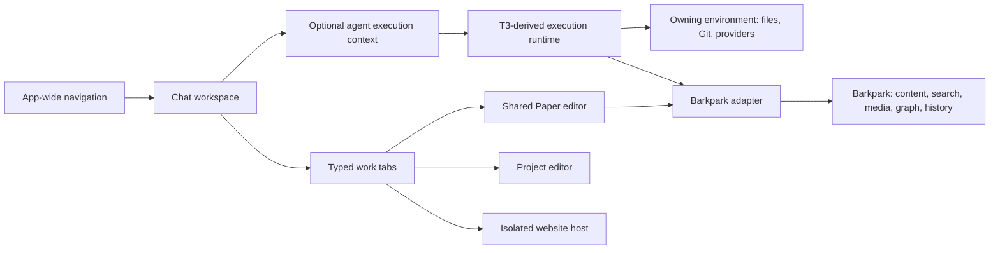

> Historical snapshot, archived 2026-09-21. Descriptions and commands below record earlier work; they are not current instructions. Use [the current plan](../PLAN.md) and [handoff](../NEXT-AGENT.md).

# Architecture and integration plan

This is a proposed implementation boundary. The typed companion is [workspace.ts](../contracts/workspace.ts). Actual upstream RPC, storage, and PortableDoc schemas remain authoritative.

## Ownership

The shell owns navigation and presentation. Each chat owns its workspace and agent context. Execution belongs to the environment that owns the project. Barkpark owns canonical content, scope authorization, and content revisions. An open browser page is untrusted content and has no privileged desktop or credential bridge.

Do not collapse four identities into a single “project”: a saved filesystem project, its particular checkout/environment, a Barkpark content project/dataset, and a chat workspace. Use explicit IDs and a deliberate mapping where one exists. Selecting a file grants no new content access and does not attach every file to a model.

## Suggested modules after the upstream audit

These are proposed responsibilities, not paths already present in this repository. Place them alongside the audited upstream equivalents, avoiding duplicate stores or RPC layers.

| Responsibility | Owns | Does not own |
|---|---|---|
| App navigation | App-wide document locations, recents, current chat/direct-document view | An app-wide filesystem cwd |
| Chat workspace state | Ordered typed tabs, selected tab, per-tab paths, drafts, reading anchors, layout, follow preference | Canonical Paper content or tool execution |
| Agent context resolver | Environment, saved project, checkout identity, folder, instruction provenance | UI navigation or silent fallback to another checkout |
| Activity router | Idempotent event routing by chat/run/target, unread markers, optional focus | Determining success from assistant prose |
| Paper host adapter | Mount/unmount, scoped read, flush, apply acknowledgements, draft recovery, revisions | A second document format or HTML-only round trips |
| Project buffer store | Environment/checkout/file keys, text, base hash, caret, dirty/conflict state | Content revision semantics for Papers |
| Search/media/graph adapter | Authorized Barkpark queries, pagination, provenance, typed references | New client-side permission rules or indiscriminate indexing |
| Browser/review hosts | Browser origin/session isolation; repository/base/target identity | Implicit commit, push, or content approval |
| Navigation pin store | Versioned location snapshot and reauthorization | Old file text, credentials, or replaying agent commands |

## Navigation transitions

| Trigger | State change | Preserve |
|---|---|---|
| Select another main chat | Restore that chat's workspace and agent context | All other drafts, runs, buffers, tab paths |
| Open sidebar document | Enter direct-document view with its own path | Prior chat workspace; no automatic expanded chat |
| Open linked document | Append/focus a destination within that document tab's path | Source path and reading position |
| Select a work tab manually | Focus chosen tab; pause automatic following | Background run and incoming update markers |
| Agent opens a target | Route to originating chat; reuse by target key or create | Foreground focus when following is paused |
| Agent updates a closed target | Record activity without reopening its view | Explicit closure/suppression until user opens it |
| Click activity | Focus the exact scoped target, including file/block/range | Agent context and unrelated tabs |
| Expand editor | Expand selected project tab, storing previous split | Main chat transcript and draft |
| Back to chat | Restore chat and previous split | Buffer, file path, caret, scroll |
| New chat in this folder | New chat + new agent context based on selected file parent | Original chat/run binding and unsaved buffers |
| Restore pin | Reauthorize and restore navigation | Newer document text and live/unsaved buffers |

For narrow layouts, keep the focused destination visible and provide a direct route to chat. At medium widths, prioritize main chat plus the final destination over intermediate document panes. Collapsed panes consume no vertical-rail space. Hidden scrollbar tracks must not disable scrolling, focus movement, PageDown, or touch scrolling.

## Agent execution

1. Resolve a run's chat and agent session to an owning environment and authorized checkout. Resolve the relative working folder against that root and capture the binding before dispatch.
2. Load applicable instructions through that environment, with their source/provenance. Editor-selected files do not implicitly redefine the working directory or instruction scope.
3. Pass context per run/tool invocation. Never change a shared global process cwd to implement chat switching.
4. Persist run intent through the audited runtime. A command receipt means the runtime accepted intent, not that a file or Paper mutation completed.
5. Send normalized activity containing originating IDs and typed target identity. Deduplicate and order on stable IDs/cursors. A background event must not acquire the currently visible chat's context.
6. A missing root or disconnected environment is explicitly unavailable. Never substitute a similar local folder, another project, or a cached authenticated scope.

Multiple agents in one chat may have separate execution contexts if later requirements need that. The current concept shows one agent context per conversation. Avoid a schema that makes a global folder mandatory merely because the fixture is simple.

## Paper editing and agent proposals

Use Barkpark's actual embed contract. The reviewed canvas emits `bp-canvas-ops` and uses existing PortableDoc projection/operation mapping; inspect its full event payload, acknowledgement methods, flush behavior, and host bridge before wiring it. Do not implement the protocol from these names alone.

The proposal lifecycle is `proposed → applying → applied`, with explicit `discarded`, `conflict`, and `failed` outcomes. A proposal records operation/run/chat/actor identity, a scoped document/block address, the expected revision, and the real structured operations.

When applying, perform the authorization and revision check at the authoritative server boundary. Only an acknowledged resulting revision permits “saved/applied” UI. On a stale revision, preserve the live draft and proposal and require reconciliation. During uncertain completion, reconcile by operation identity/receipt or refetch; do not retry a mutation blindly.

Treat typing, AI operations, history restore, and file writes as distinct actions. Preserve native text undo. Use the real supported undo receipt for a committed content change, respecting authorization, expiry, single use, and conflicts. A stopped run leaves already confirmed changes intact. A restored content revision produces the server-defined draft state; restoring a navigation pin never restores content.

The initial alpha recommendation is visible review before agent apply. The user's desire to watch edits does not by itself define a production auto-apply permission policy.

## File editing

Key a buffer by environment + checkout + canonical file identity, not its visible filename. Preserve dirty buffers across tab switches/closure and restart according to the recovery policy. Resolve traversal and symlink boundaries in the owning host. A file save needs an expected content hash or equivalent external-change check; return a confirmed write, conflict, or explicit failure. “Store in demo” is only a prototype label and must not survive as production save semantics.

## Search, media, and relationships

Call existing authorized Barkpark surfaces. QueryPipeline is an internal backend entry point, not a proposed HTTP endpoint for the desktop. Read the actual SDK/API contracts before choosing the adapter methods. Search results need scoped identities, result kinds, pagination, and a route back to their source.

Outgoing references and backlinks are stored relationships. Related results are ranking suggestions with explanatory evidence. Accepting a suggested link is an explicit write; simply displaying it creates no relationship. Respect permissions before expanding or traversing references.

Media insertion stores a supported asset reference and its metadata; use the canonical media URL/delivery contract. Handle pending uploads, failed uploads, inaccessible assets, and missing originals while retaining the surrounding document draft. Do not create a second independent media library in Barkdown.

## Persistence and reconnect

Version workspace and pin formats. Reuse upstream durable chat/run state rather than serializing a second transcript in the shell. Persist UI state and dirty buffers separately from authoritative content revisions. Keep secure credentials outside those records.

On restart, restore navigation and recover drafts, then reauthorize targets and refetch authoritative content. Saved references that are deleted, revoked, or disconnected should remain visible as unavailable. On reconnect, resume an event cursor where supported; otherwise refetch and reconcile. Duplicate events must not duplicate tabs, proposals, or writes.

## Open integration decisions

Resolve during the first spike: T3 import commit/toolchain, Paper bundle packaging and styles, supported Barkpark authentication, renderer-to-environment adapter boundary, secure storage, file editor host, isolated browser sessions, diff source, restart recovery policy, and the first provider adapter. Keep each decision tied to a measured spike result. Live multi-user editing, CRDT transport, and every-platform packaging are not assumed by this handoff.
