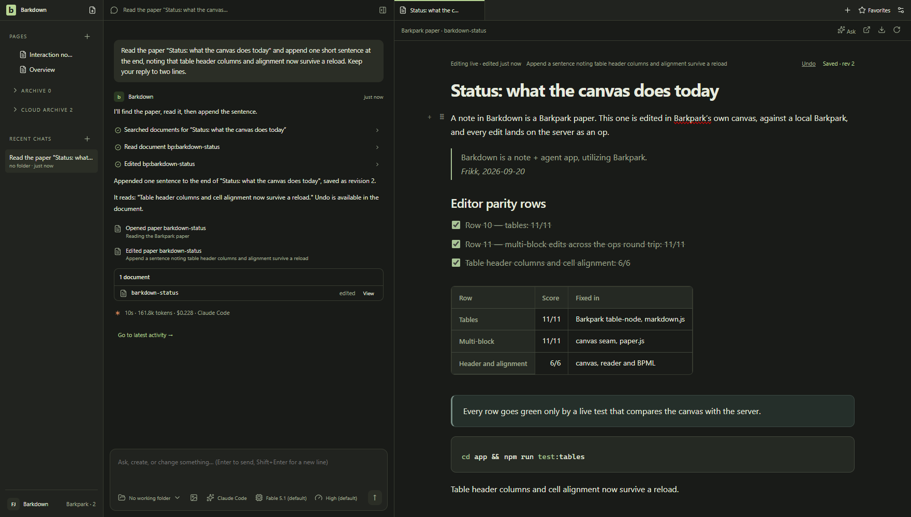

# C073 integration evidence

The complete Paper stack was integrated with upstream main `c423813d7` in Barkpark `446f29ced`. Follow-up `1aaa857e6` changes only a selector self-test and a repository-paper snapshot. Barkdown's application and shipped Barkpark pin are unchanged; these are connected private-runtime results, not a fallback-bundle upgrade or deployment.

| Proof | Result / source |
|---|---|
| Fresh production compilation | [Passed](prod-compile.log), Elixir 1.18.4 / OTP27.3.4; isolated build and compiler environment |
| Focused server regression | [234 tests, zero failures](exunit.log), disposable UTF-8 PostgreSQL cluster |
| Editor unit suite | [Passed](editor-tests.log); additional [portal theme regression](link-preview.log) passed |
| Real editor/server parity | [20/20 rows](parity.md), Barkdown `d4e3567` / Barkpark `446f29ced`; [runtime log](live-parity.log) |
| Exact deletion/recovery adapter | [Passed](deletion-contract-1790293778168.json): lost response, recreated-original refusal and repeated copy recovery; [log](deletion-adapter-http.log) |
| Adjacent contracts | [Security 139/139](security-shape.log), [workflow ledger 21/21](workflow-ledger-fixed.log), [vendor freshness](vendor-freshness-fixed.log), [design](design-check-fixed.log), [snapshot freshness](repo-paper-freshness-fixed.log) |
| Root verification | [Passed](root-verify.log); concepts/handoff only, separate from the real runtime rows above |
| Current-main contract repairs | [111 tests passed](contract-spec-tests.log): route manifest, error registry, containment inventory, CLI manifest, ingest/create and the real receipt versus OpenAPI. [Receipt census passed](census-fixed.log); its prior run derived the new route pin rather than guessing it. |
| Follow-up formatting and CLI contracts | [All 34 changed Elixir files formatted](format-all-changed.log) with CI's 1.19.5; [four test ASTs unchanged](format-proof.log). [Ten CLI tests passed](cli-error-contract.log), including API error coverage and canonical `paper_exists` classification. [Documentation budgets passed](doc-budget-followup.log), with limits unchanged. |
| Live CLI boundary | [Passed](cli-create-live.json) through the real capabilities manifest: native JSON creates a paper, collision exits 6, and readback preserves the original document. [Clean run](cli-create-live-clean.log), host `a05de06` / upstream and CLI `677992c51`; build fingerprint and binary hash retained. |
| Final hosted gates | [All four required contexts pass](hosted-final-checks.json) on `677992c51`, with actual branch protection recorded. [Full Elixir log](hosted-elixir-final.log.gz), [hashes/provenance](hosted-elixir-final-provenance.json): 30 doctests, 22,901 tests, zero failures, 40 excluded; separate 14 receipt tests pass. Go and documentation gates also pass. |

## Visual review

Five live stills, their five differences and all 37 GIF frames were inspected and [explicitly accepted](status-review.json). [Comparison metrics](visual-comparison.json) retain the old and new image names; [manifest](../../../images/status/history/2026-09-25T00-08-09-647Z.json) binds the capture to Barkdown `d4e3567` and upstream `1aaa857e6`. Light views support theme contrast review. The transcript is a real Claude Code turn on disposable content. [Full editing GIF](../../../images/status/editing.0cfaf231.gif) retains all captured steps; `motion-*.jpg` sheets expose every frame for review.

The first capture timed out on the settings screenshot; [failed log](live-shots.log) and four partial views in `capture-timeout/` are retained as diagnostics. The [complete retry](live-shots-retry.log) stopped its private runtime normally. Neither partial screenshots nor the optional token-skipped hosted parity job count as behavior acceptance.

The existing standard fixture approval and notebook README demo remain applicable because Barkdown app, dependency, pin and capture inputs did not change. Fresh connected Paper evidence does not claim that every migration or narrow-layout journey was repeated.

Supplemental [dark](link-dark.png), [light](link-light.png) and [narrow](link-narrow.png) link-preview captures show the changed portal consuming the paper's theme with readable Open/Edit controls. All three were inspected; [geometry](linkpreview-geometry.json) also confirms viewport containment. This fixture uses the real private server without a provider turn. Its [named review](linkpreview-review.json) records the exact source and artifact hashes.

## Failures and boundaries

- `exunit-setup-failed.log` is the initial disposable SQL_ASCII cluster setup failure; the successful run uses UTF-8. `dev-compile.log` records warnings from the machine's newer Elixir 1.20; production validation uses the declared 1.18.4 toolchain.
- `deletion-http/` and `deletion-http.log` audit generic mutation/restore APIs. They demonstrate unsafe generic deletion/overwrite behavior and are **not** the Barkdown adapter proof. The exact adapter result linked above uses the supported guarded path.
- Initial hosted logs use `446f29ced` and the former PR base. `hosted-path-escape.log` found a real mismatch in the selector's independent test oracle; `1aaa857e6` corrects top-level ancestor matching without changing production selection. `selector-harness.log` records the corrected two-reader assertion.
- `hosted-js.log` reports advisory SDK gzip budget overages of 250/282/276 bytes. HEAD and current main have the same complete `js` tree (`31b306c97d5c129c1921a860f4d8219f7b78776c`); the integration does not increase those sources. No budget was raised. This is attribution evidence, not a claim that the same failure was observed on a main CI run.
- The [final-head SDK run](hosted-js-final.log) reports the same three overages. Existing [issue 18370](https://github.com/FRIKKern/barkpark/issues/18370), task `task-77f40fa9b56ba99f`, owns this debt and its reduction/design decision. Its older main measurements are distinct from this candidate's measurement.
- The [stale-tree advisory](hosted-stale-tree.log) flags both rebuilt core archives because their gzip blobs match an older commit. [All ten files](vendor-core-comparison.json), [all members and complete decompressed tar bytes](vendor-core-container.json) match current main; the gzip OS header differs. Both templates carry identical archives within each revision. An independent reader confirmed no lost main content. The PR documents this deliberate regeneration as the workflow instructs; the advisory remains red, not waived or relabeled green.
- `doc-checks.log` and `required-ack.log` are interrupted local duplicates, not passes. Their equivalent initial Linux CI steps passed. Windows CRLF/Python prerequisites caused earlier local checker failures; raw logs retain them.
- The first live CLI probe used a stale prebuilt development manifest (`cli-create-live.log`). After rebuilding, an invalid disposable tag rationale was refused (`cli-create-live-rebuilt.log`); the next attempt was stopped by the clean-source guard because workflow documentation changed during startup (`cli-create-live-valid.log`). The corrected clean run is the acceptance evidence, and all private runtimes stopped. These retries did not change upstream source or weaken validation.

The initial full Linux run executed 22,901 tests with nine failures. [Failure excerpts](hosted-failures.txt) identify the missing create manifest/error code, popup inventory and receipt registry; all are addressed in upstream `39d76cd9b`. The [full log is retained compressed](hosted-elixir.log.gz), with [original-byte hashes and provenance](hosted-elixir-provenance.json). These failures prompted the targeted corrections above; the final hosted suite now passes. No editor runtime code changed after the reviewed live capture.

Hosted readiness and the next action belong to the [current handoff](../../C073-upstream-integration.md). No upstream merge, production deployment or migration activation is included in this evidence.

The first run against the correct main base found [four unformatted older tests](hosted-format-followup.log), an [API reference seven bytes over budget](hosted-doc-followup.log), and the [missing CLI conflict exit mapping](hosted-go.log). Upstream `fbcf43f22` and `677992c51` correct these findings. The preceding expensive runs were superseded because their known failures already prevented acceptance; cancelled suites are not passes. The independent reader found no remaining issue in these focused changes. Runtime editor assets are unchanged, so the reviewed images above retain their original source attribution.

The [four-run Elixir timing cohort](ci-elixir-cohort.json), summarized by the existing [CI-effort reader](ci-elixir-cohort-summary.json), records 869 seconds (14.5 job-minutes) in cancelled jobs. The final suite was still running at capture time. This is elapsed job time across parallel work, not billing, CPU usage or agent idle time. Canonical CYCLES now names the earlier consumer/formatter/budget checks and prebuilt-runtime freshness requirement; no future savings are claimed.
