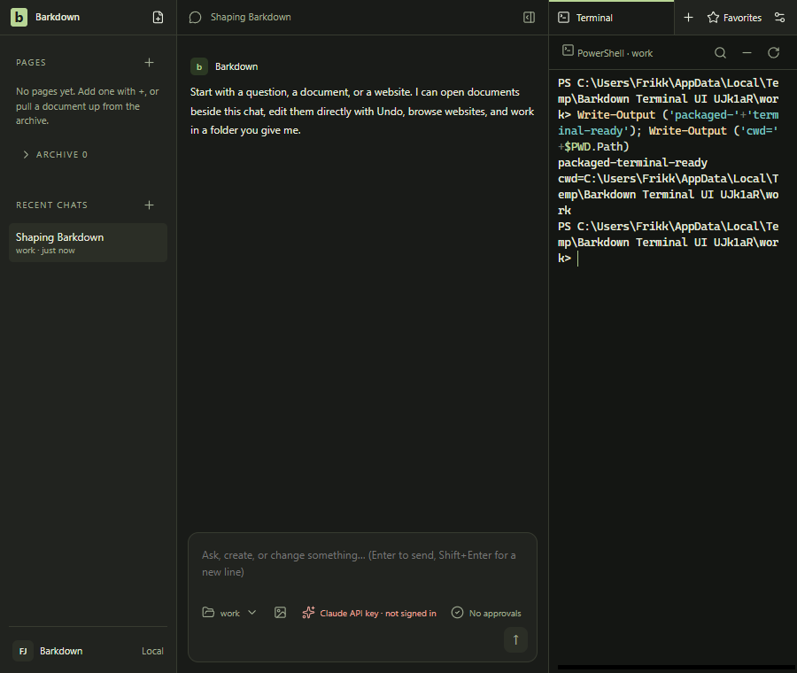

# Packaged Windows PowerShell fallback

Implementation `78a885f6` repairs a real packaged launch failure: node-pty's relative executable search omits the final PATH entry. With Windows PowerShell last in an OS-only PATH, [original package01](packaged-terminal-01/native-result.json) reports `File not found` and verifies cleanup. Barkdown now passes the absolute built-in OS tool path; the optional PowerShell7 preference remains. No upstream adapter or installed environment was modified.

[Regression red](terminal-red-01/result.json) fails219ms before implementation. [Full terminal ownership](terminal-green-01/result.json) passes10.226s, including real descendant isolation and shutdown. [Final guard source](terminal-guards-02/result.json) passes fallback199ms/skip ratchet287ms after making the new Windows-only test explicit. Ten off-Windows unit sites are now recorded; C098 owns the next Mac regression pass. The earlier guard01 used the pre-canonical skip spelling and is retained rather than presented as final ratchet proof.

[Fresh package03](carried-package-03/result.json) passes46.359s:6067 runtime files/325064743bytes, carried runtime unchanged. [Native service06](packaged-terminal-06/result.json) passes2.736s with the original failing PATH order. The real owned worker loads carried x64 `conpty.node` SHA256 `ee8f4e6f4dad71939eecfda11de249400e34bfefe4c8b48af13f3b5476f4035b` inside `Barkdown.exe`, with no loaded `node.exe`/`node.dll`. Cwd, TERM,100→52 columns, interrupted foreground sleep and stopped/zero-active Job all pass. This proves the selected modern Windows adapter's delayed host import; it does not prove WinPTY, ARM64 or every optional module.

[Actual packaged GUI](packaged-terminal-ui-01/result.json) passes10.981s: open the terminal work tab, type a command, resize the native window, press Restart and quit normally. Both Job receipts finish stopped/zero-active. Codex inspected both original PNGs:1300×900 and900×760, dark theme, text wraps inside the pane and search/restart controls remain reachable. The disposable profile explicitly disables Barkpark for this focused terminal journey; the GUI hydrates registry PATH normally. It does not establish no-registry or clean-machine acceptance.

[Fresh dependency scan06](import-scan-06/run/result.json) passes15.861s. [Byte review02](terminal-package-byte-02/result.json) passes10.109s:185 unchanged native images, all186 import tables unchanged, all6067 runtime files exact in both old/new packages,223 owned archive files with only `main/terminal.js` and its README changed. The executable integrity resource and archive changed as expected; the original package remains exact. All186 new raw import outputs and the actually selected native module hashes match. The first read-only archive comparison failed because ASAR `statFile` needs native normalized nested Windows paths; [original failure](terminal-package-byte-01/failure.json) and producer remain.

Original native attempts02/03/04 retain probe-only OSC prompt, PowerShell UTF-8 output and post-Ctrl+C readiness failures. Each verifies shutdown. Successful original adapter05 takes2.236s with an explicit PATH reorder; fresh06 proves the production fix with that workaround removed. Preserve these distinctions rather than turning corrected observations into an original pass.

[Fresh visual review](terminal-captures-01/review.md) records actual image inspection and explicit approval. [Full Windows Desktop](terminal-desktop-01/review.md) passes821.003s/all88/five existing skips on78a885f6, with536 tracked app inputs unchanged and951 earlier results preserved. Fresh process receipts and17 browser images are reviewed. [Repository verification](terminal-verify-01/result.json) passes50.376s, including current Windows visuals and retention. Hosted integration remains blocked by account billing; prior startup failure06 is unresolved. Complete notices, CRT prerequisite installation, clean install/update/rollback/uninstall, A2/A3/A5 and actual Mac transfer remain open. This is an unsigned engineering package on one Windows developer host.
