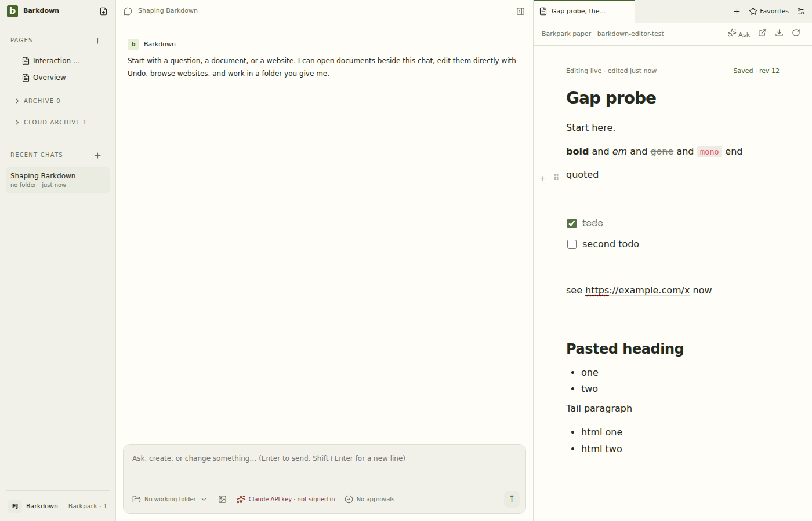

# Focused live editor proof

Hosted run38444480330 passes13/13 real native editor cases and the aggregate gate. Actual serverab6569646/clientc4ebd9a1 are recorded in [matrix.log](matrix.log); [review and limits](review.json). These are disposable Linux/Phoenix/Electron interactions, not Windows installation or real-library proof. The existing light theme is retained to compare the upstream parity suite; dark Windows fixtures are reviewed separately.

[Original27.12-second native video](editor-gap-assertions/2026-10-13T18-16-32-997Z/editor-gaps.webm) · [Complete13-case result](editor-gap-assertions/2026-10-13T18-16-32-997Z/result.json) · [Artifact hashes](editor-gap-assertions/2026-10-13T18-16-32-997Z/manifest.json). All13 action stills and29 one-fps motion frames were inspected. Full20paired rows are running; deliberate broken Tab and merge enforcement remain unproven.
