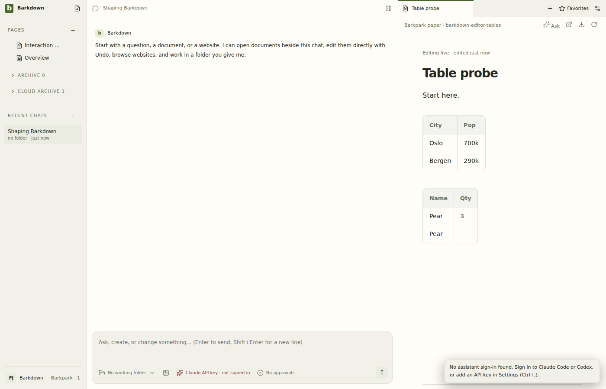

# Full paired editor matrix

Run38445616564 passes20/20 real Electron/Phoenix rows and the aggregate gate at serverab6569646/clientc4ebd9a1. [Exact results](parity.json), [actual checkout/log](matrix.log), [gate log](gate.log), [review and limits](review.json). Table baseline11/11 includes both native Tab behaviors. These are isolated Linux runtime checks, not Windows installation or complete migration acceptance.

All25 main stills,13 gap action stills and42 sampled one-fps motion frames were inspected. Original gap recording, structured results and hashes remain under editor-gap-assertions. The deliberate broken-Tab control is now running on a temporary draft-only source revision; required-check enforcement and integration remain open.
