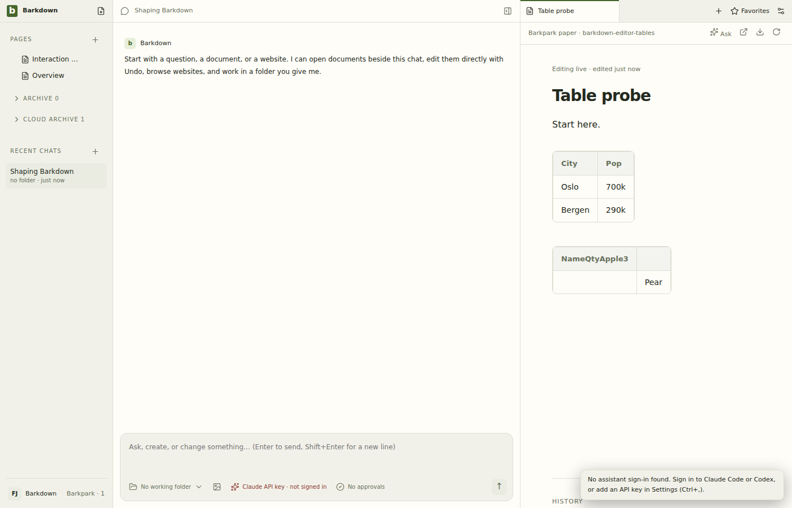

# Deliberately broken native Tab

Run38447630236 at server1330ec9bf/clientc4ebd9a1 fails the table row and aggregate gate. Native cases are9/11green: only Tab cell movement and last-cell row creation fail; the other nine—including server agreement, structural controls, Undo, paste, Enter and reload—pass. The full baseline run38445616564 passed20/20, with tables11/11. [Exact signature and limits](review.json), [matrix log](matrix.log), [gate log](gate.log).

The single Tab handler and actual served bundle were rebuilt for the control. [Original and mutant hashes](preparation.json) and [byte-exact restoration](restoration.json) are retained. Restored source7a34dca39 has the identical complete tree to passingab6569646. Post-restoration table run38448660409 is pending. This proves regression rejection; required-check enforcement and authorized integration remain separate.
