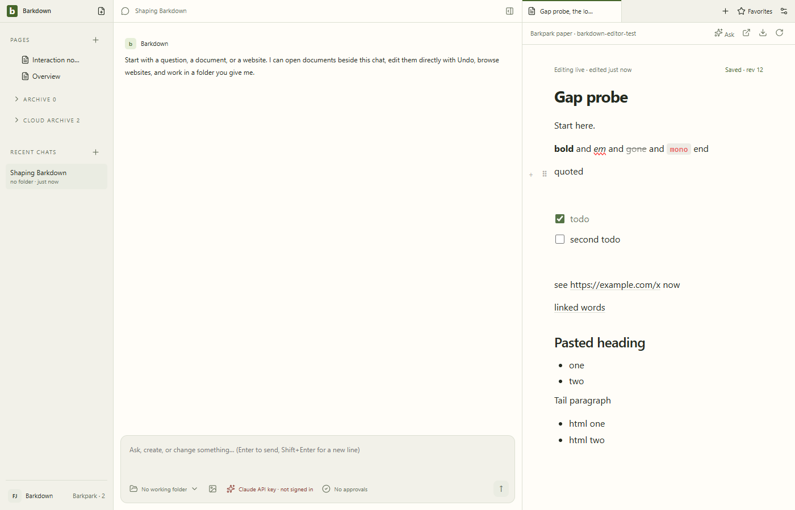

# Native Windows gap regression

Actual Windows Electron against disposable carried source138 passes13/13 at client8c8907eb. HTML-paste Undo/Redo and same-identity quote conversion acknowledge the full server document. [Complete results](result.json), [source/editor hashes](manifest.json), [runtime cleanup](cleanup-result.json), [review and limits](review.json), [raw capture log](capture.log).

The first run retained11/13: Undo grouped the preparatory Enter with paste, and its failed assertion prevented acknowledgement before Redo. The test now observes the mounted500ms history interval, allows a571ms human idle and asserts one new event20→21. Strict document/identity/server assertions remain intact; no history or document command repairs the result.

All13 action stills and29 one-fps motion frames were inspected; [original26.92-second recording](editor-gaps.webm) remains unchanged. Runtime and user-data folders are retained privately; no real library or pin change. Upstream Linux confirmation of the newer test and current-head CI follow; no installation or stage acceptance.
