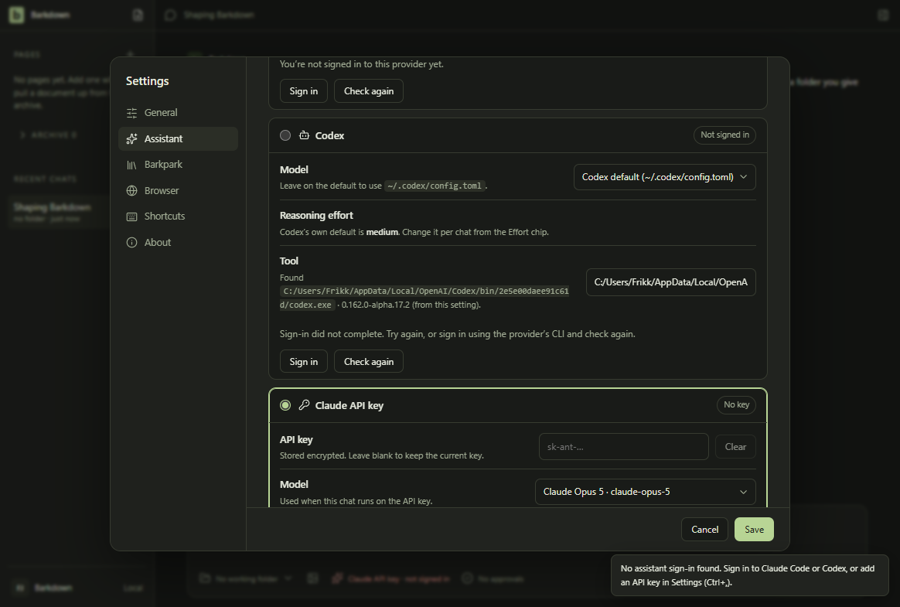
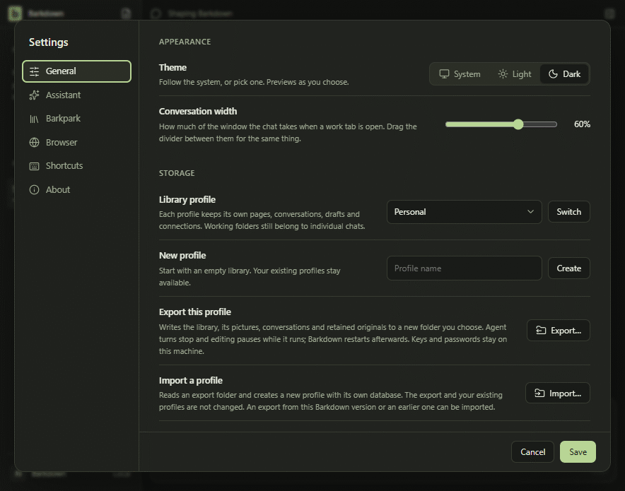

# Real Windows CLI selection survives restart

On the tested Windows 11 developer machine, the actual Settings field and Save selected the already installed Codex CLI0.162.0-alpha.17.2. A relative path was refused visibly without replacing the selection; Cancel discarded it. A new Electron process restored the same path/version without a repair write. [Result](result.json), [independent disk read](disk-review.json) and [review](review.json). The bounded journey took11,938ms.

Dark source-app screenshot, disposable unsigned-in profile, real native version check. This development executable path is internal/versioned and can change after a Codex app update. No model request, account login, production backend, installer or real library was used. The default PATH still resolves0.30.0; this evidence does not replace it.

Actual timestamped narrow UI screenshots: persisted selection, relative-path refusal, Cancel and natural toast expiry. [Motion/frame manifest](motion.json), [all raw frames](frames/) and [contact sheet](contact.png). The initial narrow toast covered footer labels; [that frame remains](04-narrow.png). The [settled native view](narrow-settled.png) shows field, Save and Cancel within the actual884×695 content viewport. No toast was masked or removed. This is supplemental setup proof, not a replacement for formal visual approval or the daily-use gate.

The [first attempt](first-attempt.json) timed out at an obsolete hidden button before editing. Its screenshot and private data remain; supported Ctrl+, corrected the harness. The [exact executed producer records](producer/manifest.json) show the assertions and capture flow; paths are machine-specific. Raw process output and the disposable profile remain private. Account/private environment data is not included. No source behavior change was needed.
