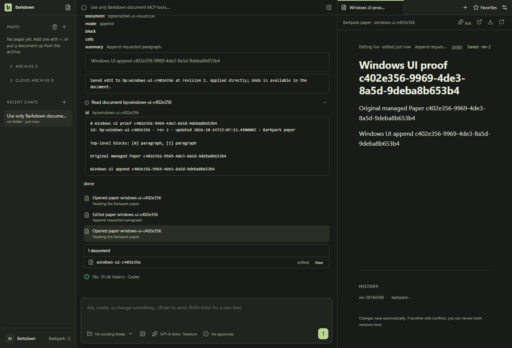
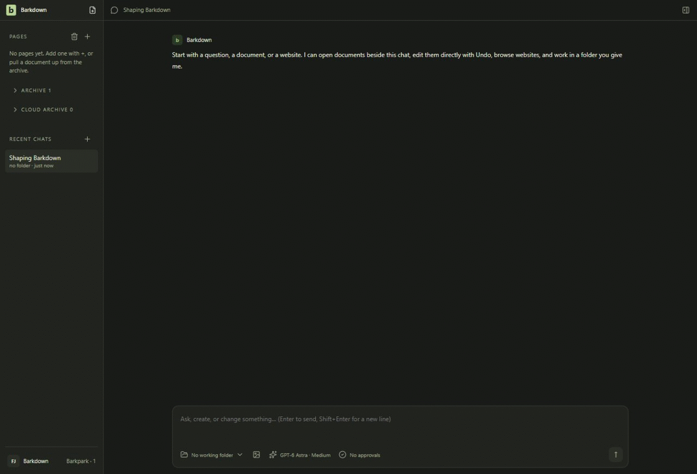

# A real Codex edit from the Windows app

A Codex turn sent with the actual composer and Enter read an existing Paper, appended exactly one paragraph and read it back. Paper advanced1→2; the already-open canvas updated without a refresh or reopen. The title, original paragraph, append receipt and owned conversation survived a clean app/runtime restart, with no second model request. [Result](result.json) and [independent retained-file/cleanup review](disk-cleanup.json).

Dark Windows11 source app, fresh managed profile and synthetic two-paragraph Paper. The existing device login and installed Codex CLI0.162.0-alpha.17.2 were used; the path was selected through Settings Save. The private2ff runtime remains test-only and unadopted. This does not establish installer, real-library, all-provider or daily-use acceptance.

Actual owned-window recording at8fps/1120px, preserving chronological source frames and timing through a final short hold. [Recording manifest](recording.json), [all raw frame hashes](raw-motion-manifest.json), [before submission](01-before-submit.png) and [after restart](03-restarted.png). Recording review is documented in [review](review.json); the formal fixture baseline remains separate.

The complete successful checkpoint took123,773ms including native startup, the one real turn, restart and cleanup. Reported usage:91,344input tokens, of which85,376cached, and208output; these are not billed-cost figures. Both owned app/runtime shutdowns cleared the PostgreSQL pid/process record; independent checks found one completed attempt, one matching receipt, zero legacy document files, no process command line matching the test root, and closed own API/PG ports. Those are scoped checks, not a whole-machine process audit.

[First attempt](../provider-ui-edit-preflight-01-failed/result.json) failed in the fixture reader before any UI/model submission; its data/image remain. The corrected binding passed. An initial offline reviewer read the registry pointer as a profile list; the checksum-bound generation was then inspected without repair. The earlier variable-rate encoding remains private; the delivered recording uses actual frames at constant8fps. [Executed source records](producer/manifest.json) show assertions/capture; raw events, credentials, writer tokens and retained profile/database data remain private. Undo was visible but not exercised here.
