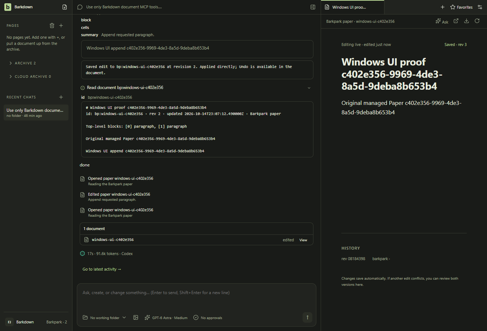
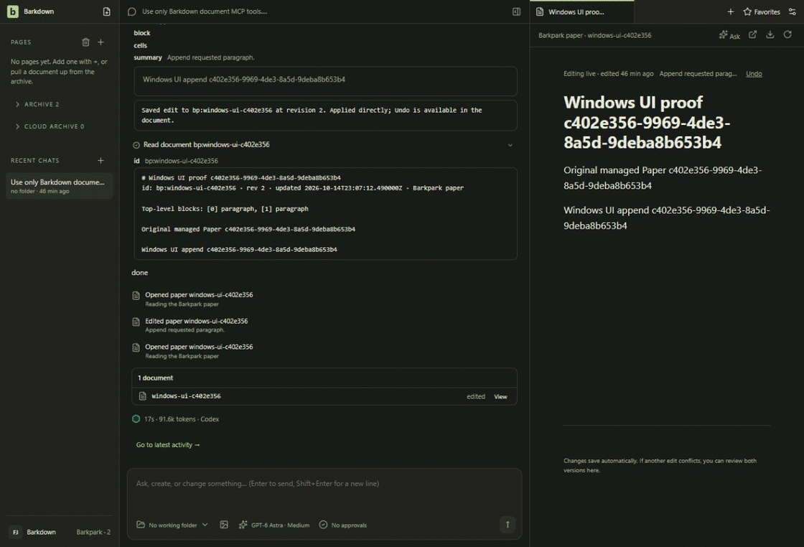

# Windows Undo and human-edit protection

The real Codex edit from the [prior UI run](../provider-ui-edit-01/README.md) is now undone through the actual Windows document button. The exact original blocks return at revision3 and the receipt remains undone after a clean app/runtime restart. The saved tab restores naturally.

A separate, explicitly labelled production-API fixture creates revision4 without a model call. Actual keyboard input saves revision5; stale Undo disappears after save, and a captured bound IPC request refuses with “Document changed since it was read. Read it again before editing.” The human text and revision remain exact through refusal and restart.

Dark-mode actual source app on one synthetic Windows profile, source9475603a, test-only unadopted2ff runtime. The16.37-second GIF has two chapters: frames0–62 are real-receipt Undo;63–130 are the separately prepared guard fixture. The intervening app/runtime restart and direct-fixture preparation are omitted. Restart proof is in the stills/result, not shown as continuous motion. The chat and91.6k token footer belong to the earlier model run; this checkpoint makes **zero new model requests**.

[Behavior results](result.json), [independent disk/cleanup review](disk-cleanup.json), [recording/frame provenance](recording.json), [actual image review](review.json), [exact producer records](producer/manifest.json). Four sequential launches closed their owned runtime/PostgreSQL; the immutable1980-file before2 backup remains byte-exact and the active writer identity is unchanged. The active original intentionally evolves2→3→4→5.

The [earlier raw-copy launch refusal](../undo-copy-01-refused/result.json) is retained: ownership binds the canonical physical store and inode. No identity was reset. The [first encoder assertion](encoding-first-failure.json) caught a1.87ms frame delivery inversion. Encoding sorts actual frame-swap timestamps while preserving raw delivery indices and hashes; no UI/model replay or invented frames. [Official timestamp definition](https://raw.githubusercontent.com/ChromeDevTools/devtools-protocol/master/pdl/domains/Page.pdl).

Other native stills: [before real Undo](clean-undo-before.png), [after Undo restart](clean-undo-restarted.png), [guard fixture before typing](later-human-before.png), [human text saved](later-human-human-protected.png), [human text after restart](later-human-restarted.png). All six stills,53 source frames and131 decoded GIF frames were inspected, including Undo/save intermediates. Original JPEGs and contact sheets are privately retained with public hashes.

No installer execution, runtime adoption, real-library, Mac transfer, all-provider, crash or whole-stage acceptance is established. [Full current root verification](../verify-16/result.json) passes75,157ms. Publication and exact hosted join are the closing delivery gates.
