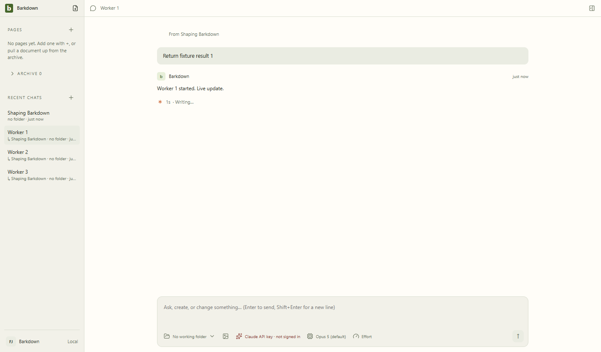
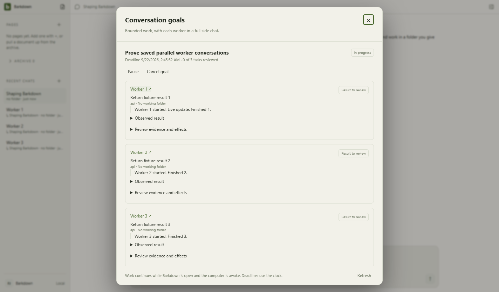

# Owned worker Electron evidence

Source: `043e4727bc363c9011df0ce46dfe3ab46bd62491`, clean source during full desktop suite. Disposable profile root: `bd-profile-goals-nCvCKm`.

Actual Electron main/preload/renderer, default Windows Job Object workers and Anthropic SDK with local deterministic HTTP streaming. Three workers, live open-chat events, late A results while B selected, saved parent references and coordinator draft, three stopped/zero-process receipts passed. These screenshots were visually inspected; the result dialog was captured after its opening animation finished.

Authenticated provider proof is separate: [three Codex workers on beefded](../beefded/authenticated-codex.json). These images do not prove crash-dialog recovery or automatic coordinator planning.
