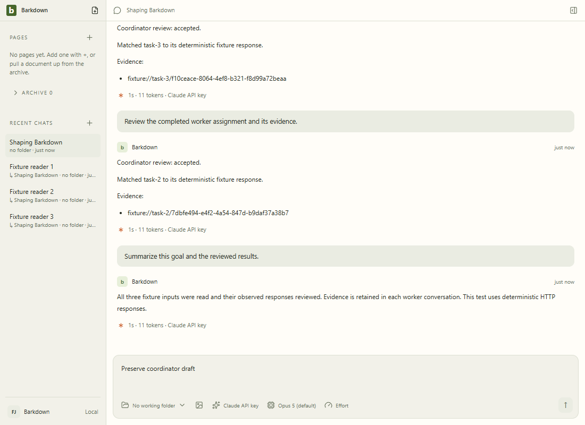
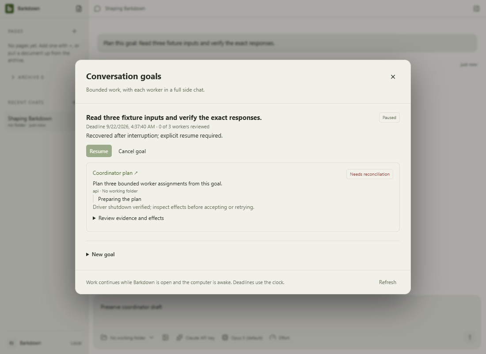
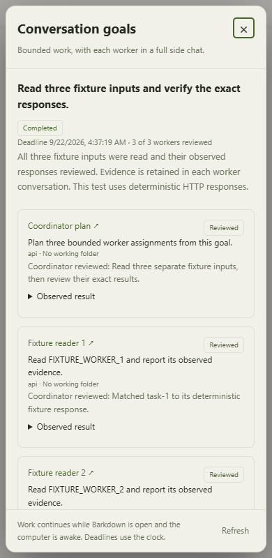

# C015 coordinator evidence

Clean source61eea4dc87de0f9548ff33d7fafc455f9f265866: authenticated Codex plan, three concurrent read-only workers, three independent coordinator reviews and summary completed in disposable folder deioUa. All three exact synthetic tokens were compared by the test; all eight owned Windows jobs have stopped/zero-active receipts. Human draft and full worker conversations were retained. The workers share a captured folder; no automatically isolated worktree claim. [Authenticated proof](authenticated-codex.json).

The first authenticated5dc188b attempt AoTVC4 safely paused on commentary preceding final JSON. The new explicit provider final-message contract fixes that parsing boundary without extracting JSON substrings or hiding raw evidence. API/Claude/Codex provider tests cover commentary plus acknowledged final response.

## Retained journal commit failure

Native planning-crash fixture1pZCiu on5dc188b reached final summary review but did not acknowledge completion. Its [authority remained revision44](acknowledged-rev44.json), while a [prepared temporary revision45](unacknowledged-rev45.json) contains completed state. This localizes failure to the final journal commit after preparing bytes; the original OS error and precise failing operation were not logged. It is not evidence that the completion was acknowledged. The original source fixture was preserved.

A copied synthetic fixture0IpgUZ recovered paused on61eea4d, then explicit Start completed from its acknowledged stopped summary with **zero provider launches**. The unacknowledged temp was not adopted. [Recovery proof](journal-recovery.json). Two subsequent actual native planning-crash/reconciliation/retry tests (MvXg3j/MsOwb3) passed; exact committed-source recapture and full visual/root gates remain pending. No power-loss or cross-machine durability claim.

## Legacy fingerprint compatibility

[Repository fixture](legacy-fingerprint.json) reserves an attempt through the actual375763a module and finalizes it through61eea4d. The old scheduler never stored dependency results or retry notes; empty reconstructed dependency data preserves its digest. Nonempty invented enrichment is rejected. This checks transcript ownership compatibility only, not native termination, and does not weaken fingerprint validation.

## Actual Electron coordinator journeys

Full desktop50783 passed on61ee app source. [Normal manifest](goal-coordinator/manifest.json) records8ZrHEw: objective-only creation, three concurrent full workers, background profile ownership, readable evidence reviews and summary, retained draft and restart without replay. [Planning-crash manifest](goal-coordinator-recovery/manifest.json) recordsBbiHiJ: actual main kill, explicit trusted shutdown check, reviewed retry and fresh plan. All17 stills inspected, including390px. Docs-only changes make these manifests report a dirty working tree; no app source changed. Local deterministic SDK HTTP is distinct from authenticated Codex proof above.

