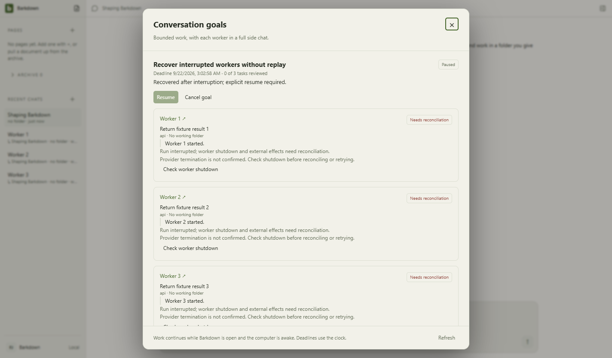
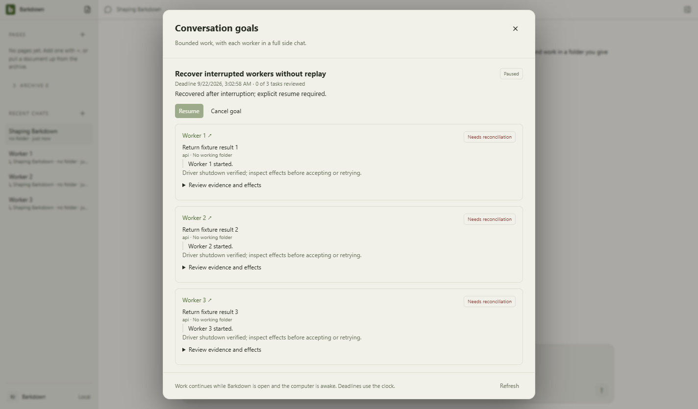
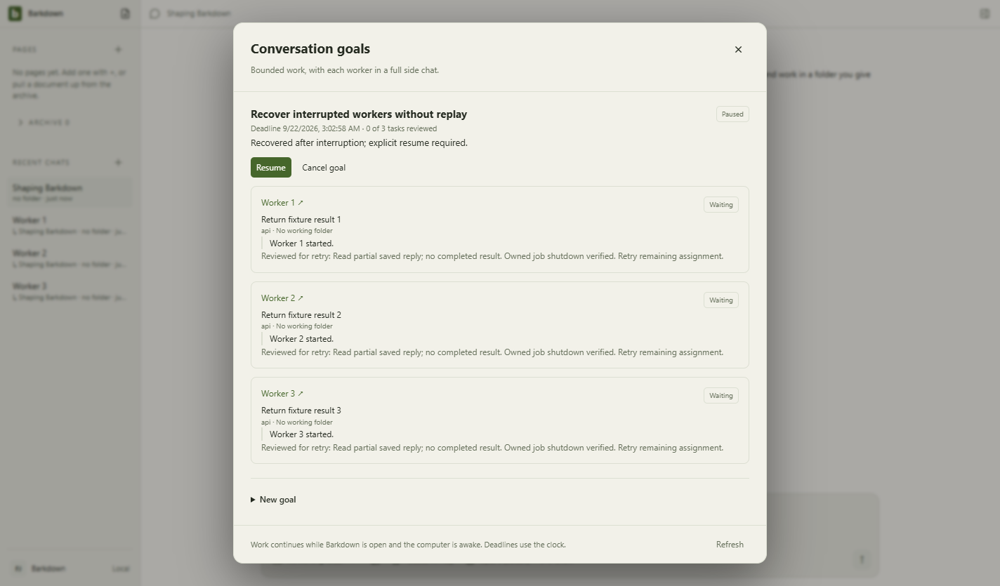
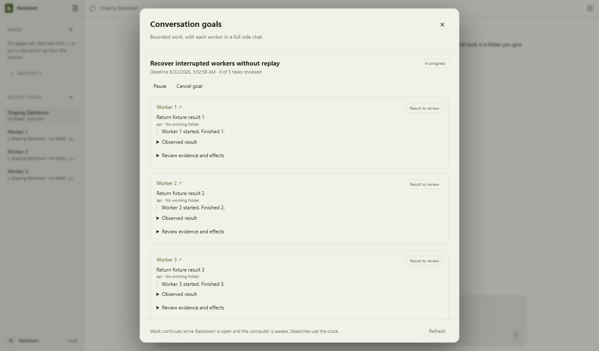
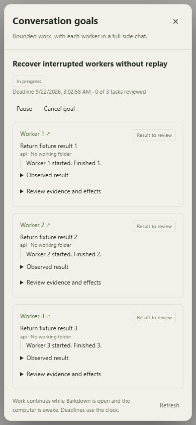

# Actual Electron recovery journey

Source e9be019. Full desktop gate passed with actual Windows owned workers and SDK streaming over local deterministic HTTP. The manifest honestly records dirty=true: parallel visual capture generated only docs evidence; app source remained committed. Synthetic environment API key used; encrypted-key restart is a separately reproduced defect.

Abruptly kill the Electron main PID after checking it matches the disposable journal lease. Reopen: paused, no new HTTP request, Resume disabled, shutdown proof required. Check all three owned jobs, explicitly review effects and choose retry, then Resume. Exactly three new requests; partial replies, immutable first attempts, full side-chat parents and human draft survive. Five frames inspected, including390px width. No overlap or unwanted scroll tracks; tall contents scroll behind the fixed footer. These are action stills, not a continuous-motion recovery recording.

