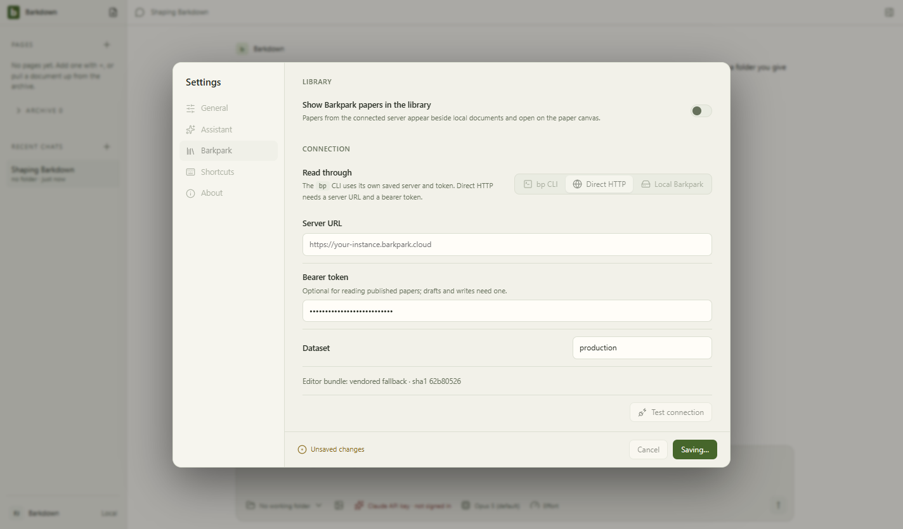
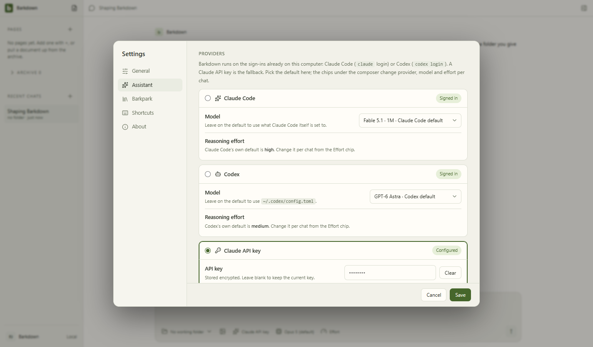

# First-run credential durability

Source f7d91e6. Actual Electron38/Windows save of synthetic API key and server token, immediate forced main-process termination, then decrypt roundtrip passed. Concurrent profile A credential save and switch to B stayed in A; B selected across restart. Malformed protected-key storage refused replacement and retained both prior ciphertexts. All secret values are disposable synthetic test data; no real credential was read or copied.

The manifest records dirty=true because concurrent visual capture produced docs-only evidence. App source remained committed. Both stills inspected: Saving remains legible while controls are disabled; after restart the stored API key is Configured. This is action-still evidence, not continuous motion. Node gate6/6 and the full desktop suite passed, including goal crash/review/retry now using a saved encrypted key with no environment key.

The gate checks canonical base64, bounds and DPAPI-tagged payload presence, syncs the file, and checks the current file index. It does not itself cryptographically unprotect the blob. Real same-machine process-crash tests establish roundtrip; no OS power-loss, arbitrary key-corruption recovery, cross-machine transfer or every-platform claim.

