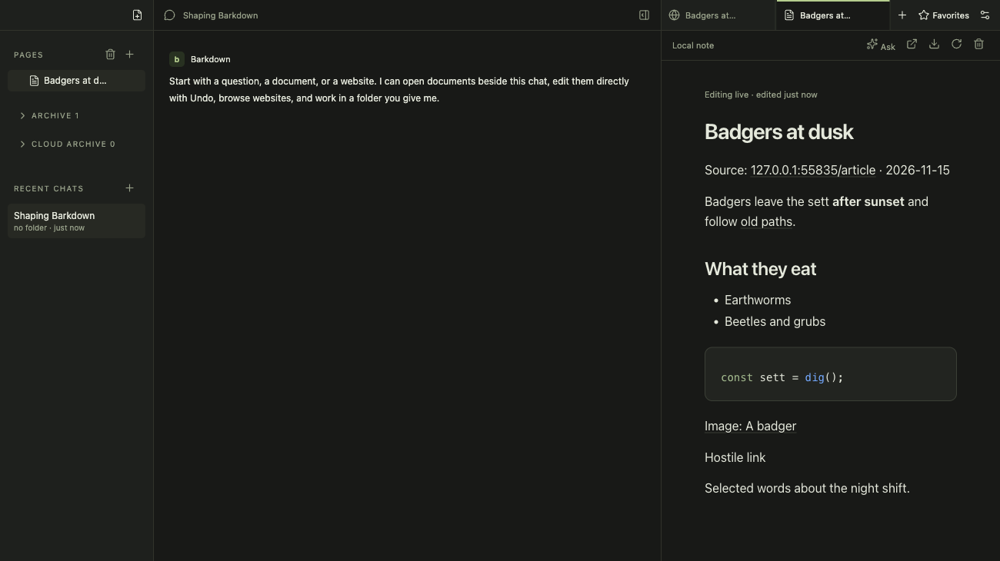
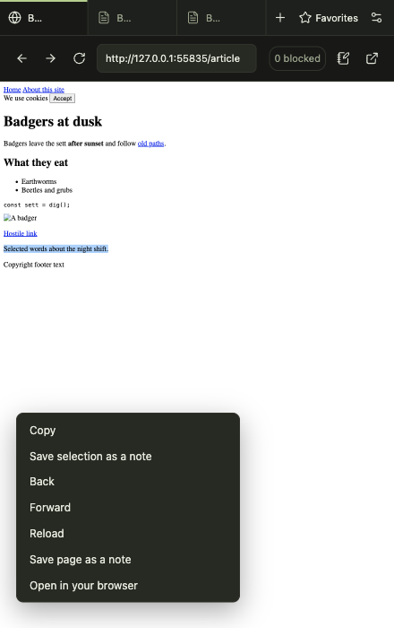
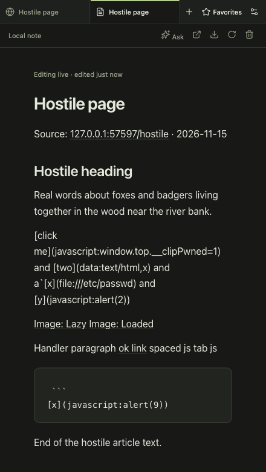

# Save any web page as a note

*Merged into Barkdown on 15 November: a button that turns the page you are reading into a clean note beside your chat. It is in Barkdown's source, not yet in a downloadable build. The hard part was making sure a page written by a stranger cannot sneak anything harmful into it.*



One press later: the page is a note in Pages, open beside the chat. A real run of the app on a local test page.

## What it does

In a build from Barkdown's main branch, open any website in a Barkdown tab and press **Save to notes** (the notebook button) in the browser bar. The page becomes a note.

The note starts with a source line: the link and the date. Then come the parts worth keeping: headings, paragraphs, lists, links, quotes, code and simple tables. Menus, footers, cookie banners, ads and scripts are left behind. Images become links.

You can also right-click: **Save page as a note** takes the whole page; select some text first and **Save selection as a note** takes only that.



## How it works

1. **Read.** The app reads the page in a sealed-off space the page's own code cannot touch.
2. **Parse.** The text is taken apart as dead data. Nothing in it can load or run.
3. **Keep.** Only the article stays. Every link must be a web (`http`, `https`) or email link.
4. **Check.** The finished note is checked once more. Any other kind of link and the clip falls back to plain text.

## What almost went wrong

A web page is written by someone you do not know. A note is yours: you keep it, export it, publish it and sync it to Barkpark. So the clipper must never copy anything that could act, such as a link that starts with `javascript:`, `data:` or `file:`.

The first version had a guard for this, and tests. A fresh review, by a reviewer who had not written the code, failed it anyway. Barkdown notes write a link as the words in square brackets followed at once by the address in round brackets. The guard broke that pattern up inside one piece of page text, but a page can split it across two pieces:

```html
<p>[click me]<span>(javascript:alert(1))</span></p>
```

Each piece looks innocent; glued together in the note they make a link that runs code. The reviewer found five ways to split it: a span, an HTML comment, an anchor with no address, code text with a backtick, and a selection. The editor would not have opened such a link that day, but the note would have stored it and carried it through export, publishing and sync.

The fix: every `]` in page text now carries an invisible mark, so no two pieces can join into a link, and the finished note is checked with the same reader that stores notes.

## 52 attacks, then a booby-trapped page

A second fresh review tried to break the fixed version with 52 hostile cases: links split across table cells and list items, `javascript:` hidden with a tab or written as character codes, a page that sets its base address to `javascript:`, fake code fences. Every case came out safe.

Then it ran the real app against a hostile page that also rewrote the browser's own functions:



Every attack is still visible, as plain text. None of it is a link. The page's rewritten functions were ignored, and its test server counted zero requests for the hidden images. Five live checks out of five passed.

## What is left

The reviewer listed a few things for later: a **Discard** button for a clip the server refuses for good (today it keeps being retried), very large pages can pause the window while they are parsed, and Retry from Pages saves the note but does not open it.

## Proof

- Pull request: [#133](https://github.com/FRIKKern/barkdown/pull/133), merged 15 November 2026 as `1185920d` (not yet in a release that day).
- First review failed on head `11d01f1` (split links); second review passed on head `860bfa1` (52 hostile cases, live run 5 of 5).
- Tests: `app/tests/clip.test.mjs` (12 pass), `app/tests/clip.live.mjs` (7 of 7 in real Electron).
- Code: `app/shared/clip.js`, `app/main/page-capture.js`, `app/renderer/src/clip-note.js`.
- Pictures: screenshots from the reviewer's live runs of the real app on local test pages, cropped.
