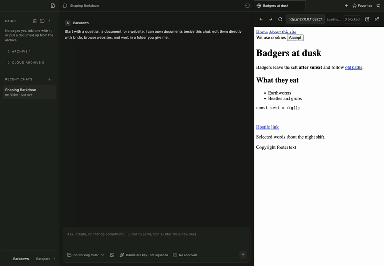

# Barkdown · Sunday 15 November 2026

Two features merged into Barkdown's main branch, both about getting things into your notes. Neither is in a downloadable build yet: the newest nightly is from 4 November, and Sunday night's build run failed. To try them today, run Barkdown from source (see the README).

## Save a web page as a note

[#133](https://github.com/FRIKKern/barkdown/pull/133). Open a website in a Barkdown tab and press **Save to notes** in the browser bar. Or right-click: **Save page as a note**, or select some text first and **Save selection as a note**.

The note starts with the page's address and the date, then the parts worth keeping: headings, text, lists, links, quotes, code and simple tables. Menus, cookie banners, footers, ads and scripts stay behind. A fresh review tried 52 hostile cases against it, such as links split across pieces of the page, and every one came out safe. The full story, with the 52 attacks it was tested against: [Save any web page as a note](2026-11-15-save-web-page-as-note.md).

## Import Markdown files and folders

[#134](https://github.com/FRIKKern/barkdown/pull/134). Pages has an **Import Markdown** button (the folder icon beside +), and quick open has **Import Markdown…**. Pick files or a whole folder, such as an Obsidian vault or a Notion "Markdown & CSV" export:

- Each `.md` file becomes a note. Its title comes from the front matter, else its first heading, else the file name without Notion's long id.
- Folders nest in Pages the same way. Hidden folders like `.obsidian` and `.git`, files over 4 MB and binary files are skipped.
- Images next to the files upload and show in the note; a missing one stays as a line of text and is counted. Links between the files, including Obsidian's `[[Note]]`, become links between the new notes.
- A line under Pages counts "Importing 12 of 40…", then a message says "Imported 40 notes, 3 images missing". Import the same folder again and nothing is made twice.

## Where it is slow or rough

- In the live test, importing a 200-file folder, interrupted twice and then run again, took 147 s and hit Barkpark's write limit 43 times. Each was retried, and the app stayed smooth (the slowest frame took 18 ms).
- Very large vaults are planned in one go, up to 2,000 notes; above that is not covered. On Windows and Linux the button opens a folder picker only.
- Saving a web page: in our recording the new pane shows an empty "Untitled" page for about a second before the note appears. Filed. The review's follow-ups (a Discard for a clip the server refuses for good, Retry that does not open the note, very large pages pausing the window) are filed too.

## Across the projects

Both features write notes into [Barkpark](https://github.com/FRIKKern/barkpark), the server Barkdown keeps its notes in; the import's 43 retries were Barkpark's write limit at work. On the same day Barkpark merged find and replace and export for papers, and Studio made two people typing in one paragraph keep every word.
