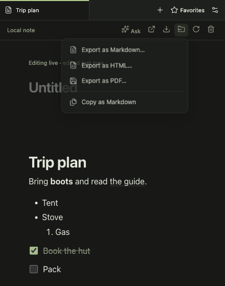
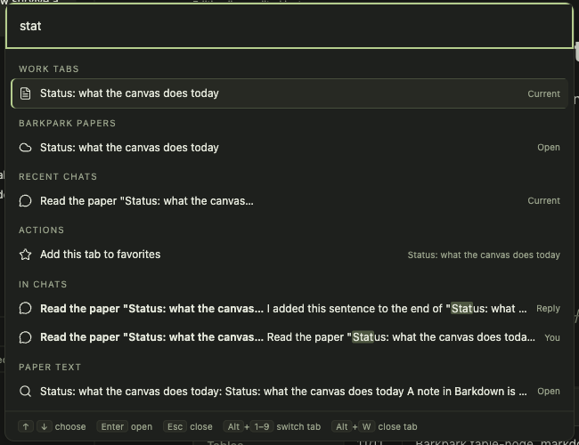

<!-- news-day: {"summary": "Two features merged into Barkdown's main branch: export a note as Markdown, HTML or PDF, or copy it as Markdown, and search inside every chat from quick open. Neither is in a downloadable build yet: the newest nightly is from 4 November, and every build run since Sunday night has failed.", "groups": [{"label": "Export a note", "text": "an Export menu in the note's path bar: Markdown with its pictures in a folder beside the file, one HTML file with the pictures inside, PDF, or Copy as Markdown", "prs": [135]}, {"label": "Search in chats", "text": "quick open finds words in your messages and the assistant's replies, side chats included; pick a hit and the chat opens at that message", "prs": [137]}]} -->
# Barkdown · Monday 16 November 2026

Three pull requests merged: two features, and this News page's own first version ([#136](https://github.com/FRIKKern/barkdown/pull/136)). Both features are merged, not yet in a build: the newest nightly is from 4 November, and the scheduled build has failed on every run since Sunday night. To try them today, run Barkdown from source (see the README).

## Export a note

[#135](https://github.com/FRIKKern/barkdown/pull/135). Open a note. In its path bar, press the export button and pick one:

- **Export as Markdown…**: you pick the file in a save dialog. Pictures go into a new `<name>_files` folder beside it, with relative links. A second export never reuses that folder; it makes `<name>_files-2`.
- **Export as HTML…**: one file, with the pictures inside it.
- **Export as PDF…**: the HTML, printed in a hidden window that loads nothing else and runs no scripts.
- **Copy as Markdown**: the note on the clipboard, pictures by their own addresses, no file written.

Headings, links, nested and task lists, tables, code and pictures are kept.

*From the live test in real Barkdown ([#135](https://github.com/FRIKKern/barkdown/pull/135)).*

## Search inside chats

[#137](https://github.com/FRIKKern/barkdown/pull/137). Open quick open and type. A new **In chats** group lists hits from every chat of the current profile, your messages and the assistant's replies, side chats included: the chat's title and a short snippet with the match marked. Choose one and the chat opens with that message scrolled into view and highlighted for a moment. Every word you type must be in the same message.

*The status picture retaken for #137.*

## Where it is slow or rough

- Not in your hands yet: no nightly since 4 November.
- Search shows at most 3 hits per chat and 12 in all, newest chat first. On a 50 MB workspace the first search takes about 350 ms; later ones under 10 ms (#137).
- Export refuses a note with unsaved edits: *Finish saving this note before exporting it* (#135).
- Search in chats has no picture yet from Windows or from a narrow window (#137).

## Across the projects

Export reads the note from [Barkpark](https://github.com/FRIKKern/barkpark), the server Barkdown keeps its notes in, and sends your sign-in only to that server when it fetches the pictures. Barkpark's own papers got Markdown export and print to PDF the day before ([FRIKKern/barkpark#26513](https://github.com/FRIKKern/barkpark/pull/26513)).
