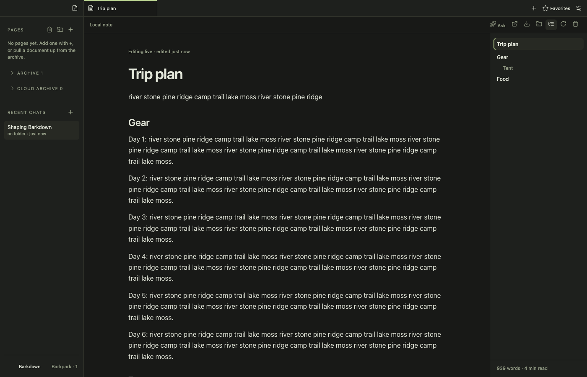
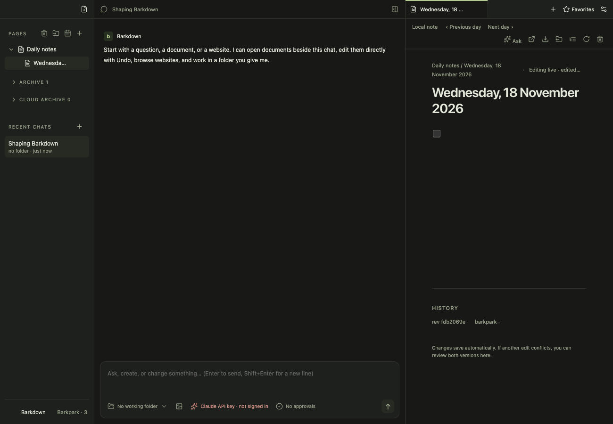

<!-- news-day: {"summary": "Four features merged into Barkdown's main branch: an outline of a Paper note's headings with word count and reading time, a menu on each chat, mentioning a note in a chat with @, and today's daily note with one key. All of them are in a downloadable build: build runs, red from Sunday night, are green again, and the Mac nightly of Thursday 19 November was built after the last merge.", "groups": [{"label": "Notes", "text": "an Outline panel lists a Paper note's headings with its word count and reading time; ⌘/Ctrl+Shift+D opens today's note under a Daily notes page, with steps to other days", "prs": [139, 142]}, {"label": "Chats", "text": "each chat has a menu to rename, pin, save as a note or export as Markdown; type @ to send a note's text with your message, unsaved typing included", "prs": [140, 141, 146]}]} -->
# Barkdown · Wednesday 18 November 2026

Eight pull requests merged: four features, two follow-ups to the @ mention, and two tooling fixes. Everything merged today is in a downloadable build. The build runs that failed from Sunday night are green again since Wednesday morning, and the Mac nightly `0.6.0-nightly.20261119.1`, published at 02:27 on Thursday 19 November, was built from main after the last of these merges. It is a pre-release nightly for Apple silicon and Intel, on the [releases page](https://github.com/FRIKKern/barkdown/releases). Export and search in chats, from 16 November, are in it too.

## What a person can now do

### See a note's outline

[#139](https://github.com/FRIKKern/barkdown/pull/139). Open a Paper note. Press the Outline button in its path bar, after Export, or press ⌘⇧O (Ctrl+Shift+O). A panel opens beside the note: the note's title, then its h1–h4 headings nested by level, and below them a line like *1,234 words · 5 min read* (230 words a minute; hover for the character count).

- Choose a heading and the note scrolls to it and highlights it for a moment. The caret stays where it was.
- The panel follows your typing and agent edits, and marks the section you are reading.
- Open or closed is kept per tab, and it starts closed. In a work area under 720 px wide, the panel lies over the note's right edge and closes after you choose a heading.
- In Markdown source mode (⌘⇧M) the panel asks you to go back to the Paper view.

*From the live test in real Barkdown ([#139](https://github.com/FRIKKern/barkdown/pull/139)).*

### A menu on each chat

[#140](https://github.com/FRIKKern/barkdown/pull/140). In Recent chats, right-click a chat, or press the … button that shows on hover or keyboard focus.

- **Rename…** refuses an empty name. A renamed chat keeps its name when its first message is sent.
- **Pin to top / Unpin**: pinned chats come first, in the order you pinned them, with a pin icon. Pins are saved with the workspace.
- **Save as a note** makes a Paper note titled after the chat: a date line, then every message under You and Barkdown headings. It lands in Pages and opens beside the chat. Two quick presses make one note. The item is disabled, with the reason shown, for an empty chat, during a reply, and without the local library.
- **Export as Markdown…**: pick a file in the save dialog. Only that file is written.
- **Delete…** is in the same menu.

### Mention a note in a chat with @

[#141](https://github.com/FRIKKern/barkdown/pull/141). In a chat's message box, main or side chat, type @ at the start or after a space. A picker lists the profile's Paper and local notes, the same ones quick open lists.

1. Type to filter. Arrows and Enter or Tab pick; Escape closes and keeps the @. An @ inside an email address opens nothing.
2. The pick shows as `@[Note title]`. Backspace removes it whole.
3. Send. The assistant gets the note's text with your words. In the chat, your message shows the note as a chip that opens it.

At most 5 notes go with one message, 20,000 characters each; a longer note is cut, and the text says so. A note mentioned twice is sent once. A deleted or unreadable note goes as "(note not available)", and a toast says so.

**Unsaved typing is included** ([#146](https://github.com/FRIKKern/barkdown/pull/146)). If the note is open with unsaved edits, its tab finishes saving first, waiting 4 seconds at most, so the assistant reads what you see. If that save fails or runs out of time, the message goes with the last saved text and a toast says so. A note open in Markdown source mode stays there; it goes as last saved, with the same toast.

**Where the text is kept** ([#141](https://github.com/FRIKKern/barkdown/pull/141), [#143](https://github.com/FRIKKern/barkdown/pull/143)). The chat transcript keeps your words and the mention, by note id, not the note's text. With an API key, the text sent to the model, mentioned notes included, stays in the chat's saved history and is sent again on later turns, like any other sent text. A resend reads the note again, so it sends the note as it is at that moment.

### Today's note with one key

[#142](https://github.com/FRIKKern/barkdown/pull/142). Press ⌘/Ctrl+Shift+D, pick *Today's note* in quick open, or press the calendar button beside the + in Pages. Today's note opens under a Daily notes page; both are made if missing.

- The note is titled with the local date in long form, such as "Wednesday, 18 November 2026", and starts with one empty checklist line.
- Its path bar has *‹ Previous day* and *Next day ›*. A missing day reads "No note for Tuesday, 17 November 2026 · Create"; nothing is made until you press Create.
- Rename or move the Daily notes page or a day's note and it is found again, not made twice. A note already titled with the date is taken over as that day's note.
- Quick open also offers *Yesterday's note* when your search starts with "yes".
- With the library off, or with "Show Barkpark papers in the library" off, the button and quick open rows are hidden, and a press says why.

*From the live test in real Barkdown ([#142](https://github.com/FRIKKern/barkdown/pull/142)).*

### Tooling

- **A Windows test flake fixed** ([#144](https://github.com/FRIKKern/barkdown/pull/144)). Barkdown saves a file by writing a copy and renaming it into place. When that rename fails and the writer gives up, it now looks at the file once more and reports that someone else changed it, if they did, instead of a plain rename error. A new test runs this path on every platform.
- **A clearer check message** ([#145](https://github.com/FRIKKern/barkdown/pull/145)). Status screenshots are pictures of the app kept in the repository; the repository check `concept` fails when they are older than the last renderer change. When the pictures were taken on a commit that is no longer in the branch's history, for example after a squash merge, the check now says so and how to retake them. Before, it blamed a renderer change.

## Where it is slow or rough

- None of the four features was tried by hand on Windows; Windows was left to the hosted test runs (#139, #140, #141, #142). The nightly is for Mac only.
- The @ live tests used the API through a scripted stand-in, not a live model. Claude Code and Codex get the same text, but only a unit test covers them (#141, #146).
- When a chat hands earlier turns to another provider, those turns carry the `@[Note title]` tokens, not the notes (#141).
- A message can wait up to 4 seconds when a mentioned note is open with unsaved edits (#146).

## Across the projects

Barkdown keeps its notes in [Barkpark](https://github.com/FRIKKern/barkpark). The outline, daily notes and *Save as a note* all work on Paper notes, which are Barkpark documents. A mention reads a Paper note from Barkpark when you send, through the profile that owns it; another profile's note is refused (#141). With an API key, the chat's saved history, mentioned notes included, is kept in Barkdown's workspace (#143). No Barkpark pull request ties in to today's work. The nightly carries its own Barkpark, with PostgreSQL inside.
