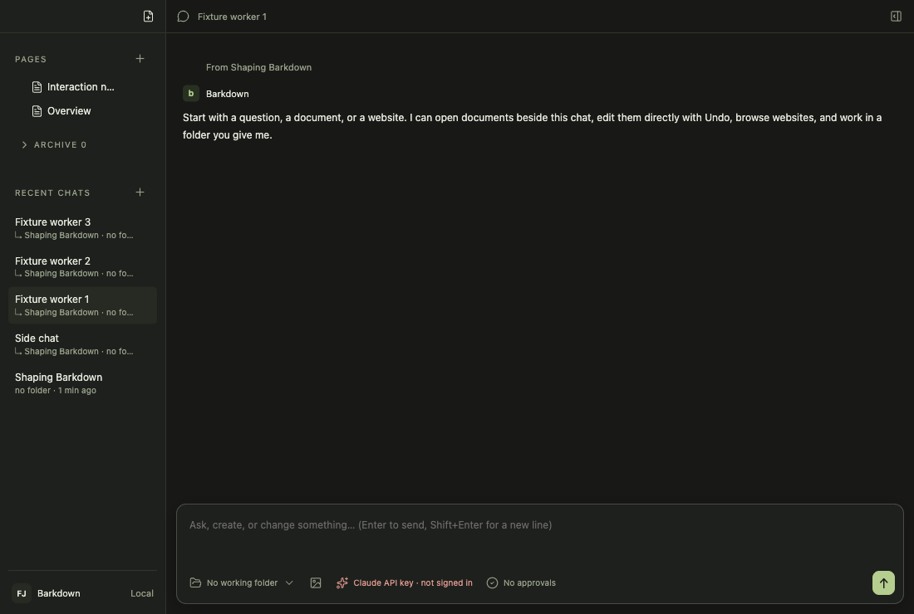
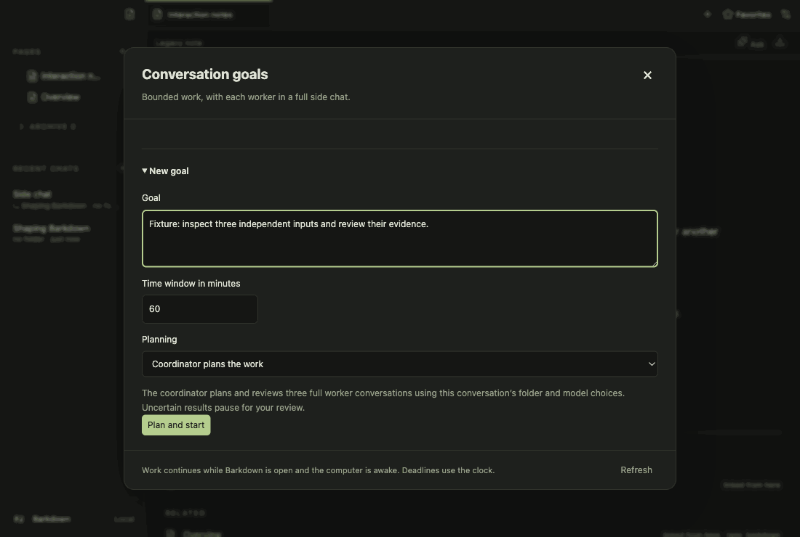
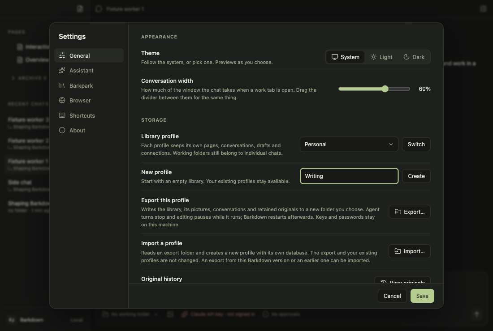

# Visual health on darwin

Approved fixture captures of the real Electron UI on darwin (OS 24.5.0, Electron 44.5.1). The primary gallery in [README.md](README.md) is the Windows source machine's; this page stands beside it, never in its place. See [rules](RULES.md).

Reviewed by feat-barkdown-3 builder (Opus). Chat note review fixes (M1-M4) merged with main 1d93f4ca. 53 steps: no tour step shows a chat note notice; goals: worker-chat differs only in the sidebar's relative time (just now vs 1 min ago); profiles steps flag geometry with 0 changed pixels and render as before; quick-open and side-chat ready under 3e-6 changed pixels. Kept-request toasts are covered by tests/chat-menu.live.mjs shots 03b-03d.

Source commit: 7b7456162871ccf11d0dc262b7f6f8a287215627; review: docs/visual/reviews/approval-bfc64a929a2d4acc7bb59e91c96722cdf3888443cd670f35afa10f8b1e6919ad.json.

## workspace

Real desktop navigation with disposable local notes; no cloud or provider.

## chat

Shared main composer: draft, provider chooser and model chooser. No message is sent.

## side-chat

A real saved side conversation and its independent composer, using disposable fixture state.

## documents

Read-only legacy document viewer. The light frame is a theme-contrast comparison; no Paper server or editing is used.

## retained

After the library switch the legacy notes are retained read-only. Dark by default; the light frame compares theme contrast. Fixture journal; no Paper server.

## settings

Real Settings navigation. No server connection or credential is configured.

## goals

Goal component with explicitly injected fixture snapshots and providers blocked. Saved worker chats use the ordinary composer; this is not live scheduler/provider proof.

## profiles

Profile Settings controls with injected stable registry names. This tour makes no profile switch; real switching and Paper save protection have separate integration evidence.

## adoption

Real recovery window with explicit fixture states; no migration is performed in this visual tour. Actual transaction/restart proof is separate.

