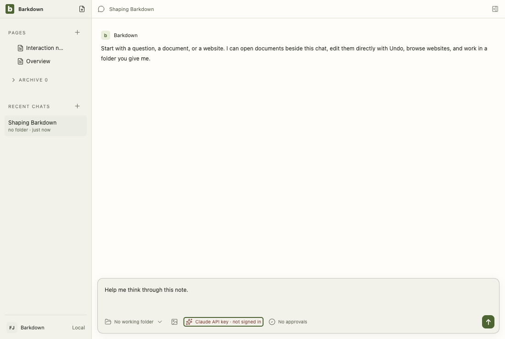
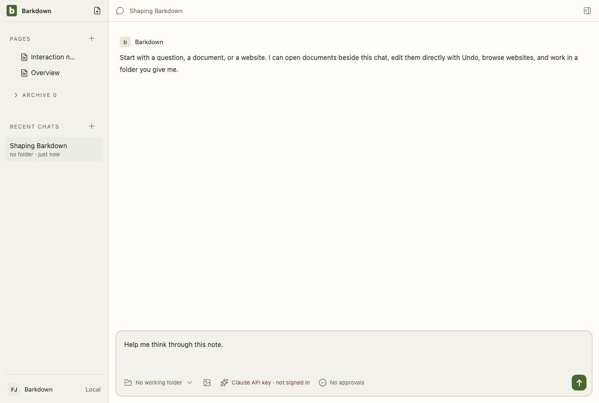
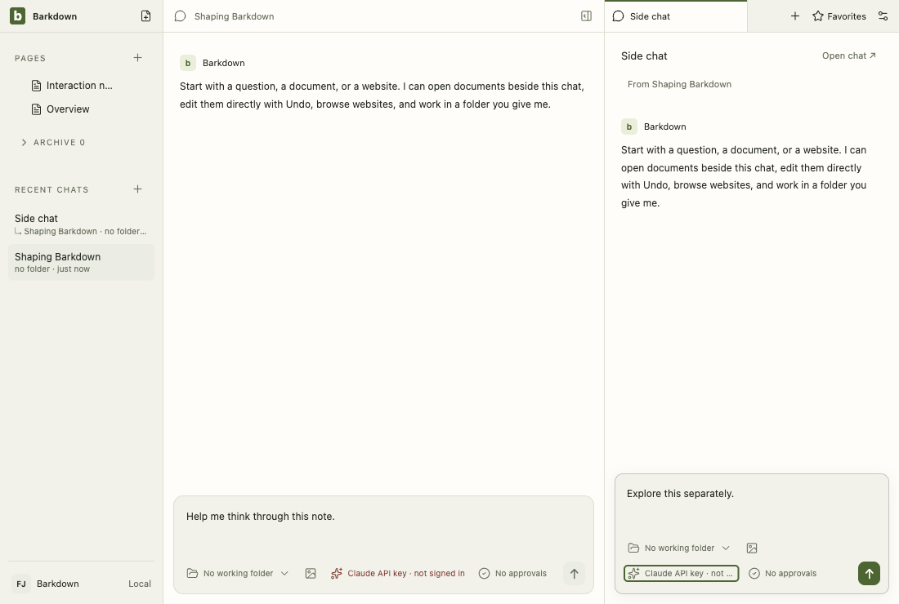
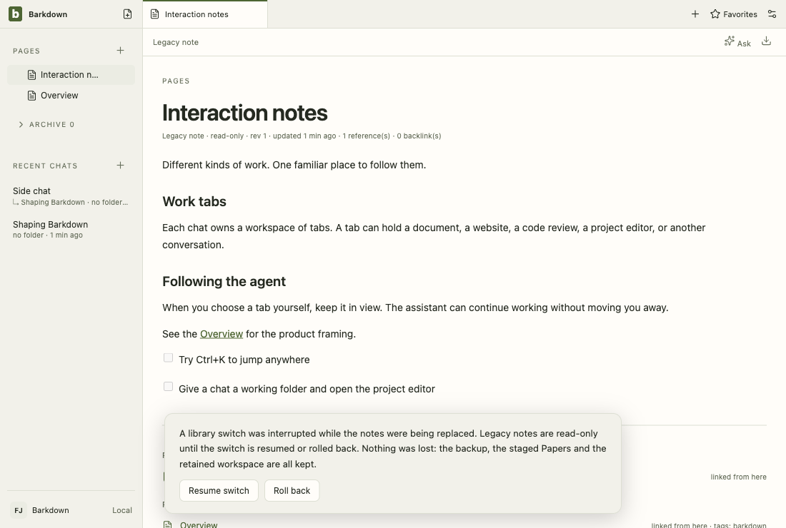
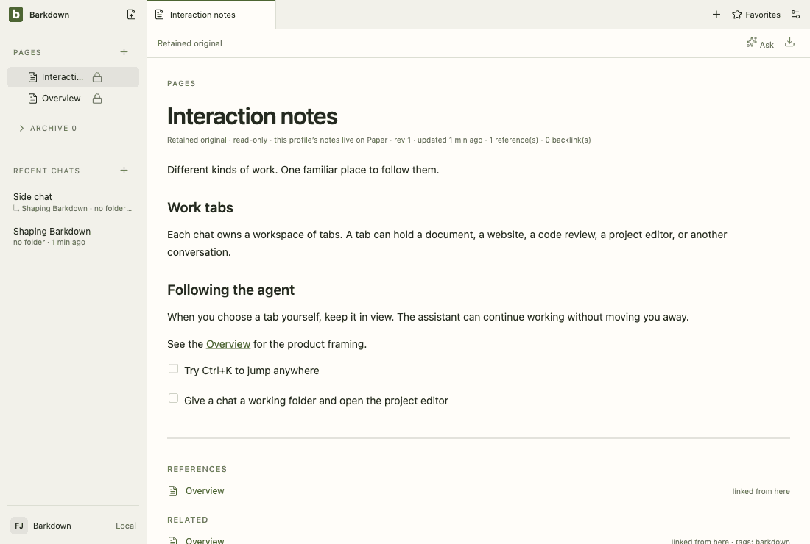
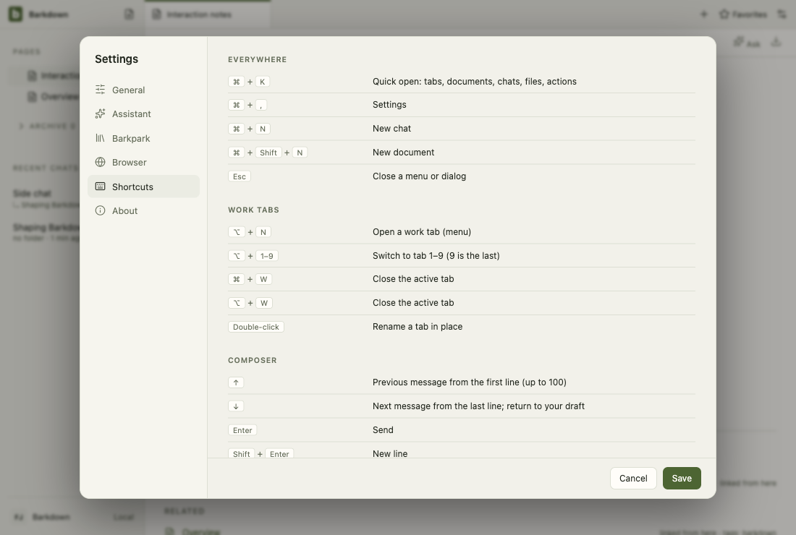
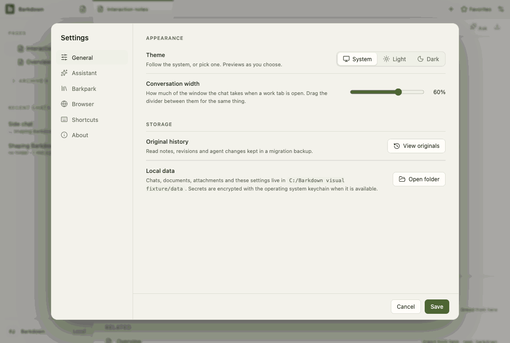
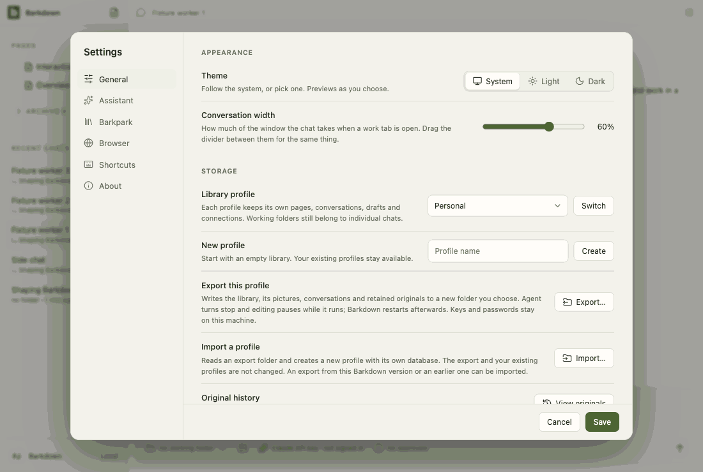

# Visual health on darwin

Approved fixture captures of the real Electron UI on darwin (OS 24.3.0, Electron 44.5.1). The primary gallery in [README.md](README.md) is the Windows source machine's; this page stands beside it, never in its place. See [rules](RULES.md).

Reviewed by Claude Fable 5.1 (agent). C094: settings: assistant gains the Barkdown controls itself section (Full YOLO switch off, the command line path). The documents, retained and goals frames differ only in clock-dependent text (updated time, relative time, deadline time): the capture ran in the evening, the baseline at midday. Inspected documents-0-diff, settings-1, goals-3-diff.

Source commit: de839e3975191773fb4ccff55037f89031fddeb6; review: docs/visual/reviews/approval-bba8ca302f82377b2a571a52aeb8be08928015ff4fdb16ee1e004206f7654a51.json.

## workspace

Real desktop navigation with disposable local notes; no cloud or provider.

## chat

Shared main composer: draft, provider chooser and model chooser. No message is sent.

## side-chat

A real saved side conversation and its independent composer, using disposable fixture state.

## documents

Legacy local document editor, still retained until P2 migration. This is not the Barkpark Paper canvas.

## retained

After the library switch the legacy notes are retained read-only: a badge in Pages and a read-only editor. Fixture journal; no Paper server.

## settings

Real Settings navigation. No server connection or credential is configured.

## goals

Goal component with explicitly injected fixture snapshots and providers blocked. Saved worker chats use the ordinary composer; this is not live scheduler/provider proof.

## profiles

Profile Settings controls with injected stable registry names. This tour makes no profile switch; real switching and Paper save protection have separate integration evidence.

## adoption

Real recovery window with explicit fixture states; no migration is performed in this visual tour. Actual transaction/restart proof is separate.

