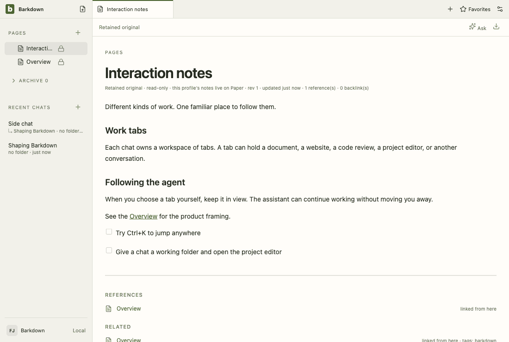

# Visual health on darwin

Approved fixture captures of the real Electron UI on darwin (OS 24.3.0, Electron 38.8.6). The primary gallery in [README.md](README.md) is the Windows source machine's; this page stands beside it, never in its place. See [rules](RULES.md).

Reviewed by Claude Fable 5.1 (agent). A5 daily-use: the reduced-motion rule now collapses every animation and transition; captured frames are unaffected (two one-pixel antialias differences: workspace: dismiss, side-chat: ready; no geometry change).

Source commit: ffcba1272a22217035f591a3f445576ccd8d7ed9; review: docs/visual/reviews/approval-29b48c5ab3cc0d34fc9cbb36ec0ba98d016cd7a25c00e3d5725f7cd50ba044c6.json.

## workspace

Real desktop navigation with disposable local notes; no cloud or provider.

## chat

Shared main composer: draft, provider chooser and model chooser. No message is sent.

## side-chat

A real saved side conversation and its independent composer, using disposable fixture state.

## documents

Legacy local document editor, still retained until P2 migration. This is not the Barkpark Paper canvas.

## retained

After the library switch the legacy notes are retained read-only: a badge in Pages and a read-only editor. Fixture journal; no Paper server.

## settings

Real Settings navigation. No server connection or credential is configured.

## goals

Goal component with explicitly injected fixture snapshots and providers blocked. Saved worker chats use the ordinary composer; this is not live scheduler/provider proof.

## profiles

Profile Settings controls with injected stable registry names. This tour makes no profile switch; real switching and Paper save protection have separate integration evidence.

## adoption

Real recovery window with explicit fixture states; no migration is performed in this visual tour. Actual transaction/restart proof is separate.

