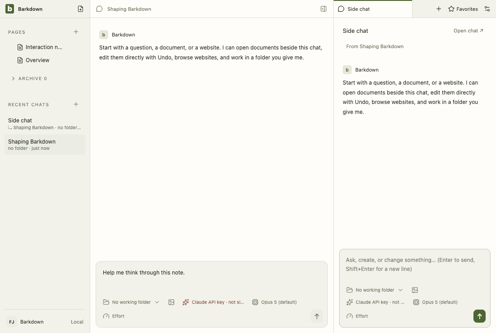
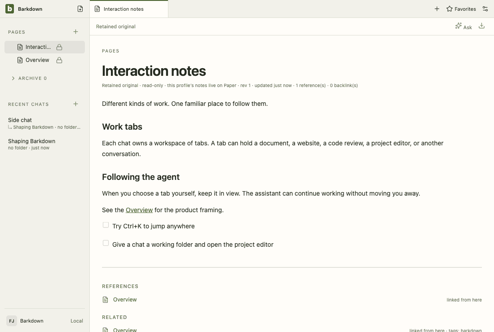
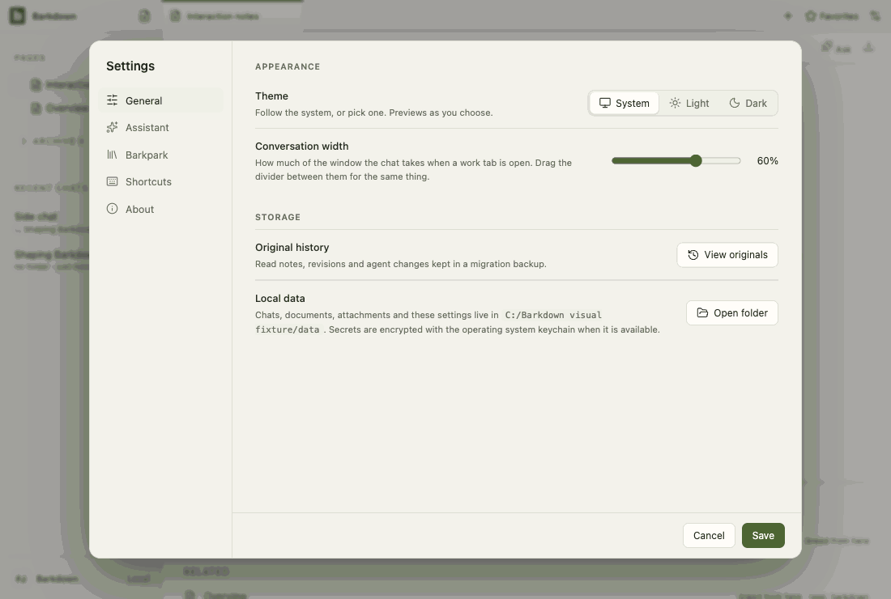
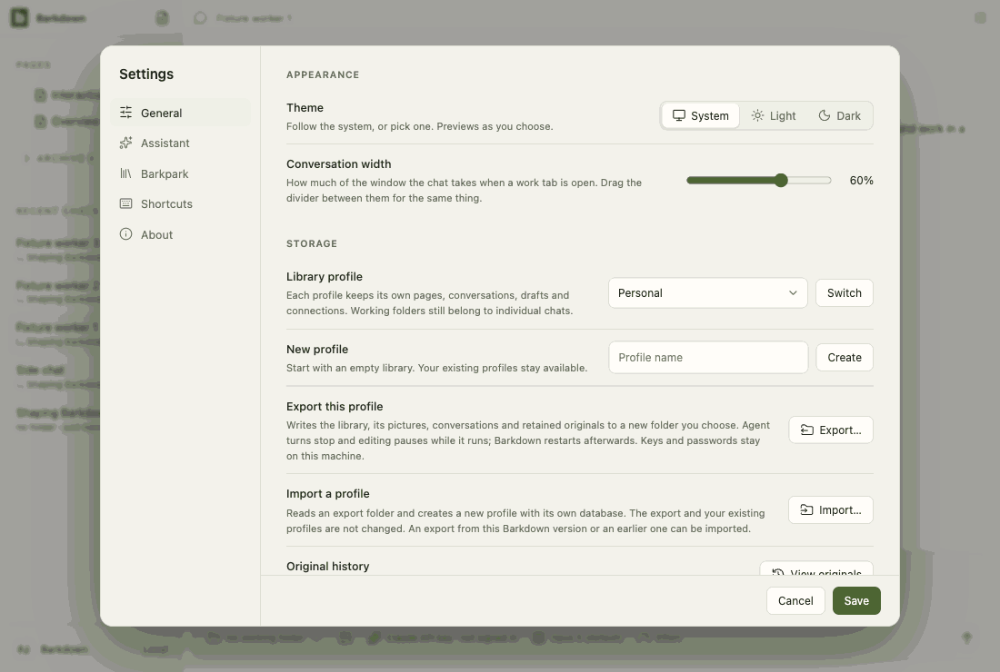

# Visual health on darwin

Approved fixture captures of the real Electron UI on darwin (OS 24.3.0, Electron 38.8.6). The primary gallery in [README.md](README.md) is the Windows source machine's; this page stands beside it, never in its place. See [rules](RULES.md).

Reviewed by Claude Fable 5.1 (agent). C086 delivery: provider truth runner on a Paper, isolated harness accepts a release, packaged runtime seeds through Barkpark.Release.seed(), recovery after three missed probes. Inspected: goals narrow differs only in the close button focus ring; four one-pixel antialias differences at the send button; no geometry change.

Source commit: e3e39659cd7a68c4a7e356f0cadd4d1302d46631; review: docs/visual/reviews/approval-42698e1ecd312fd9b478cfa0f88e942dec53841d32149c8340ca9cff6f0525f4.json.

## workspace

Real desktop navigation with disposable local notes; no cloud or provider.

## chat

Shared main composer: draft, provider chooser and model chooser. No message is sent.

## side-chat

A real saved side conversation and its independent composer, using disposable fixture state.

## documents

Legacy local document editor, still retained until P2 migration. This is not the Barkpark Paper canvas.

## retained

After the library switch the legacy notes are retained read-only: a badge in Pages and a read-only editor. Fixture journal; no Paper server.

## settings

Real Settings navigation. No server connection or credential is configured.

## goals

Goal component with explicitly injected fixture snapshots and providers blocked. Saved worker chats use the ordinary composer; this is not live scheduler/provider proof.

## profiles

Profile Settings controls with injected stable registry names. This tour makes no profile switch; real switching and Paper save protection have separate integration evidence.

## adoption

Real recovery window with explicit fixture states; no migration is performed in this visual tour. Actual transaction/restart proof is separate.

