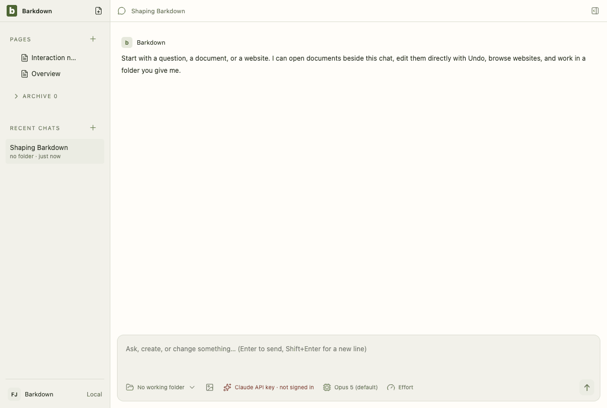
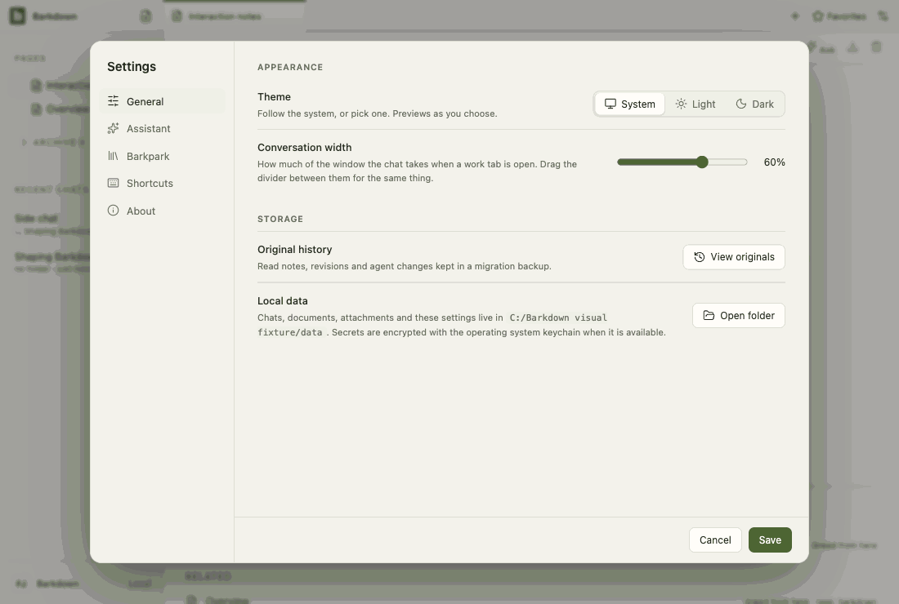
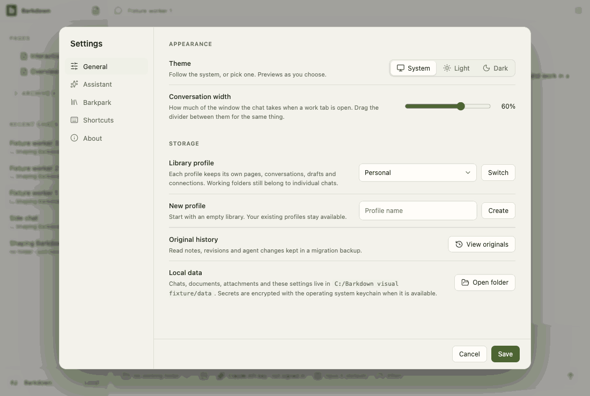

# Visual health on darwin

Approved fixture captures of the real Electron UI on darwin (OS 24.3.0, Electron 38.8.6). The primary gallery in [README.md](README.md) is the Windows source machine's; this page stands beside it, never in its place. See [rules](RULES.md).

Reviewed by Claude Fable 5.1 (agent, macOS host). First darwin approval, recorded beside the Windows baseline (never over it). Inspected the final frame of all eight areas plus the settings, side-chat and adoption views against the 2026-09-25 Windows run: identical layouts, states and copy; differences are macOS font rendering (system-ui for Segoe UI) and line height. No new baseline for Windows is implied; its approval is now stale against these inputs and is recaptured at the Windows return checkpoint. Product finding, not a capture defect: the Shortcuts pane labels chords Ctrl on macOS although the app accepts Cmd (C084 gap). Behavior evidence: full desktop chain 80/80 on this host (evidence/C084).

Source commit: c22231a14ee387a519ede0d219025c857fffbd87; review: docs/visual/reviews/approval-676abcea7c37c5a2c352d00c42662f596582e3965573021eaf04f6e13de66130.json.

## workspace

Real desktop navigation with disposable local notes; no cloud or provider.

## chat

Shared main composer: draft, provider chooser and model chooser. No message is sent.

## side-chat

A real saved side conversation and its independent composer, using disposable fixture state.

## documents

Legacy local document editor, still retained until P2 migration. This is not the Barkpark Paper canvas.

## settings

Real Settings navigation. No server connection or credential is configured.

## goals

Goal component with explicitly injected fixture snapshots and providers blocked. Saved worker chats use the ordinary composer; this is not live scheduler/provider proof.

## profiles

Profile Settings controls with injected stable registry names. This tour makes no profile switch; real switching and Paper save protection have separate integration evidence.

## adoption

Real recovery window with explicit fixture states; no migration is performed in this visual tour. Actual transaction/restart proof is separate.

