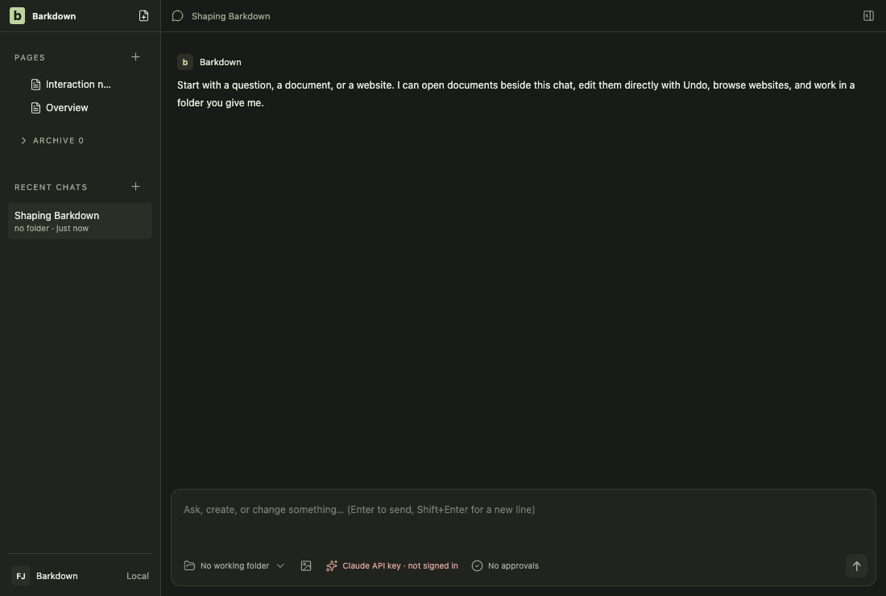
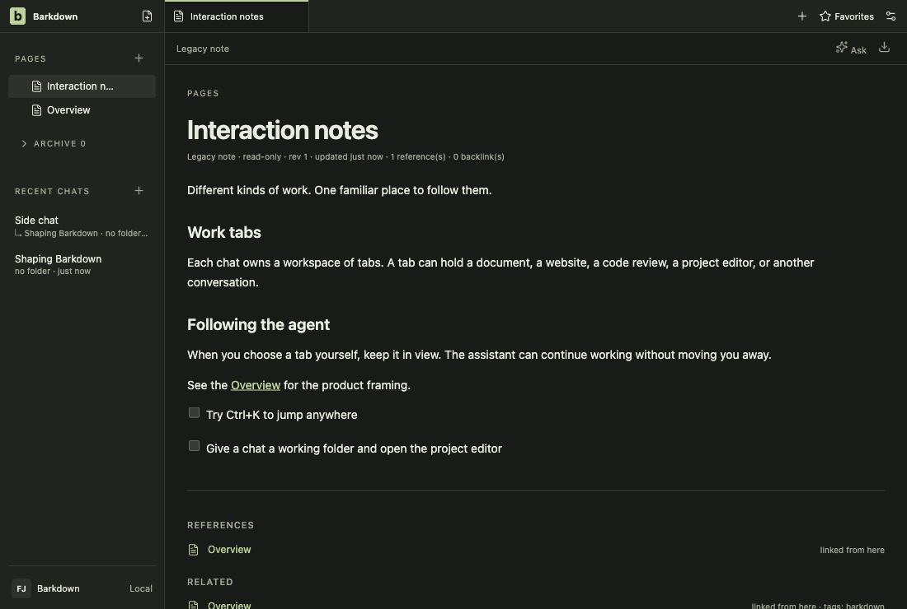
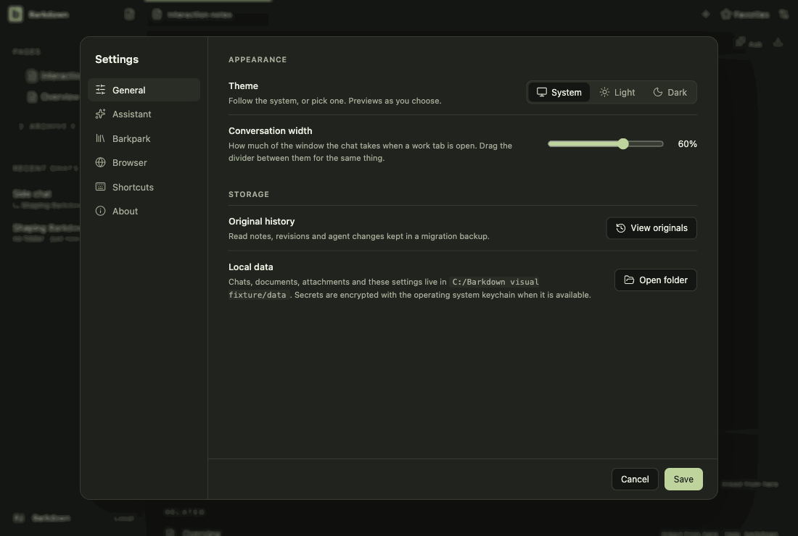
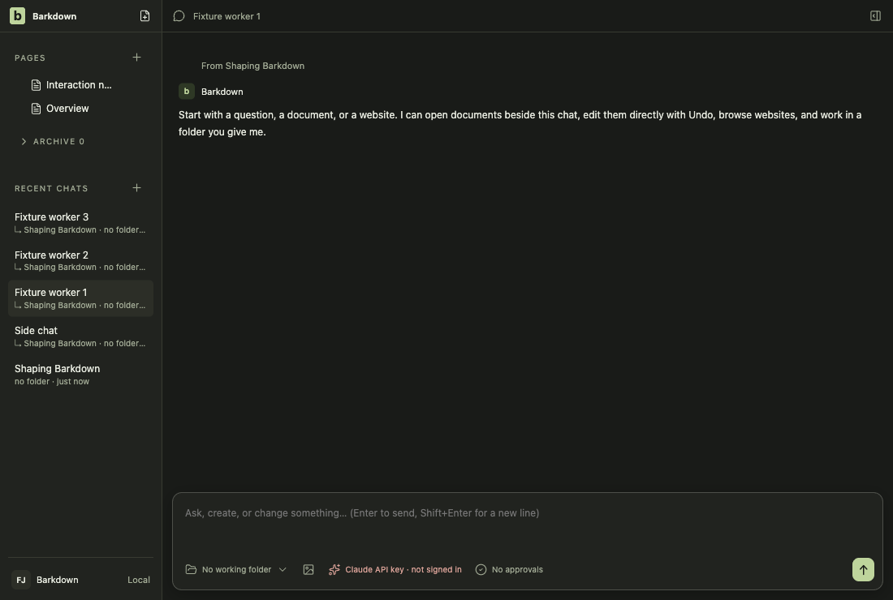
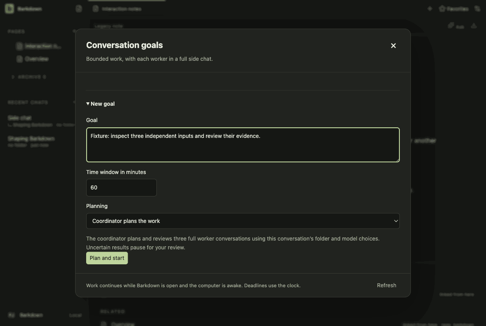
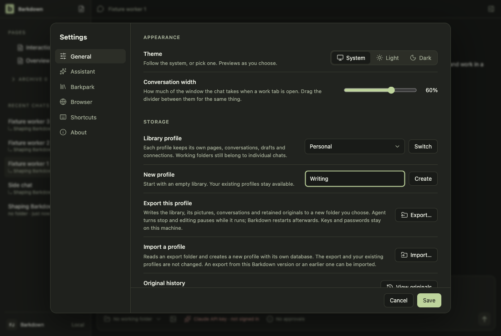
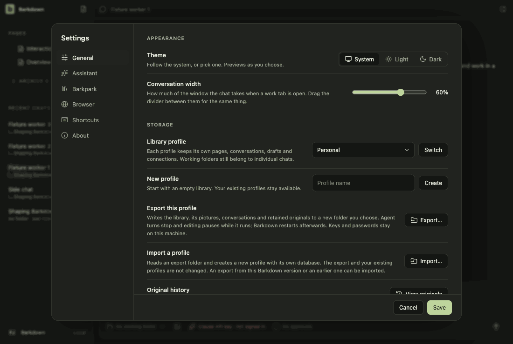
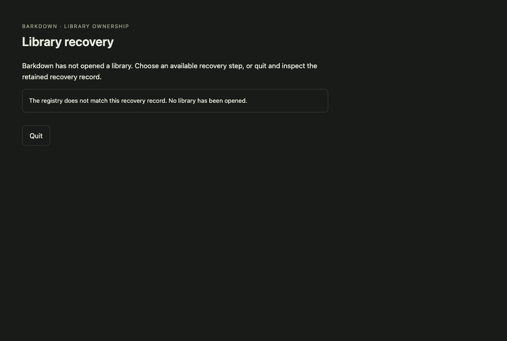

# Visual health on darwin

Approved fixture captures of the real Electron UI on darwin (OS 27.0.0, Electron 44.5.1). The primary gallery in [README.md](README.md) is the Windows source machine's; this page stands beside it, never in its place. See [rules](RULES.md).

Reviewed by Claude (agent, Opus 5.5), for #95. Run 2026-10-27T17-24-30-944Z after 29b8ec16 (tar relative paths in app/scripts/source-runtime.mjs and its test; no renderer change), compared with the approved 2026-10-27T16-56-56-138Z run. All frames small-difference, none review-required, no geometry change; the largest is goals-6 at 0.04% changed pixels. Inspected the goals-6 difference image: no visible change. Other frames were read from the report, not opened one by one.

Source commit: 29b8ec1686f66b16d113b1348a2edca4db44699e; review: docs/visual/reviews/approval-0b10e732cc1f35ed6e7fbdcc9052e34ea70e187ebb2af519719cbef03f783bf2.json.

## workspace

Real desktop navigation with disposable local notes; no cloud or provider.

## chat

Shared main composer: draft, provider chooser and model chooser. No message is sent.

## side-chat

A real saved side conversation and its independent composer, using disposable fixture state.

## documents

Read-only legacy document viewer. The light frame is a theme-contrast comparison; no Paper server or editing is used.

## retained

After the library switch the legacy notes are retained read-only. Dark by default; the light frame compares theme contrast. Fixture journal; no Paper server.

## settings

Real Settings navigation. No server connection or credential is configured.

## goals

Goal component with explicitly injected fixture snapshots and providers blocked. Saved worker chats use the ordinary composer; this is not live scheduler/provider proof.

## profiles

Profile Settings controls with injected stable registry names. This tour makes no profile switch; real switching and Paper save protection have separate integration evidence.

## adoption

Real recovery window with explicit fixture states; no migration is performed in this visual tour. Actual transaction/restart proof is separate.

