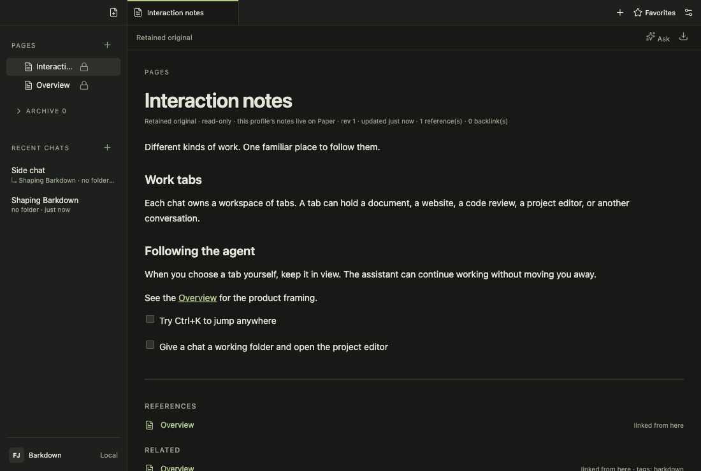

# Visual health on darwin

Approved fixture captures of the real Electron UI on darwin (OS 24.5.0, Electron 44.5.1). The primary gallery in [README.md](README.md) is the Windows source machine's; this page stands beside it, never in its place. See [rules](RULES.md).

Reviewed by feat-barkdown builder (Opus). Save to notes after review of 11d01f1: hostile links can no longer be assembled from split page text, a quote starting like a list stays a quote, and main reads the page in an isolated world (main/page-capture.js). No new pixels in the fixture tour (it has no website step): compared with run 2026-11-15T16-09-55-947Z, settings:assistant differs only in the random temp folder name, quick-open and side-chat open by one or two pixels. The browser bar button, context menu and the 'Saved page not confirmed · Retry' notice were inspected in the live run docs/cycles/evidence/clip/live/2026-11-15-clip-live-isolated (06-not-confirmed shows the notice after a profile switch caught a save mid-flight). Behaviour: app/tests/clip.test.mjs 12/12 (two new cases fail on 11d01f1); app/tests/clip.live.mjs 7/7 on the carried runtime.

Source commit: 11fd6ac9eb5992c69a31a3f73c7b4b5274b41655; review: docs/visual/reviews/approval-937e98394202578b1405b0d79394cf449f3c4fab6df3a7972240cd7fef0071fc.json.

## workspace

Real desktop navigation with disposable local notes; no cloud or provider.

## chat

Shared main composer: draft, provider chooser and model chooser. No message is sent.

## side-chat

A real saved side conversation and its independent composer, using disposable fixture state.

## documents

Read-only legacy document viewer. The light frame is a theme-contrast comparison; no Paper server or editing is used.

## retained

After the library switch the legacy notes are retained read-only. Dark by default; the light frame compares theme contrast. Fixture journal; no Paper server.

## settings

Real Settings navigation. No server connection or credential is configured.

## goals

Goal component with explicitly injected fixture snapshots and providers blocked. Saved worker chats use the ordinary composer; this is not live scheduler/provider proof.

## profiles

Profile Settings controls with injected stable registry names. This tour makes no profile switch; real switching and Paper save protection have separate integration evidence.

## adoption

Real recovery window with explicit fixture states; no migration is performed in this visual tour. Actual transaction/restart proof is separate.

