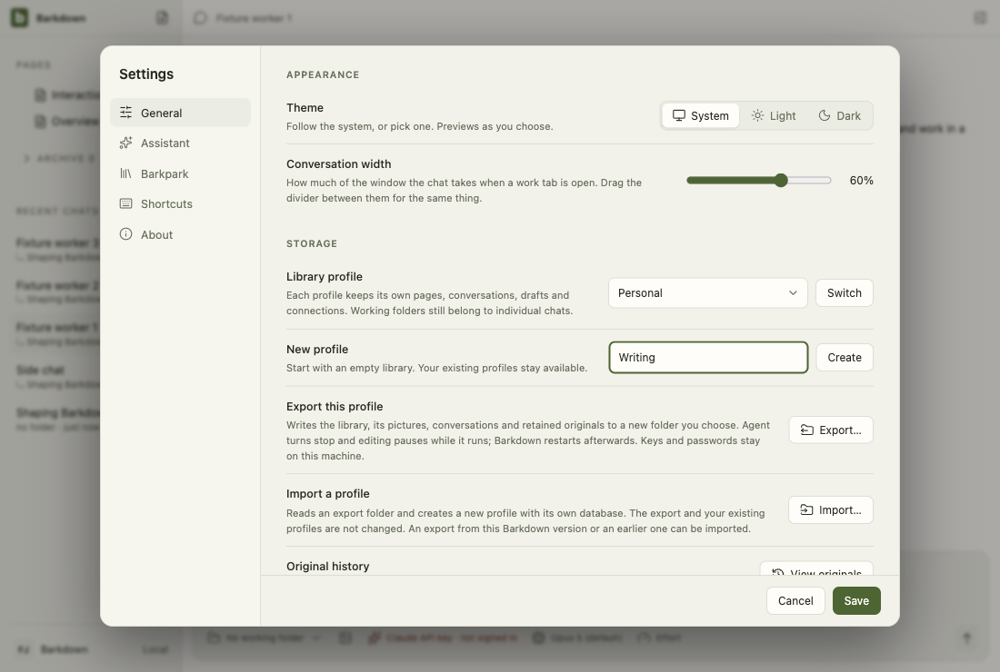

# Visual health on darwin

Approved fixture captures of the real Electron UI on darwin (OS 24.3.0, Electron 38.8.6). The primary gallery in [README.md](README.md) is the Windows source machine's; this page stands beside it, never in its place. See [rules](RULES.md).

Reviewed by Claude primary agent. C085 two installations and an earlier export into a later Barkdown: all 46 compared entries are pixel-identical to the previous approved run. The one renderer change is the import description in Settings, below the point where the fixture tours stop; it was read in the live rehearsal (two-installs 01, portable-ui 01). Inspected in the live rehearsals, all dark: the imported profile opened on the second installation with its conversation, Pages and the picture loaded (one pixel wide, a dot), and the refusal of another version naming both versions (portable-ui 02b).

Source commit: 169811e2756c19b3def637c0dc8b6eec2e3a8bde; review: docs/visual/reviews/approval-555f1a8d28a4ae8d7204a6576bd37b9287495b6d1d21e15ee48b4a7b1d7bf36a.json.

## workspace

Real desktop navigation with disposable local notes; no cloud or provider.

## chat

Shared main composer: draft, provider chooser and model chooser. No message is sent.

## side-chat

A real saved side conversation and its independent composer, using disposable fixture state.

## documents

Legacy local document editor, still retained until P2 migration. This is not the Barkpark Paper canvas.

## retained

After the library switch the legacy notes are retained read-only: a badge in Pages and a read-only editor. Fixture journal; no Paper server.

## settings

Real Settings navigation. No server connection or credential is configured.

## goals

Goal component with explicitly injected fixture snapshots and providers blocked. Saved worker chats use the ordinary composer; this is not live scheduler/provider proof.

## profiles

Profile Settings controls with injected stable registry names. This tour makes no profile switch; real switching and Paper save protection have separate integration evidence.

## adoption

Real recovery window with explicit fixture states; no migration is performed in this visual tour. Actual transaction/restart proof is separate.

