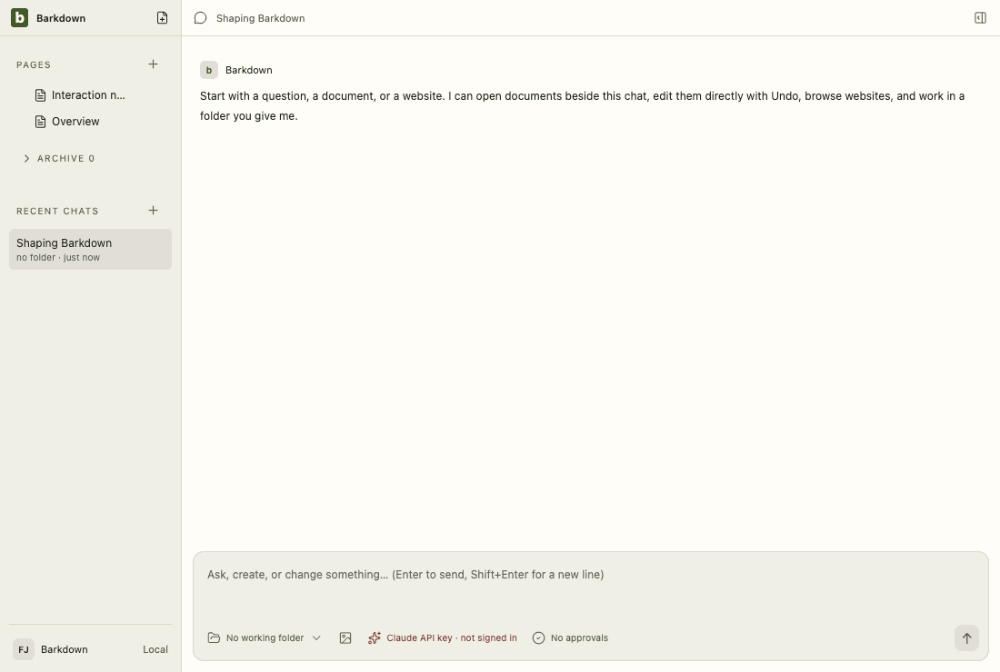
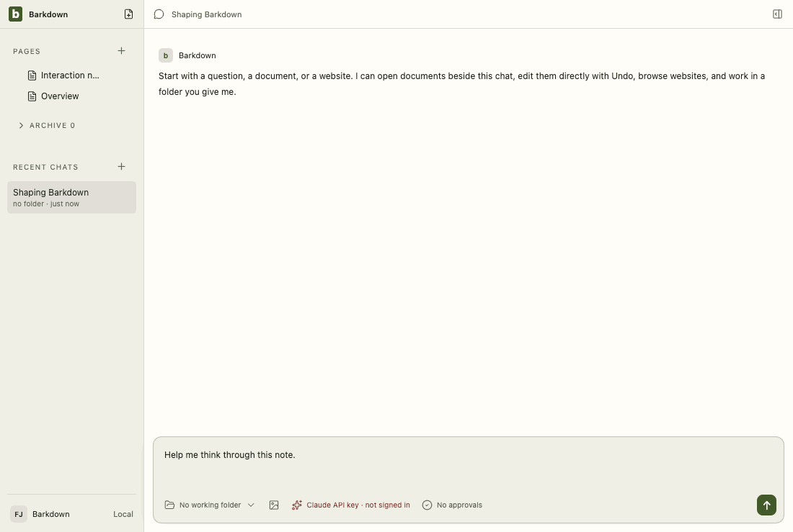
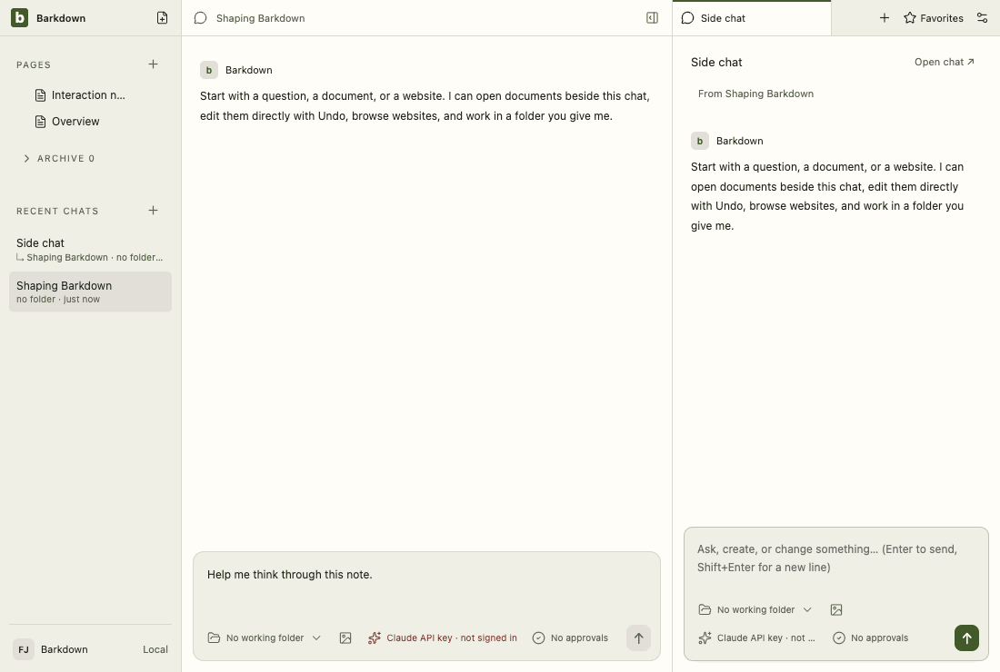
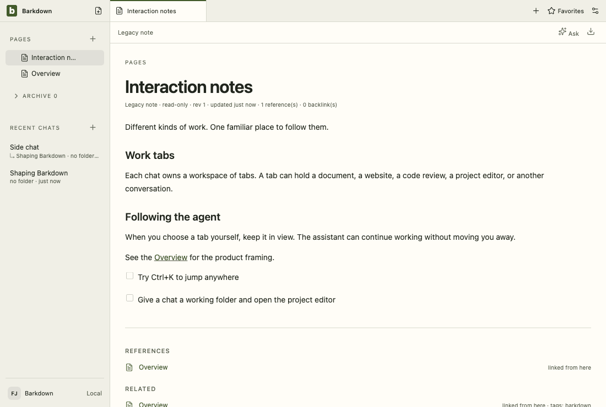
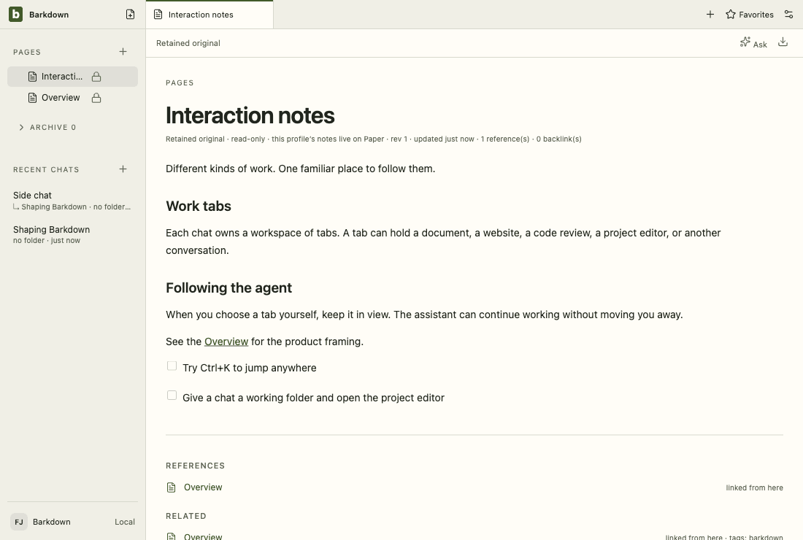
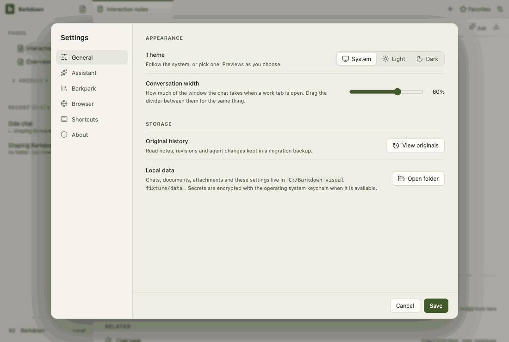
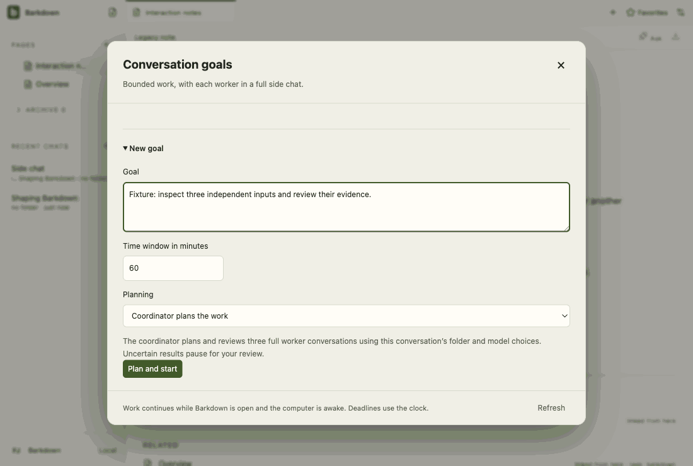
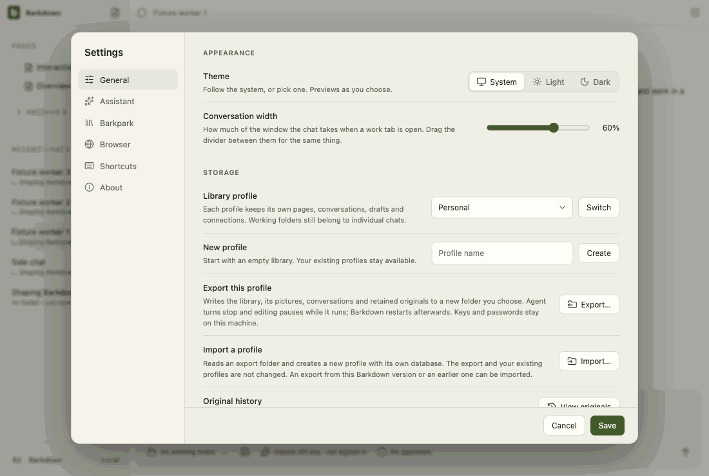
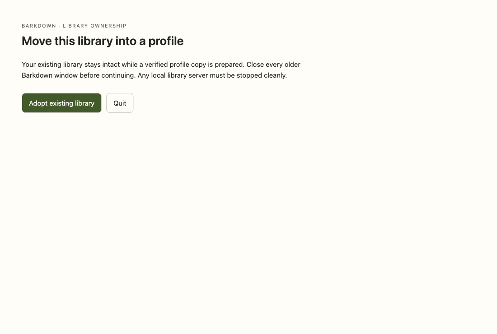

# Visual health on darwin

Approved fixture captures of the real Electron UI on darwin (OS 24.5.0, Electron 44.5.1). The primary gallery in [README.md](README.md) is the Windows source machine's; this page stands beside it, never in its place. See [rules](RULES.md).

Reviewed by Claude (agent), C095. C095 changes no UI surface the tour captures; the renderer change is the control surface's handlers, a deleted-note tab passing profile preparation, and the export notice refresh. Inspected every review-required frame: documents and retained differ only in the updated/relative clock text; settings: assistant only in the temporary path of the command; goals: worker-chat only in the relative time. Small differences elsewhere are sub-pixel text. Environment changed: a second Mac (same platform). Behaviour: control.test.mjs 7 of 7; control-wider.live.mjs 13 of 13 at 2474cd04 (docs/cycles/evidence/C095/live/2026-10-05T16-36-24-695Z-wider); control.live.mjs 13 of 13.

Source commit: 2474cd045447b100fddcd961b032f74f970697c1; review: docs/visual/reviews/approval-0b00198f8a8ede47d255302c38d2ab59da77f32f2073c35de4486c52e64491cc.json.

## workspace

Real desktop navigation with disposable local notes; no cloud or provider.

## chat

Shared main composer: draft, provider chooser and model chooser. No message is sent.

## side-chat

A real saved side conversation and its independent composer, using disposable fixture state.

## documents

Legacy local document editor, still retained until P2 migration. This is not the Barkpark Paper canvas.

## retained

After the library switch the legacy notes are retained read-only: a badge in Pages and a read-only editor. Fixture journal; no Paper server.

## settings

Real Settings navigation. No server connection or credential is configured.

## goals

Goal component with explicitly injected fixture snapshots and providers blocked. Saved worker chats use the ordinary composer; this is not live scheduler/provider proof.

## profiles

Profile Settings controls with injected stable registry names. This tour makes no profile switch; real switching and Paper save protection have separate integration evidence.

## adoption

Real recovery window with explicit fixture states; no migration is performed in this visual tour. Actual transaction/restart proof is separate.

