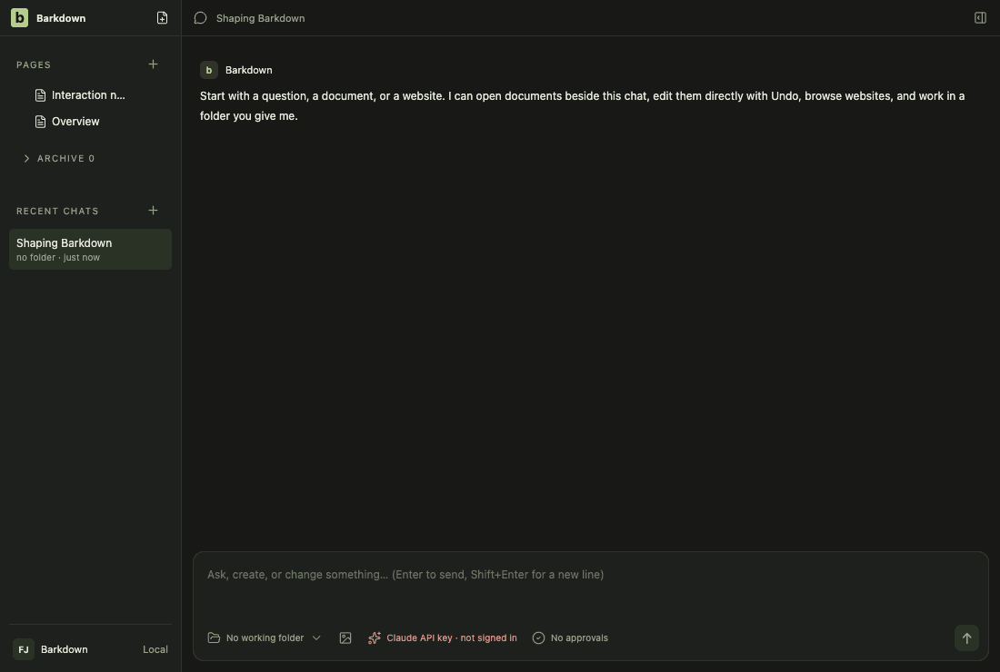
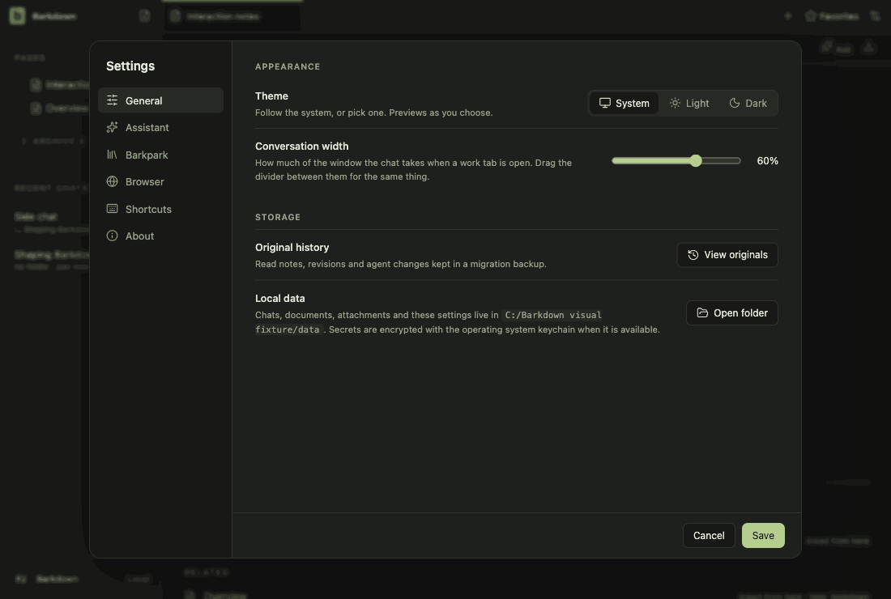
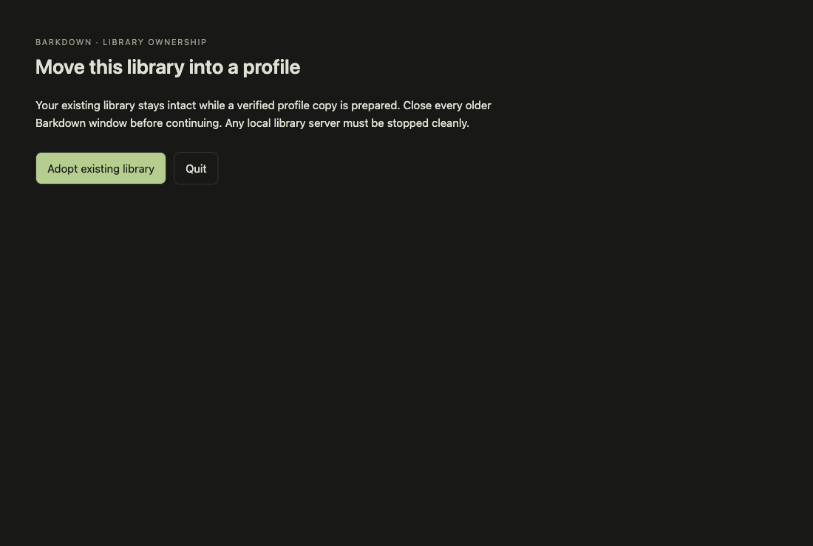

# Visual health on darwin

Approved fixture captures of the real Electron UI on darwin (OS 24.5.0, Electron 44.5.1). The primary gallery in [README.md](README.md) is the Windows source machine's; this page stands beside it, never in its place. See [rules](RULES.md).

Reviewed by Claude (agent, Opus 5.5). Inspected every changed frame of run 2026-10-27T12-50-12-854Z. settings-1 (review-required): the only difference is the random temp folder name in the Command line path (/private/tmp/barkdown-visual-XXXXXX), not a UI change. goals-6: no visible difference in the diff (sub-pixel antialiasing, 0.04%). workspace-3: one antialiasing pixel at the send button corner. All other frames 0 changed pixels; geometry unchanged everywhere. The change (shield blocked count kept per page in main, asked for at dom-ready) has no visual surface in these tours; behaviour proven by browser.live.mjs (tracker blocked and counted) locally.

Source commit: e83a4bbf94dac3f81f4fa20de5d47dd846324c95; review: docs/visual/reviews/approval-c9fd918901d002566f380befa4a340543dc9f4b98b3b9cdf6da66b05990af2ff.json.

## workspace

Real desktop navigation with disposable local notes; no cloud or provider.

## chat

Shared main composer: draft, provider chooser and model chooser. No message is sent.

## side-chat

A real saved side conversation and its independent composer, using disposable fixture state.

## documents

Read-only legacy document viewer. The light frame is a theme-contrast comparison; no Paper server or editing is used.

## retained

After the library switch the legacy notes are retained read-only. Dark by default; the light frame compares theme contrast. Fixture journal; no Paper server.

## settings

Real Settings navigation. No server connection or credential is configured.

## goals

Goal component with explicitly injected fixture snapshots and providers blocked. Saved worker chats use the ordinary composer; this is not live scheduler/provider proof.

## profiles

Profile Settings controls with injected stable registry names. This tour makes no profile switch; real switching and Paper save protection have separate integration evidence.

## adoption

Real recovery window with explicit fixture states; no migration is performed in this visual tour. Actual transaction/restart proof is separate.

