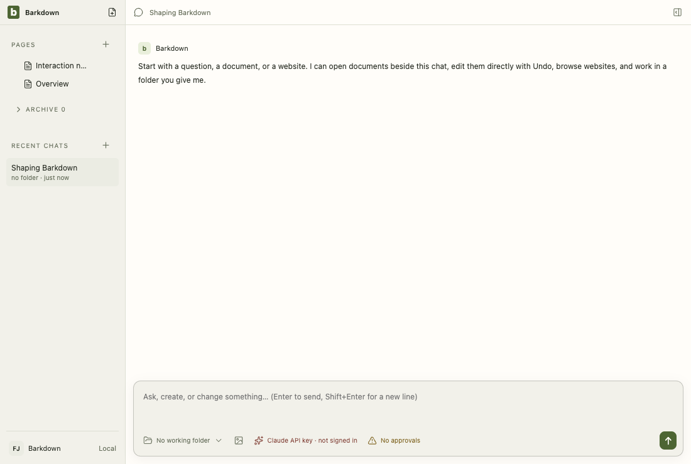
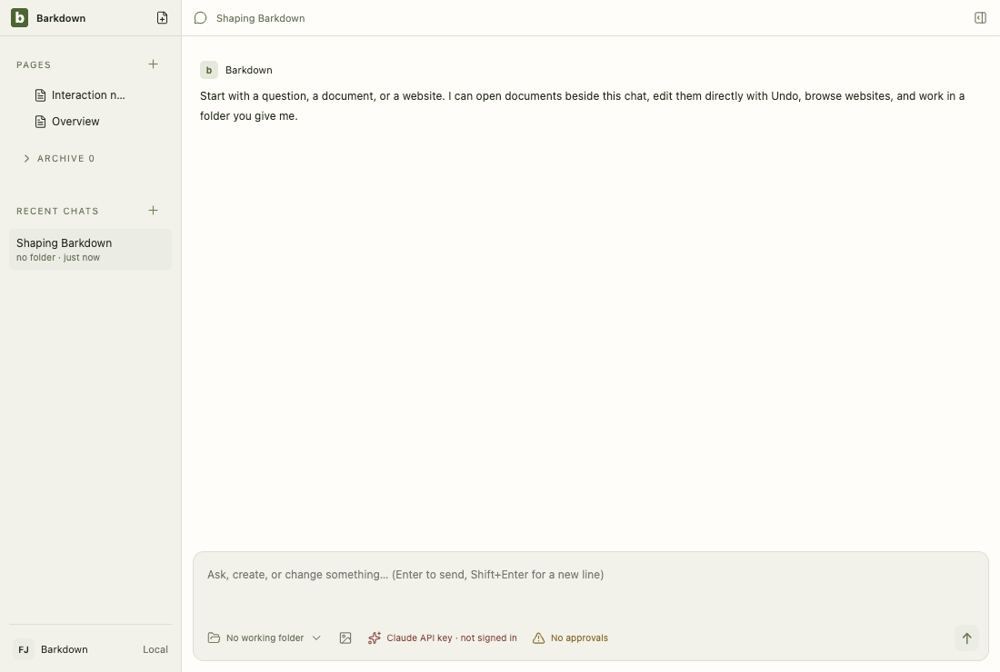
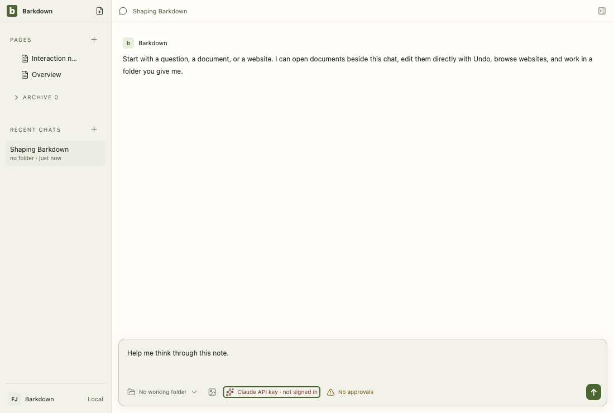
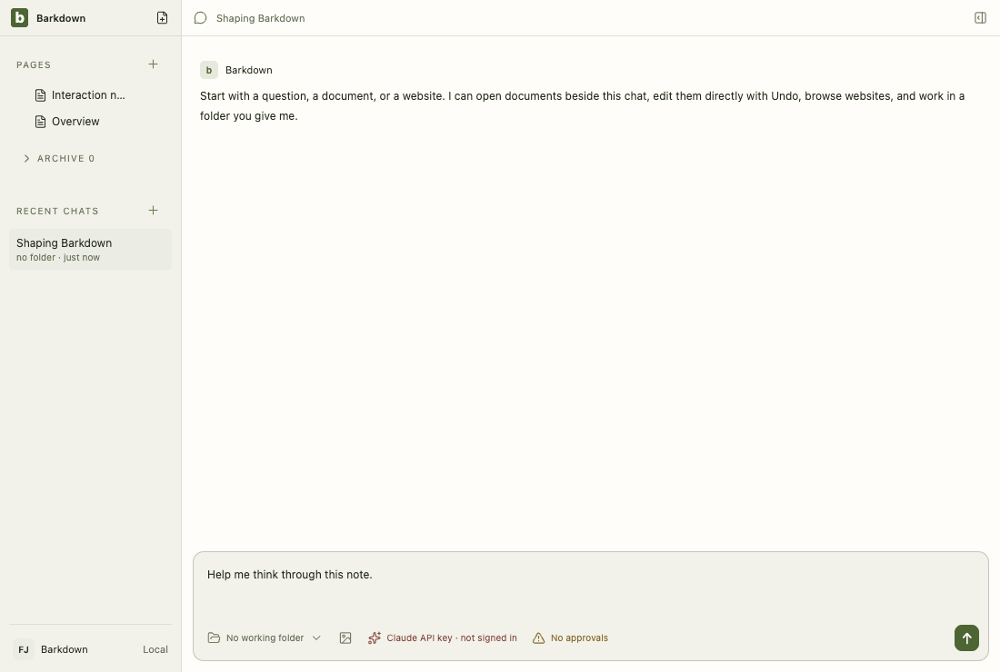
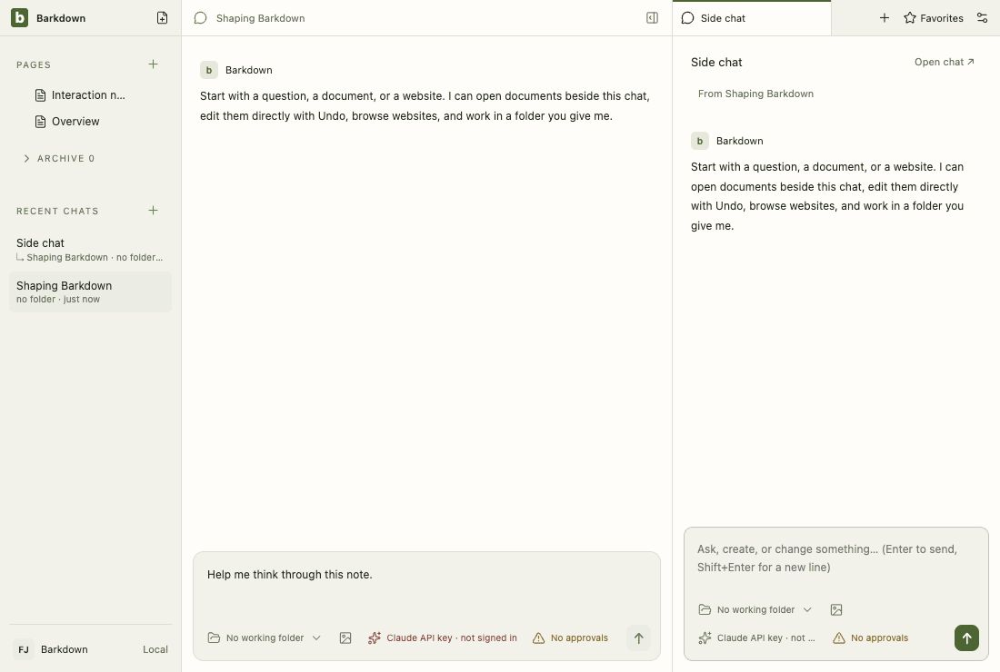
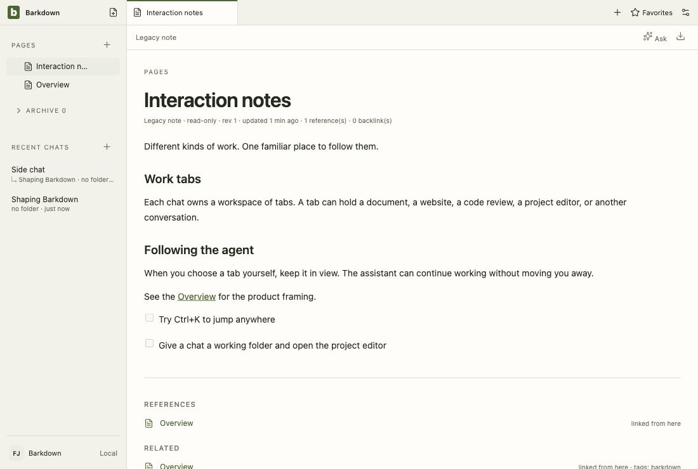
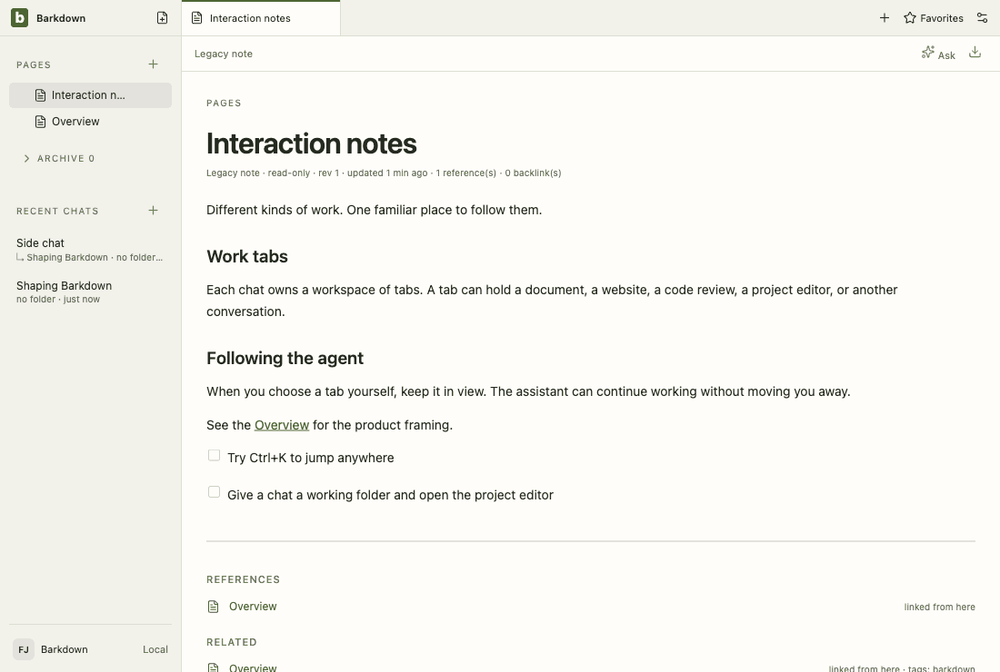
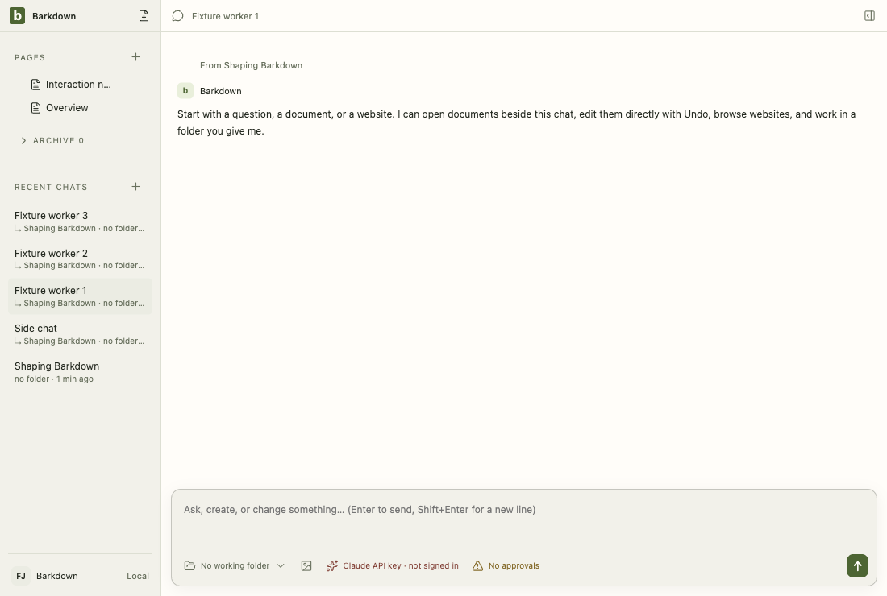
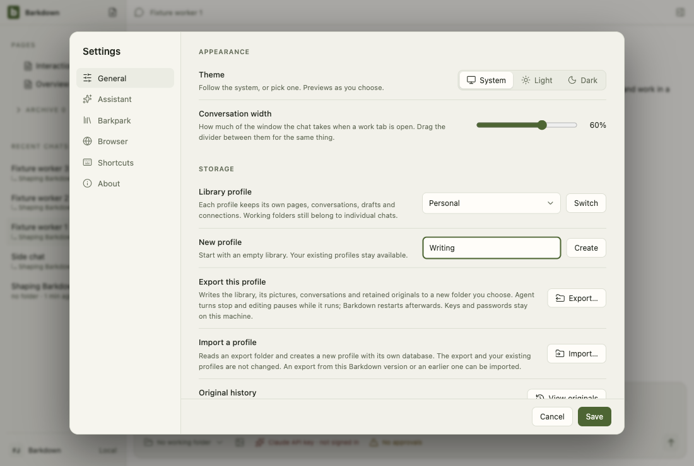

# Visual health on darwin

Approved fixture captures of the real Electron UI on darwin (OS 24.3.0, Electron 44.5.1). The primary gallery in [README.md](README.md) is the Windows source machine's; this page stands beside it, never in its place. See [rules](RULES.md).

Reviewed by Claude Fable 5.1 (agent). C091: the provider, model and effort chips are one chip with one menu, so every composer frame changes, the chat tour's provider, dismiss and model steps are removed coverage and its assistant step is new coverage (same for the side chat). Reviewed: chat: assistant and side-chat: assistant (the menu with provider across the top and the model list; the fixture's API provider has no effort levels and is not signed in, shown in the warning colour), and the approvals chip with its warning icon.

Source commit: 39a641e0dc3a56b670a6e9bc391dc33c09668c7b; review: docs/visual/reviews/approval-240ccec1d42930e6abe6202e34ca6a2a9f823246214cc6a5325bd4e0373b162f.json.

## workspace

Real desktop navigation with disposable local notes; no cloud or provider.

## chat

Shared main composer: draft, provider chooser and model chooser. No message is sent.

## side-chat

A real saved side conversation and its independent composer, using disposable fixture state.

## documents

Legacy local document editor, still retained until P2 migration. This is not the Barkpark Paper canvas.

## retained

After the library switch the legacy notes are retained read-only: a badge in Pages and a read-only editor. Fixture journal; no Paper server.

## settings

Real Settings navigation. No server connection or credential is configured.

## goals

Goal component with explicitly injected fixture snapshots and providers blocked. Saved worker chats use the ordinary composer; this is not live scheduler/provider proof.

## profiles

Profile Settings controls with injected stable registry names. This tour makes no profile switch; real switching and Paper save protection have separate integration evidence.

## adoption

Real recovery window with explicit fixture states; no migration is performed in this visual tour. Actual transaction/restart proof is separate.

