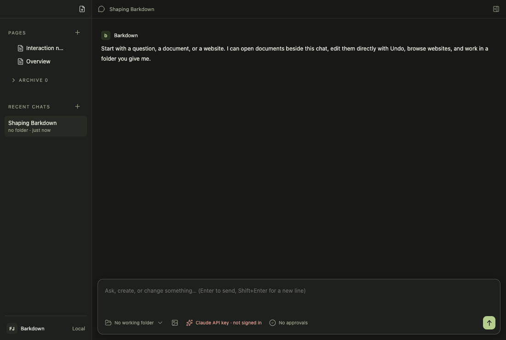
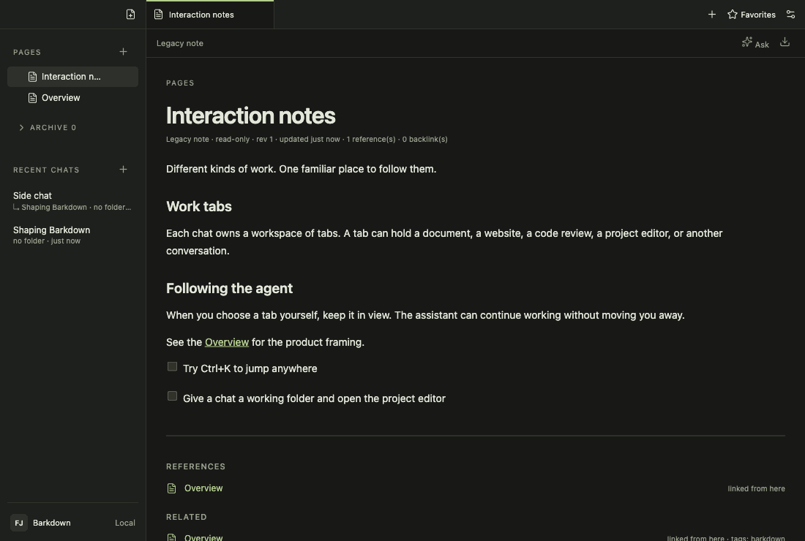

# Visual health on darwin

Approved fixture captures of the real Electron UI on darwin (OS 24.5.0, Electron 44.5.1). The primary gallery in [README.md](README.md) is the Windows source machine's; this page stands beside it, never in its place. See [rules](RULES.md).

Reviewed by feat-barkdown builder (Opus). Save to notes (web clipper): a notebook-pen button in the website tab's browser bar, two context-menu items (Save page / Save selection as a note), and a Pages notice 'Saved page not confirmed · Retry' that shows only after an unconfirmed save. The fixture tour has no website step, so none of these appear in this run; every tour frame matches the 2026-11-03 baseline (settings:assistant differs only in the random temp folder name in the Command line path; goals new-goal frames differ in the textarea resize corner; quick-open by one pixel). The new controls were inspected in the live Electron run instead: docs/cycles/evidence/clip/live/2026-11-15-clip-live (browser bar with the icon, context menu with both items, the saved note beside the page, the still-loading toast, the other profile after a switch). Behaviour: app/tests/clip.test.mjs 9/9; app/tests/clip.live.mjs 7/7 on the carried runtime (button save, two presses one note, selection, still loading, huge page capped, no library, profile switch).

Source commit: 670c4abb03deb56d085e21590a499e7d8baf38b8; review: docs/visual/reviews/approval-02edb90b31486400652091204f304315ac7e63c7702f98101e79a1782d9255cb.json.

## workspace

Real desktop navigation with disposable local notes; no cloud or provider.

## chat

Shared main composer: draft, provider chooser and model chooser. No message is sent.

## side-chat

A real saved side conversation and its independent composer, using disposable fixture state.

## documents

Read-only legacy document viewer. The light frame is a theme-contrast comparison; no Paper server or editing is used.

## retained

After the library switch the legacy notes are retained read-only. Dark by default; the light frame compares theme contrast. Fixture journal; no Paper server.

## settings

Real Settings navigation. No server connection or credential is configured.

## goals

Goal component with explicitly injected fixture snapshots and providers blocked. Saved worker chats use the ordinary composer; this is not live scheduler/provider proof.

## profiles

Profile Settings controls with injected stable registry names. This tour makes no profile switch; real switching and Paper save protection have separate integration evidence.

## adoption

Real recovery window with explicit fixture states; no migration is performed in this visual tour. Actual transaction/restart proof is separate.

