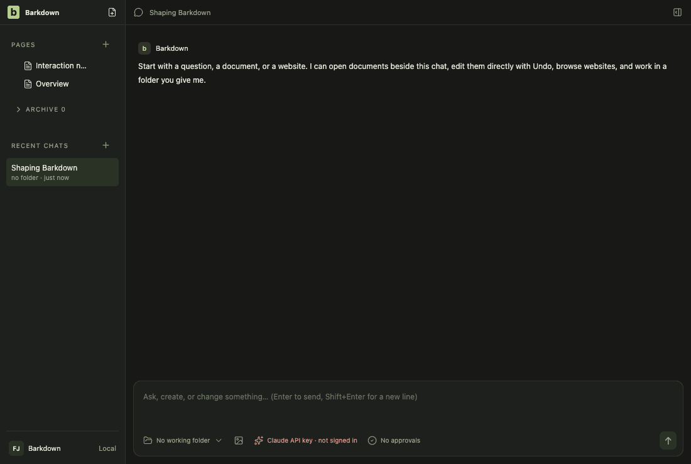
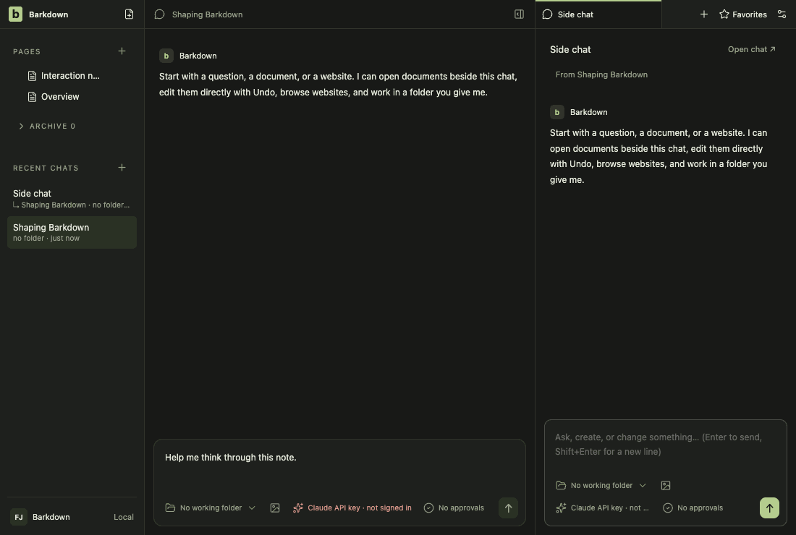
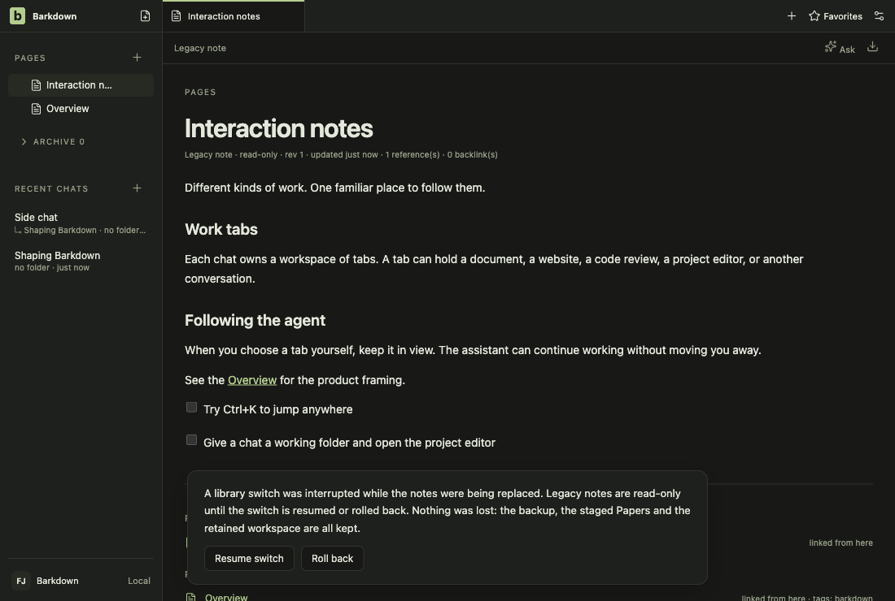
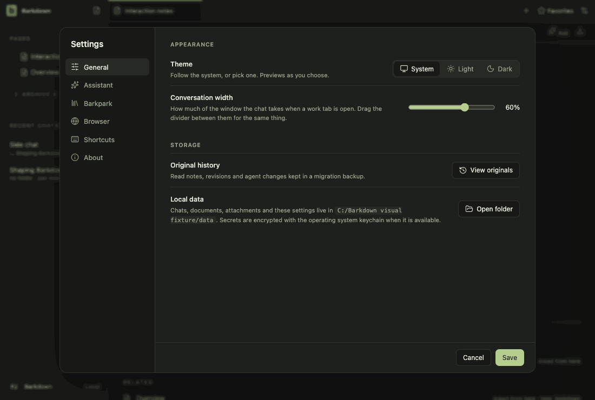
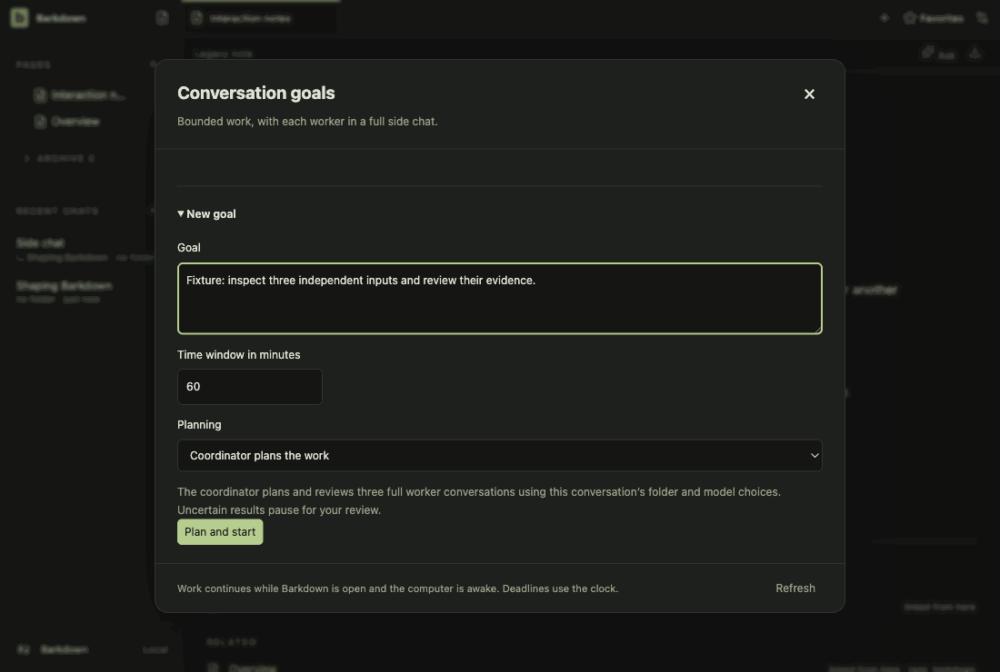

# Visual health on darwin

Approved fixture captures of the real Electron UI on darwin (OS 24.5.0, Electron 44.5.1). The primary gallery in [README.md](README.md) is the Windows source machine's; this page stands beside it, never in its place. See [rules](RULES.md).

Reviewed by Claude (Mac, SATECHI). Barkpark pin 944a57a1e -> 1482fb675 (editor upgrade, bundle rebuilt byte-identical). Inspected all 44 darwin fixture stills side by side with the approved win32 run 2026-10-14T23-19-45-319Z (dark): same layout, content and reachable actions in workspace, chat, side-chat, documents, retained, settings, goals, profiles and adoption; differences are macOS font rendering and Cmd/Option shortcut glyphs. No clipping, overlap or missing content found. Settings > Barkpark shows the new vendored editor bundle (sha1 5e9374cb, was 7de8da5b). The pixel compare is against the 2026-10-05 darwin baseline, which was light before the harness forced dark; documents dark/light frames are unchanged (0). Motion GIFs not re-reviewed frame by frame. Fixture tour only: no live Paper save, provider, Windows or stage acceptance.

Source commit: ef4d4534a3f833f7fae95c34c38f86cc63a4fcbf; review: docs/visual/reviews/approval-58ff0de7a6521eb6107cb8811ed76be0b221a9a563c97fc58d32b1b1632bab0f.json.

## workspace

Real desktop navigation with disposable local notes; no cloud or provider.

## chat

Shared main composer: draft, provider chooser and model chooser. No message is sent.

## side-chat

A real saved side conversation and its independent composer, using disposable fixture state.

## documents

Read-only legacy document viewer. The light frame is a theme-contrast comparison; no Paper server or editing is used.

## retained

After the library switch the legacy notes are retained read-only. Dark by default; the light frame compares theme contrast. Fixture journal; no Paper server.

## settings

Real Settings navigation. No server connection or credential is configured.

## goals

Goal component with explicitly injected fixture snapshots and providers blocked. Saved worker chats use the ordinary composer; this is not live scheduler/provider proof.

## profiles

Profile Settings controls with injected stable registry names. This tour makes no profile switch; real switching and Paper save protection have separate integration evidence.

## adoption

Real recovery window with explicit fixture states; no migration is performed in this visual tour. Actual transaction/restart proof is separate.

