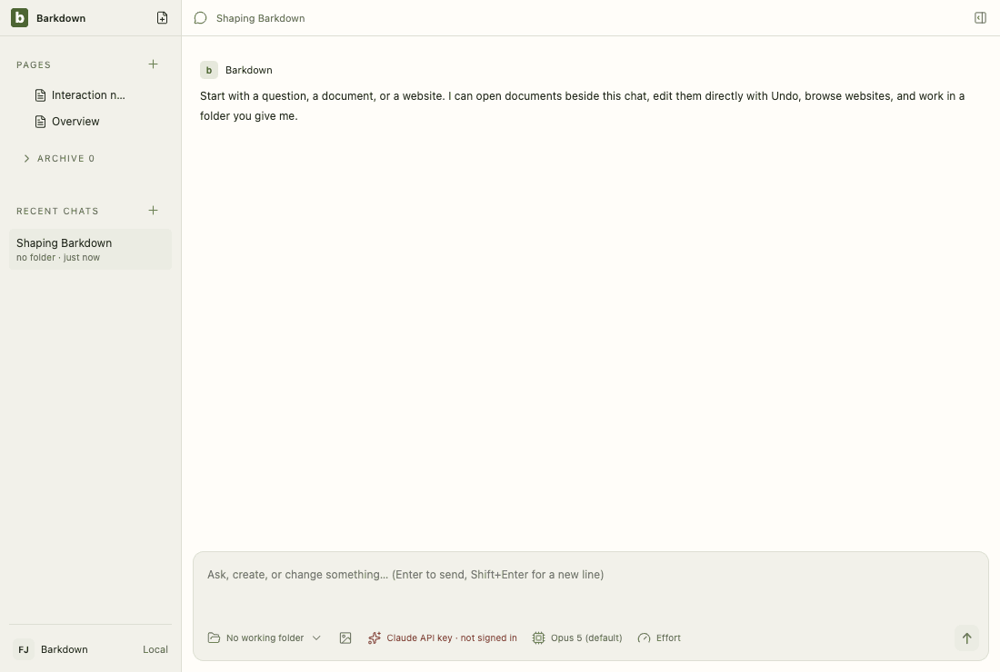

# Visual health on darwin

Approved fixture captures of the real Electron UI on darwin (OS 24.3.0, Electron 38.8.6). The primary gallery in [README.md](README.md) is the Windows source machine's; this page stands beside it, never in its place. See [rules](RULES.md).

Reviewed by Claude Fable 5.1 (agent, this session). Inspected the 2026-09-29T12-19-07-673Z comparison: 46 frames; two Settings › Barkpark frames differ by 0.09 percent, no geometry change, and the difference is the vendored editor bundle hash in the 'Editor bundle' line (now sha1 e33b4467), which is the editor upgrade to upstream 9f1874235 itself; two other frames differ by two pixels. Behavior at the upgraded pin: docs/cycles/evidence/C083/rehearsals-pin-9f1874235-macos.log.

Source commit: 19ee6d51ab570ecf79a949528b17228d2795a3d5; review: docs/visual/reviews/approval-3663f6b75b6826531167b002b90ee7173db90f1a208c241e78822d782c12690d.json.

## workspace

Real desktop navigation with disposable local notes; no cloud or provider.

## chat

Shared main composer: draft, provider chooser and model chooser. No message is sent.

## side-chat

A real saved side conversation and its independent composer, using disposable fixture state.

## documents

Legacy local document editor, still retained until P2 migration. This is not the Barkpark Paper canvas.

## retained

After the library switch the legacy notes are retained read-only: a badge in Pages and a read-only editor. Fixture journal; no Paper server.

## settings

Real Settings navigation. No server connection or credential is configured.

## goals

Goal component with explicitly injected fixture snapshots and providers blocked. Saved worker chats use the ordinary composer; this is not live scheduler/provider proof.

## profiles

Profile Settings controls with injected stable registry names. This tour makes no profile switch; real switching and Paper save protection have separate integration evidence.

## adoption

Real recovery window with explicit fixture states; no migration is performed in this visual tour. Actual transaction/restart proof is separate.

