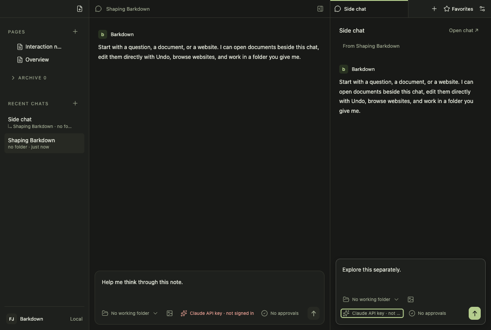

# Visual health on darwin

Approved fixture captures of the real Electron UI on darwin (OS 24.5.0, Electron 44.5.1). The primary gallery in [README.md](README.md) is the Windows source machine's; this page stands beside it, never in its place. See [rules](RULES.md).

Reviewed by feat-barkdown-3 builder (Opus). Daily notes at 5e10a4bc: when the look-first branch settles a kept day request, it now places that note under Daily notes. Run 2026-11-18T10-07-32-545Z vs 09-56-34-521Z on darwin, all changed frames inspected. workspace narrow and side-chat ready differ by a few anti-aliased pixels (the send button edge); settings assistant differs only in the random temp folder name. Every other still has 0 changed pixels and the same geometry. The fixture tour has no profile or local library, so it never shows the daily-note controls; those are in the live test pictures (docs/cycles/evidence/daily-note/live/2026-11-18-daily-live). Behavior: daily-note.test.mjs 12/12 (case 12 fails on 27da6b19); daily-note.live.mjs passed 6/6 at 58dcb182, with the kept request forced and its row asserted visible under Daily notes.

Source commit: 5e10a4bcd332d56f8dc00b2e4d3db2d9f5b36068; review: docs/visual/reviews/approval-9d85b431602cb06278af65af5155197f557ab8a799bc9753920797e10136b993.json.

## workspace

Real desktop navigation with disposable local notes; no cloud or provider.

## chat

Shared main composer: draft, provider chooser and model chooser. No message is sent.

## side-chat

A real saved side conversation and its independent composer, using disposable fixture state.

## documents

Read-only legacy document viewer. The light frame is a theme-contrast comparison; no Paper server or editing is used.

## retained

After the library switch the legacy notes are retained read-only. Dark by default; the light frame compares theme contrast. Fixture journal; no Paper server.

## settings

Real Settings navigation. No server connection or credential is configured.

## goals

Goal component with explicitly injected fixture snapshots and providers blocked. Saved worker chats use the ordinary composer; this is not live scheduler/provider proof.

## profiles

Profile Settings controls with injected stable registry names. This tour makes no profile switch; real switching and Paper save protection have separate integration evidence.

## adoption

Real recovery window with explicit fixture states; no migration is performed in this visual tour. Actual transaction/restart proof is separate.

