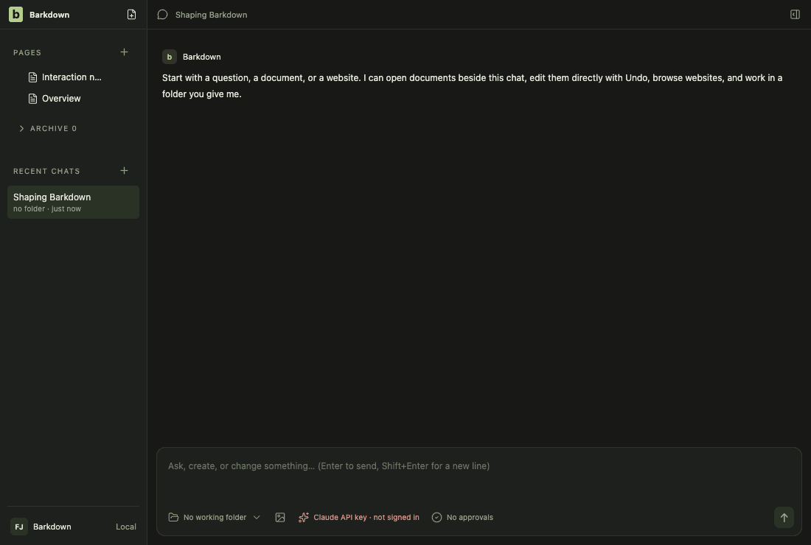
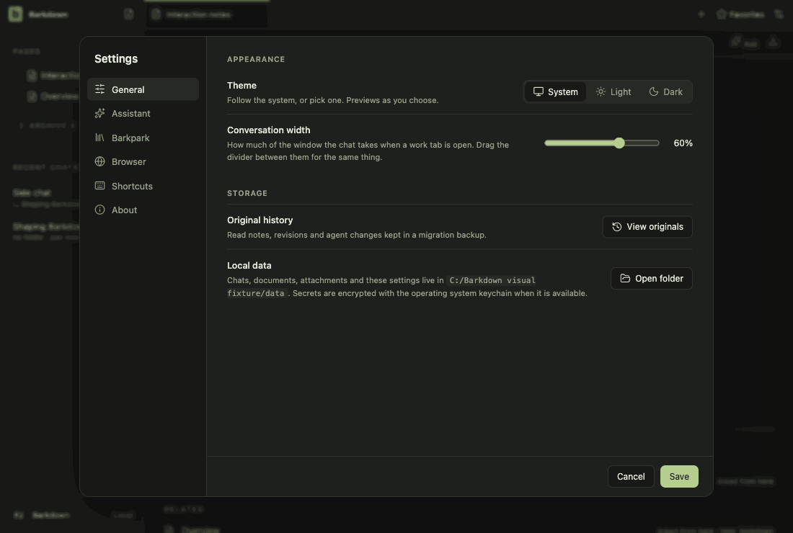
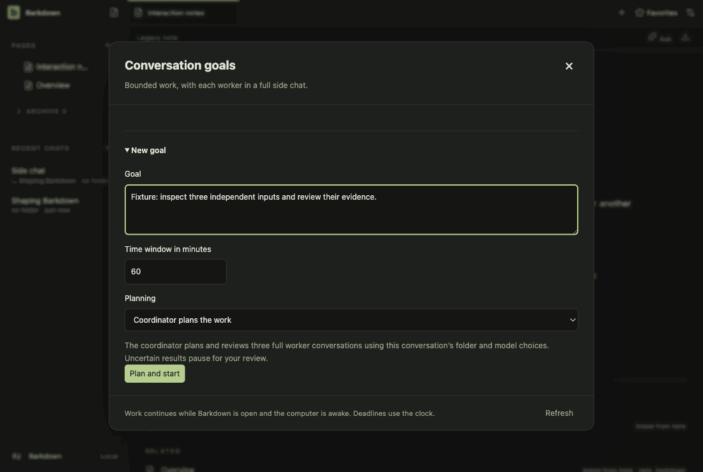
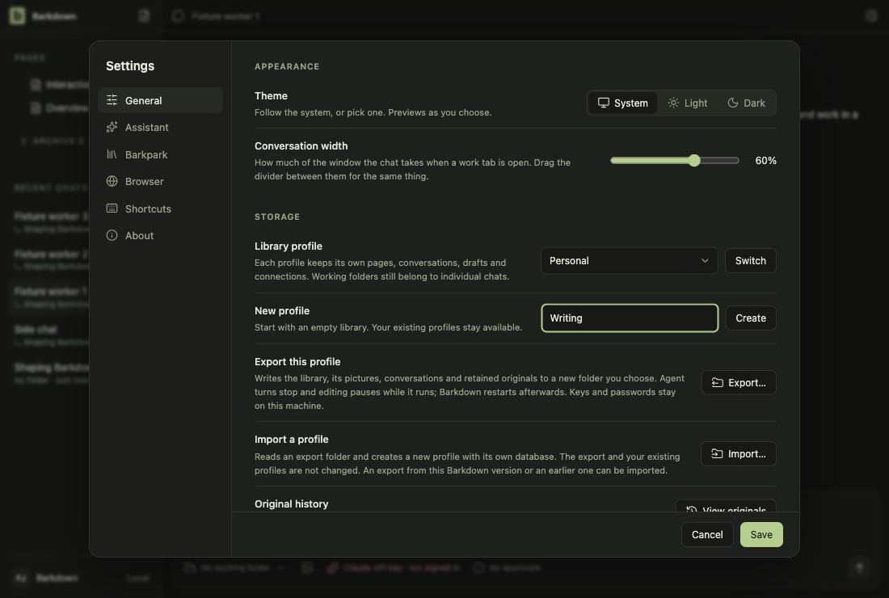

# Visual health on darwin

Approved fixture captures of the real Electron UI on darwin (OS 24.5.0, Electron 44.5.1). The primary gallery in [README.md](README.md) is the Windows source machine's; this page stands beside it, never in its place. See [rules](RULES.md).

Reviewed by claude-barkdown-mac. Inspected all 13 review-required diffs (settings 0-4, goals 3-7, profiles 0/1/3) and the 31 small differences against baseline 2026-10-27T17-24-30-944Z: no geometry change; the marked pixels are the Settings title's antialiasing, the goals deadline in this host's locale (environmentChanged) and the command-line temp path, identical to run 2026-10-28T08-27-54-860Z. The change (quit settles a note that mounts mid-quit) has no visual surface; quit-settlement.test.mjs and the workspace/backend/admission quit live tests pass.

Source commit: 42e3c6bfad723278b811c40b31d786f0d5d90463; review: docs/visual/reviews/approval-f59f07a0c5a1a64dacb94492c87b8a55967c7dceee36ea77836a7d9abd49bb4f.json.

## workspace

Real desktop navigation with disposable local notes; no cloud or provider.

## chat

Shared main composer: draft, provider chooser and model chooser. No message is sent.

## side-chat

A real saved side conversation and its independent composer, using disposable fixture state.

## documents

Read-only legacy document viewer. The light frame is a theme-contrast comparison; no Paper server or editing is used.

## retained

After the library switch the legacy notes are retained read-only. Dark by default; the light frame compares theme contrast. Fixture journal; no Paper server.

## settings

Real Settings navigation. No server connection or credential is configured.

## goals

Goal component with explicitly injected fixture snapshots and providers blocked. Saved worker chats use the ordinary composer; this is not live scheduler/provider proof.

## profiles

Profile Settings controls with injected stable registry names. This tour makes no profile switch; real switching and Paper save protection have separate integration evidence.

## adoption

Real recovery window with explicit fixture states; no migration is performed in this visual tour. Actual transaction/restart proof is separate.

